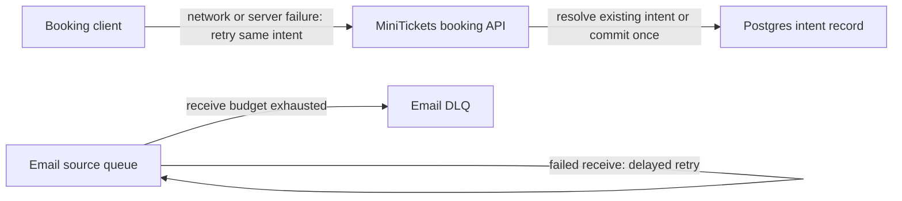

# Retry policy: retry only what is safe

History: see [CHANGELOG.md](../CHANGELOG.md) or run `pnpm docs:history`

Area: Reliability · Status: ✅ built in repository; live AWS acceptance is separate
<!-- interview-card: v2 -->

## 1. What is it?

A retry policy decides which failed operations to attempt again, how long to wait and when to stop. It must account for work that succeeded even when its response was lost.

## 2. Why do we need it?

A booking request may commit just before the network disconnects. MiniTickets must retry the same intent, rather than accidentally treat the uncertainty as a new purchase.

## 3. How does it work?

1. Separate temporary failures from invalid or unauthorized requests.
2. Keep operation identity stable and wait between attempts.
3. Apply the chosen attempt budget or durable backlog policy.

## 4. How do we use it in MiniTickets?

General mutations do not automatically retry. Booking has a bounded exception with the same intent. Worker retries eventually use a DLQ; the Postgres outbox retries durably without a maximum attempt count. Randomized waiting, called jitter, is proposed only.

## 5. Interview-ready answer

“MiniTickets uses different retry policies for different boundaries. A booking retries ambiguous failures with the same intent, workers have a bounded receive budget, and outbox delivery keeps durable pending work. I avoid retrying invalid requests and watch multiplied attempts across layers. Backoff reduces pressure; jitter would spread synchronized retries but is not implemented.”

## 6. Important follow-up questions

- **What if the response disappears after success?** Resolve the same operation identity; a fresh identity can repeat the effect.
- **Should validation errors retry?** Normally no. The same invalid input will still fail.
- **Why not retry immediately forever?** That increases load and can prolong the dependency outage.
- **Do all retry layers combine safely?** Not automatically. Their attempt counts multiply, so assign clear responsibility and budgets.

## 7. Advanced details

Technical reference

### Source references

- Anchor: `apps/web/src/providers/query-provider.tsx` — `shouldRetry`; follow the numbered comments at this boundary.
- Anchor: `apps/worker/src/retry-later.ts` — `delayFailedMessages`; follow the numbered comments at this boundary.

`apps/web/src/features/bookings/lib/booking-retry.ts`, `apps/worker/src/backoff.ts` and `apps/api/src/services/outbox.ts` implement separate policies. Run `pnpm demo:outbox`. Outbox retries cap at 60 s without a maximum attempt count; worker failures use 10/40/120 s and a DLQ after 3 receives.

### Configuration and design

General mutations do not auto-retry. Booking explicitly retries network/5xx at most twice with the same intent; worker and outbox policies differ, and jitter remains explain-only. Immediate retries turn a partial failure into more load.

### Checks and troubleshooting

Run `pnpm demo:outbox` and inspect the asserted outcome described above.

What if the response is lost after send? A retry may duplicate delivery; the consumer must be idempotent. Do not change a live stack to demonstrate it.

Which error should normally not be retried? **Invalid input.**

### Trade-offs and alternatives

Do not retry validation/authorization failures. Layered retries multiply attempts; choose one responsible layer. Proposed jitter belongs in retryInMs/backoff with bounded randomized tests.

10x: retry budgets and attempt metrics. 100x: per-destination admission and circuit breakers with durable backlog.

### Further technical context

Retry only failures likely to be temporary, bound attempts/time and retain operation identity. Exponential backoff reduces pressure; jitter prevents synchronized clients. MiniTickets retries ambiguous booking network failures with the same key, caps worker retries into a DLQ and keeps outbox retries durable. Jitter is a proposed improvement, not a claim about current fixed schedules.

### Related reading

Uses the [current system](../00-big-picture.md); gives a concrete decision to the [scenario](../guides/interview-scenarios.md#retry-backoff) and [explorer tour](../guides/infra-explorer.html?tour=failing-email).

[Open this piece in the city explorer](../guides/infra-explorer.html?concept=retry-policy#chapter=14&piece=email-queue).

## Where it appears in the story

- [app-story: 9c. Side path: outbox, fan-out and recoverable work](../app-story.md#9c-side-path-outbox-fan-out-and-recoverable-work)

