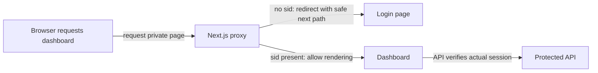

# Route guard in the Next.js proxy (UX only, not security)

History: see [CHANGELOG.md](../CHANGELOG.md) or run `pnpm docs:history`

Area: Frontend · Status: ✅ built · Step doc: [09 dashboard](../../09-dashboard.md)
<!-- interview-card: v2 -->

## 1. What is it?

A route guard redirects visitors toward login before showing a private page. MiniTickets’ Next.js proxy checks cookie presence for this navigation convenience; it does not authenticate the session.

## 2. Why do we need it?

A logged-out visitor opening the dashboard should go straight to login instead of seeing an empty private screen. The API must still refuse fake or expired cookies.

## 3. How does it work?



1. The proxy recognizes a private-page path.
2. Missing cookie presence triggers a login redirect.
3. A rendered page still obtains private data through the protected API.

## 4. How do we use it in MiniTickets?

The navigation guard covers dashboard, admin and tickets. The wider HTML/RSC matcher also supplies fresh security nonces and no-store responses. Login passes its return path through `getSafeNext` before navigating.

## 5. Interview-ready answer

“MiniTickets uses the proxy to improve navigation, not as its data security boundary. It redirects missing-cookie visitors before private pages render, but a fake cookie can pass that test. The protected API verifies the real session. Keeping those responsibilities clear prevents a convenient frontend check being mistaken for authorization.”

## 6. Important follow-up questions

- **Why not query Redis in the guard?** We keep navigation cheap; the API already checks authority for private data.
- **What happens with an expired cookie?** The page can render, but private API calls reject it and navigation returns to login.
- **Is the next parameter trusted?** No. `getSafeNext` permits only safe local paths.
- **Does the proxy run only on dashboard?** No. Current HTML/RSC handling is broader; the redirect test selects private pages.

## 7. Advanced details

<details>
<summary>Technical reference</summary>

### Source references

- Anchor: `apps/web/src/proxy.ts` · `proxy`, `config.matcher`: the cookie check and the redirect.
- Anchor: `apps/web/e2e/dashboard.spec.ts` · test "a fake sid cookie passes the route guard…": proves it is UX only.

Step by step:

1. The matcher covers HTML/RSC routes, excluding API/tRPC/static/image/favicon paths; only `/dashboard`, `/admin` and `/tickets` branches trigger the cookie-presence redirect.
2. `request.cookies.has("sid")`: yes → `NextResponse.next()` (render the page).
3. No cookie → build `/login`, put the wanted path in `?next=`, return a redirect.
4. The page then loads `ProfileCard`, whose `useProfile` asks the api. If the session is fake or
   expired the api answers 401 and `useProfile` sends the user to `/login?next=/dashboard`
   ([ui-error-handling](ui-error-handling.md)).
5. After login, `getSafeNext` lets the user back to `/dashboard`, but never to another site
   ([open-redirect](open-redirect.md)).

**Runtime:** Next.js 16 renamed `middleware.ts` to `proxy.ts`, and it runs on the **Node.js
runtime** by default. Verified in the installed Next.js 16.4.0 docs
(`node_modules/next/dist/docs/01-app/03-api-reference/03-file-conventions/proxy.md`: "Proxy defaults
to using the Node.js runtime"; "`v16.0.0` Middleware is deprecated and renamed to Proxy").

### Configuration and design

| Setting | Why |
| ------- | --- |
| Only checks that the cookie exists | No Redis call is made; API session checks remain authoritative. |
| HTML/RSC matcher plus private-page path test | All HTML/RSC gets fresh nonce/CSP and private,no-store; private pages also get the navigation guard. |
| `?next=` path kept | The user lands where they wanted after login. |

### Checks and troubleshooting

```bash
curl -s -o /dev/null -w '%{http_code} %{redirect_url}\n' http://localhost:3000/dashboard
# 307 http://localhost:3000/login?next=%2Fdashboard
curl -s -o /dev/null -w '%{http_code}\n' -b 'sid=fake' http://localhost:3000/dashboard
# 200: the page renders; the api's 401 then redirects in the browser
```

(Output recorded on the owner's laptop with `pnpm dev`. 307 is "Temporary Redirect", which
`NextResponse.redirect` uses by default.) The e2e test `dashboard.spec.ts` checks both paths in a
real browser.

**Isolated thought experiment (not performed):** change the matcher to `["/"]`. `/dashboard` is no longer guarded: a
logged-out visitor sees "Loading your profile..." and then the 401 redirect. Still safe, because the
api is the real check; just a worse experience.

- Cookie renamed in the api but not here: everyone is redirected to login. The e2e dashboard test
  fails.
- Someone relies on the guard as security: a data leak, if the api check were missing. Our e2e test
  with a fake cookie documents that the api must refuse.

- *Why not check the session in the proxy?* An extra Redis round-trip per page for UX only; the api
  checks anyway.
- *Is `next` safe to redirect to?* Only after `getSafeNext` ([open-redirect](open-redirect.md)).

### Trade-offs and alternatives

- **Pros:** no flash of an empty dashboard; zero network calls; easy to reason about.
- **Cons:** a fake or expired cookie passes; developers might mistake it for security.

- **Validate the session in the proxy** (call the api or Redis): stronger UX for expired sessions,
  but adds latency to every guarded page.
- **Signed cookies / JWT checked in the proxy:** possible without a network call, but brings JWT
  trade-offs ([sessions-vs-jwt](sessions-vs-jwt.md)).
- **Check in a Server Component** (fetch `auth.me` while rendering): page-level, needs cookie
  forwarding.

### Further technical context

`proxy.ts` covers HTML/RSC and guards dashboard/admin/tickets; it checks only that a `sid` cookie
  exists and redirects with `?next=`. It is UX; the api's `protectedProcedure` validates the session
  in Redis, and an e2e test proves a fake cookie gets past the proxy but not the api.

### Related reading

- **Uses ←** the `sid` cookie set by login ([session-cookie](session-cookie.md)).
- **Gives →** a fast redirect; the real check is [protected-procedure](protected-procedure.md).
  Locally the cookie is set by `localhost:4000` and read by `localhost:3000`: cookies are scoped
  by host, not port, so the proxy can see it.

[Open this piece in the city explorer](../guides/infra-explorer.html?concept=route-guard-proxy#chapter=8&piece=web-task).

## Where it appears in the story

- [App story: 1. Browser → Next.js: layout, server vs client components, proxy guard](../app-story.md#1-browser--nextjs-layout-server-vs-client-components-proxy-guard)

</details>
