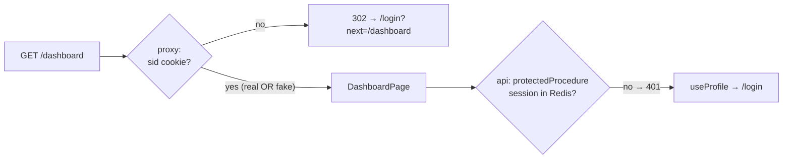

# Route guard in the Next.js proxy (UX only, not security)

History: see [CHANGELOG.md](../CHANGELOG.md) or run `pnpm docs:history`

Area: Frontend · Status: ✅ built · Step doc: [09 dashboard](../../09-dashboard.md)

## 1. In one line

`proxy.ts` sends logged-out visitors from `/dashboard` to `/login?next=/dashboard` **before** the
page renders; it only checks that a `sid` cookie exists, so it is a convenience, not a lock.

## 2. Real-life comparison

A receptionist who asks "do you have a badge?" but never scans it. Fine for sending lost visitors
to the front desk; useless against someone with a fake badge. The real scanner is on the door of
the vault (the api).

## 3. Picture it



## 4. Where in our code

- Anchor: `apps/web/src/proxy.ts` · `proxy`, `config.matcher`: the cookie check and the redirect.
- Anchor: `apps/web/e2e/dashboard.spec.ts` · test "a fake sid cookie passes the route guard…": proves it is UX only.

Step by step:

1. `config = { matcher: ["/dashboard/:path*"] }`: the proxy runs only for `/dashboard` and below,
   not for every request.
2. `request.cookies.has("sid")`: yes → `NextResponse.next()` (render the page).
3. No cookie → build `/login`, put the wanted path in `?next=`, return a redirect.
4. The page then loads `ProfileCard`, whose `useProfile` asks the api. If the session is fake or
   expired the api answers 401 and `useProfile` sends the user to `/login?next=/dashboard`
   ([ui-error-handling](ui-error-handling.md)).
5. After login, `getSafeNext` lets the user back to `/dashboard`, but never to another site
   ([open-redirect](open-redirect.md)).

**Runtime:** Next.js 16 renamed `middleware.ts` to `proxy.ts`, and it runs on the **Node.js
runtime** by default. Verified in the installed Next.js 16.4.0 docs
(`node_modules/next/dist/docs/01-app/03-api-reference/03-file-conventions/proxy.md`: "Proxy defaults
to using the Node.js runtime"; "`v16.0.0` Middleware is deprecated and renamed to Proxy").

## 5. See it yourself

```bash
curl -s -o /dev/null -w '%{http_code} %{redirect_url}\n' http://localhost:3000/dashboard
# 307 http://localhost:3000/login?next=%2Fdashboard
curl -s -o /dev/null -w '%{http_code}\n' -b 'sid=fake' http://localhost:3000/dashboard
# 200: the page renders; the api's 401 then redirects in the browser
```

(Output recorded on the owner's laptop with `pnpm dev`. 307 is "Temporary Redirect", which
`NextResponse.redirect` uses by default.) The e2e test `dashboard.spec.ts` checks both paths in a
real browser.

**Break it on purpose:** change the matcher to `["/"]`. `/dashboard` is no longer guarded: a
logged-out visitor sees "Loading your profile..." and then the 401 redirect. Still safe, because the
api is the real check; just a worse experience.

## 6. How it connects

- **Uses ←** the `sid` cookie set by login ([session-cookie](session-cookie.md)).
- **Gives →** a fast redirect; the real check is [protected-procedure](protected-procedure.md).
  Locally the cookie is set by `localhost:4000` and read by `localhost:3000`: cookies are scoped
  by host, not port, so the proxy can see it.

## 7. Our settings and WHY

| Setting | Why |
| ------- | --- |
| Only checks that the cookie exists | The proxy cannot reach Redis (and should not: one extra hop per page). |
| `matcher: ["/dashboard/:path*"]` | Runs only where it is needed; static files and other pages skip it. |
| `?next=` path kept | The user lands where they wanted after login. |

## 8. Trade-offs

- **Pros:** no flash of an empty dashboard; zero network calls; easy to reason about.
- **Cons:** a fake or expired cookie passes; developers might mistake it for security.

## 9. Alternatives and when to choose them

- **Validate the session in the proxy** (call the api or Redis): stronger UX for expired sessions,
  but adds latency to every guarded page.
- **Signed cookies / JWT checked in the proxy:** possible without a network call, but brings JWT
  trade-offs ([sessions-vs-jwt](sessions-vs-jwt.md)).
- **Check in a Server Component** (fetch `auth.me` while rendering): page-level, needs cookie
  forwarding.

## 10. What breaks, and how we'd notice

- Cookie renamed in the api but not here: everyone is redirected to login. The e2e dashboard test
  fails.
- Someone relies on the guard as security: a data leak, if the api check were missing. Our e2e test
  with a fake cookie documents that the api must refuse.

## 13. Interview answers at 3 levels

- **Simple:** If you're not logged in, opening the dashboard sends you to login first.
- **Senior:** `proxy.ts` runs before rendering for `/dashboard/*`, checks only that a `sid` cookie
  exists and redirects with `?next=`. It is UX; the api's `protectedProcedure` validates the session
  in Redis, and an e2e test proves a fake cookie gets past the proxy but not the api.
- **Lead:** Frontend guards are for experience; authorization lives at the data boundary. I'd keep
  the proxy cheap and make sure every data path is protected server-side, with tests that bypass
  the UI.

## 14. Follow-up questions interviewers ask

- *Why not check the session in the proxy?* An extra Redis round-trip per page for UX only; the api
  checks anyway.
- *Is `next` safe to redirect to?* Only after `getSafeNext` ([open-redirect](open-redirect.md)).

## 15. Say it in 30 seconds

"A Next.js proxy on `/dashboard/*` redirects to login when there's no `sid` cookie. It only checks
that the cookie exists, so it's a UX shortcut, not security. The real check is the api's
protectedProcedure, and an e2e test shows a fake cookie gets past the proxy but gets a 401 from the
api."

## 16. Status

✅ built.
