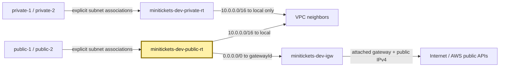
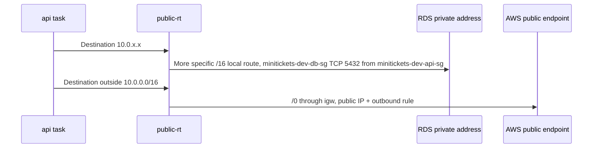

# Route tables: the city road signs

History: see [CHANGELOG.md](../CHANGELOG.md) or run `pnpm docs:history`

Area: AWS Network · Status: ✅ built · Step doc: [12 network](../../12-infra-network.md)
<!-- interview-card: v1 -->

## 1. In one line

A MiniTickets [route table](../glossary.md#route-table) chooses the next road for an address; our public sign points internet traffic to the city gate.

## 2. Where it sits

[Open this piece in the city explorer](../guides/infra-explorer.html?concept=route-tables#chapter=24&piece=public-rt).

## 3. How it works

## 4. What happens in MiniTickets

1. `createNetwork` attaches `minitickets-dev-igw` to our VPC.
2. `publicRouteTable` adds `0.0.0.0/0 → internetGateway.id`: every other IPv4 address.
3. AWS supplies `10.0.0.0/16 → local` to both tables.
4. Four explicit associations give every subnet its intended sign.
5. The more specific route wins. Database traffic stays inside; image downloads use the gate.

## 5. Reach / Allowed / Password

**Reach:** a matching route provides a path, not a promise that the destination answers.

**Allowed:** security groups separately admit the connection.

**Password:** not needed by a road sign; stores and AWS APIs still authenticate callers.

## 6. In our code

`infra/src/network.ts` → `createNetwork` (`internetGateway`, `publicRouteTable`, `privateRouteTable`).

## 7. In the AWS console

VPC → Route tables → `minitickets-dev-public-rt` → Routes / Subnet associations. Expect local plus the default gateway route and two associations. The private table has local only. VPC → Your VPCs → our VPC → Resource map draws both signs. [AWS route guide](https://docs.aws.amazon.com/vpc/latest/userguide/WorkWithRouteTables.html). Live tables were not checked.

## 8. Good / Bad

**Good:** two small tables are easy to inspect; explicit associations avoid hidden defaults.

**Bad:** private workers would have no external path; losing the public default route breaks new task startup.

## 9. Other choices

- Pick a NAT gateway per zone when private workers need an internet exit resilient to one zone failing.
- Pick VPC endpoints when only supported AWS service roads are needed.
- Pick Transit Gateway when joining many networks through a hub.

## 10. Connected to

| Neighbor | Direction | What allows it | Console check |
| --- | --- | --- | --- |
| [Subnets](subnets.md) | Subnet → table | Explicit association | Route table → Subnet associations |
| [VPC](vpc.md) | Internal destinations | Built-in local route | Route table → Routes |
| [ALB](alb.md) | Public round trip | Default route to attached IGW | ALB → Network mapping; subnet Routes |

## 11. When it breaks

- Tasks cannot fetch images → public Routes and task IP → restore the missing public path.
- One subnet differs → Subnet associations → replace unintended use of the main table.

## 12. Say it in 30 seconds

“MiniTickets uses one public and one private road sign. Both know local addresses; only the public table has a default route to the internet gateway. The longest match keeps database calls local. Routes provide reach, while security groups and credentials remain separate checks.”

## 13. Likely follow-ups

- **What is the main table?** AWS creates a fallback for subnets without explicit associations.
- **IGW versus NAT?** The gate connects public addresses; NAT lets private callers start outbound internet connections.

## 14. Remember it

The most specific sign wins; no sign means no road.

## 15. More detail

Reference notes, source anchors and earlier useful detail

- Anchor: `infra/src/network.ts` · `publicRouteTable`, `privateRouteTable`, `internetGateway`, the 4 `RouteTableAssociation`s.

AWS creates a main route table too. Our four subnets have explicit associations, so none should rely on it. Expect our two named tables plus the AWS-created main table in a fresh stack; verify live inventory rather than assuming the count.

`10.0.5.7` matches both `/16` and `/0`; `/16` is longer and wins. A route table is attached to a subnet through a `RouteTableAssociation`, not directly to an application. An attached internet gateway without a default route does not provide an internet path.

Removing `0.0.0.0/0` breaks inbound/outbound public round trips. In today's ALB-only mode browsers time out; in optional CloudFront mode the origin can time out and produce 502/504. New tasks can fail image pulls or secret reads. Existing healthy task logs may show nothing because no request arrives.

Private tables have no NAT and no VPC endpoint routes today. A later VPC Lambda or worker would need suitable endpoints or NAT for external calls. Current email/ticket Lambdas are outside the VPC and do not use these tables.

NAT per zone avoids sharing one zone's failure and can avoid cross-zone traffic. Gateway endpoints for S3/DynamoDB add routes; interface endpoints provide private network interfaces. Transit Gateway is a many-network hub. Road tables and an internet gateway have no separate hourly charge; old NAT examples of roughly $33/month were historical regional estimates, not a current quote.

The old hourly NAT example was $0.045 plus per-GB processing; actual rates depend on region and time.

Read-only check: `aws ec2 describe-route-tables --filters Name=vpc-id,Values=<actual-vpc-id>`; inspect routes and associations with `AWS_PROFILE=ticketlite`.

## Where it appears in the story

- [Infra story: 10. The network: VPC, subnets, route tables, internet gateway](../infra-story.md#10-the-network-vpc-subnets-route-tables-internet-gateway)
- [Big picture: 4. Components](../00-big-picture.md#4-components)
