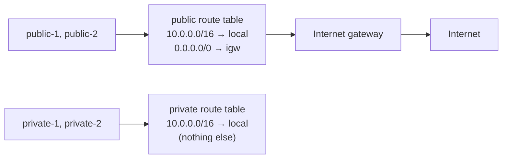

# Route tables and the internet gateway

History: see [CHANGELOG.md](../CHANGELOG.md) or run `pnpm docs:history`

Area: AWS Network · Status: ✅ built · Step doc: [12 network](../../12-infra-network.md)

## 1. In one line

A **route table** lists where traffic leaving a subnet goes; the **internet gateway (IGW)** is the
VPC's door to the internet, and a route `0.0.0.0/0 → IGW` is what makes a subnet public.

## 2. Real-life comparison

The signboard at the end of each corridor: "rooms 10.0.x.x: this way (inside the building);
everything else: the front door". A corridor without the "everything else" sign has no way out.

## 3. Picture it



The **longest matching prefix wins**: `10.0.5.7` matches both `10.0.0.0/16` and `0.0.0.0/0`, and
`/16` is more specific, so it stays inside the VPC.

## 4. Where in our code

- Anchor: `infra/src/network.ts` · `publicRouteTable`, `privateRouteTable`, `internetGateway`, the 4 `RouteTableAssociation`s.

Step by step:

1. `internetGateway` is attached to the VPC (`vpcId: vpc.id`).
2. `publicRouteTable` has one route we write: `{ cidrBlock: "0.0.0.0/0", gatewayId: internetGateway.id }`.
3. `privateRouteTable` has no routes we write. AWS adds the `local` route to every route table
   by itself.
4. Four `RouteTableAssociation`s link each subnet to its table. Without them a subnet would use the
   VPC's **main** route table, which is easy to forget about.
5. No NAT gateway: the comment at `privateRouteTable` explains the choice.

## 5. See it yourself

```bash
cd infra
aws ec2 describe-route-tables --profile ticketlite \
  --filters Name=vpc-id,Values=$(pulumi stack output vpcId) \
  --query "RouteTables[].{name:Tags[?Key=='Name']|[0].Value,routes:Routes[].[DestinationCidrBlock,GatewayId]}"
```

Expect 3 tables: our public one (`local` + `igw-…`), our private one (`local` only), and the VPC's
main table that AWS created (no subnets use it).

**Break it on purpose (thought experiment):** delete the `0.0.0.0/0` route. The ALB loses its way
back to CloudFront, and new tasks cannot pull images: CloudFront shows 502/504 and tasks fail
with `CannotPullContainerError`.

## 6. How it connects

- **Uses ←** the [VPC](vpc.md) and [subnets](subnets.md).
- **Gives →** internet reach for the [ALB](alb.md) and the tasks (image pull, secrets, logs);
  isolation for [RDS](rds-postgres.md) and [Valkey](elasticache-valkey.md).

## 7. Our settings and WHY

| Choice | Why |
| ------ | --- |
| One shared public table, one shared private table | Both AZs need the same routes; one table each keeps it simple. |
| Explicit associations | Never rely on the main route table. |
| No NAT gateway | About $33 a month; nothing private needs the internet today. |

## 8. Trade-offs

- **Pros:** tiny, readable network; private subnets are truly cut off.
- **Cons:** anything we later put in a private subnet (a worker, a Lambda) has no way to call the
  internet or AWS APIs until we add NAT or VPC endpoints.

## 9. Alternatives and when to choose them

- **NAT gateway per AZ:** production private subnets that must call out. One per AZ so an AZ
  failure does not cut the other AZ off.
- **VPC endpoints:** routes (gateway endpoints for S3 and DynamoDB) or private network cards
  (interface endpoints) to AWS services without the internet.
- **Transit gateway:** many VPCs and on-premises networks joined through one hub.

## 10. What breaks, and how we'd notice

- **Missing IGW route:** timeouts on everything that goes out or comes in. Reach problem: nothing
  in the logs because nothing arrives.
- **Subnet not associated:** it silently uses the main table; behaviour differs from what the code
  says.

## 11. Reach / Allowed / Password

Pure **Reach**. A route says a path exists; a security group then says whether a connection may
use it.

## 12. Cost

Route tables and the internet gateway are free. A NAT gateway would be about $0.045 an hour plus
per-GB traffic ([docs/17](../../17-infra-ecs-api.md), section 3.16).

## 13. Interview answers at 3 levels

- **Simple:** A route table tells traffic where to go. The internet gateway is the way out.
- **Senior:** Every route table has the `local` route for the VPC; the most specific match wins.
  Our public table adds `0.0.0.0/0 → igw`, which is the only thing that makes those subnets public.
  The private table has only `local`, and each subnet is explicitly associated.
- **Lead:** I choose between NAT and VPC endpoints by traffic and cost: endpoints for heavy AWS
  traffic (ECR, S3, logs), NAT for anything else. One NAT per AZ for resilience, and I would keep
  the database subnets without any outbound route.

## 14. Follow-up questions interviewers ask

- *Internet gateway vs NAT gateway?* The IGW is two-way for things with public IPs; NAT lets private
  things start outbound connections only.
- *What is the main route table?* The VPC's default; any subnet without an association uses it.

## 15. Say it in 30 seconds

"Public subnets use a route table with `0.0.0.0/0` to the internet gateway; private subnets use one
with only the built-in `local` route. Every subnet is explicitly associated, and we chose no NAT
gateway, so private subnets have no way out at all."

## 16. Status

✅ built.
