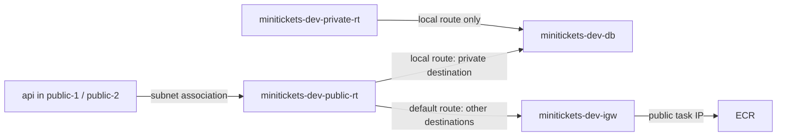

# Route tables: the city road signs

History: see [CHANGELOG.md](../CHANGELOG.md) or run `pnpm docs:history`

Area: AWS Network · Status: ✅ built · Step doc: [12 network](../../12-infra-network.md)
<!-- interview-card: v2 -->

## 1. What is it?

A [route table](../glossary.md#route-table) tells network traffic where to go next. It chooses a path from the destination address, like road signs at a junction.

## 2. Why do we need it?

MiniTickets api needs two different journeys: a private database call and an image download from AWS. Routes keep database traffic inside while giving public tasks a way out.

## 3. How does it work?

1. The subnet selects its associated table.
2. The most specific matching destination wins.
3. Local traffic stays inside; the public default route uses the gateway.

## 4. How do we use it in MiniTickets?

Both public subnets share one table. Both private subnets share another, with local access only. Explicit associations make placement predictable. Security groups and credentials are still separate checks.

## 5. Interview-ready answer

“MiniTickets has public and private route tables. Both route internal addresses locally, while only the public table has a default internet gateway route. The most specific match wins, so database calls stay private. When traffic times out, I check the path first, then security rules and credentials.”

## 6. Important follow-up questions

- **Does an internet gateway alone give access?** No. The subnet needs a route, and public IPv4 traffic needs public addressing.
- **What is the main table?** The fallback for subnets without an explicit association; our four subnets use explicit tables.
- **What if the public default route disappears?** Public requests and new task startup calls can fail.
- **Would NAT make a subnet public?** No. Its internet route leads through NAT rather than directly through the internet gateway.

## 7. Advanced details

Technical reference

### Implementation and operations

`infra/src/network.ts` → `createNetwork` creates the attached `minitickets-dev-igw`, `publicRouteTable` and `privateRouteTable`. Public has `0.0.0.0/0 → internetGateway.id`; both have AWS's `10.0.0.0/16 → local`. Four `RouteTableAssociation` resources attach the tables. The local API→RDS path still requires `minitickets-dev-db-sg` TCP 5432 from `minitickets-dev-api-sg`; external calls need task public IP and allowed outbound traffic.

VPC → Route tables → `minitickets-dev-public-rt` → Routes / Subnet associations should show local plus default and two associations; the private table has local only. The VPC Resource map draws both. Live tables were not checked. A mismatch affecting only one subnet points to its association, including unintended reliance on the main table.

- Anchor: `infra/src/network.ts` · `publicRouteTable`, `privateRouteTable`, `internetGateway`, the 4 `RouteTableAssociation`s.

AWS creates a main route table too. Our four subnets have explicit associations, so none should rely on it. Expect our two named tables plus the AWS-created main table in a fresh stack; verify live inventory rather than assuming the count.

`10.0.5.7` matches both `/16` and `/0`; `/16` is longer and wins. A route table is attached to a subnet through a `RouteTableAssociation`, not directly to an application. An attached internet gateway without a default route does not provide an internet path.

Removing `0.0.0.0/0` breaks inbound/outbound public round trips. In today's ALB-only mode browsers time out; in optional CloudFront mode the origin can time out and produce 502/504. New tasks can fail image pulls or secret reads. Existing healthy task logs may show nothing because no request arrives.

Private tables have no NAT and no VPC endpoint routes today. A later VPC Lambda or worker would need suitable endpoints or NAT for external calls. Current email/ticket Lambdas are outside the VPC and do not use these tables.

NAT per zone avoids sharing one zone's failure and can avoid cross-zone traffic. Gateway endpoints for S3/DynamoDB add routes; interface endpoints provide private network interfaces. Transit Gateway is a many-network hub. Road tables and an internet gateway have no separate hourly charge; old NAT examples of roughly $33/month were historical regional estimates, not a current quote.

The old hourly NAT example was $0.045 plus per-GB processing; actual rates depend on region and time.

Read-only check: `aws ec2 describe-route-tables --filters Name=vpc-id,Values=<actual-vpc-id>`; inspect routes and associations with `AWS_PROFILE=ticketlite`.

### Related reading

- [AWS route guide](https://docs.aws.amazon.com/vpc/latest/userguide/WorkWithRouteTables.html)
- [Subnets](subnets.md)
- [VPC](vpc.md)
- [ALB](alb.md)

[Open this piece in the city explorer](../guides/infra-explorer.html?concept=route-tables#chapter=24&piece=public-rt).

## Where it appears in the story

- [Infra story: 10. The network: VPC, subnets, route tables, internet gateway](../infra-story.md#10-the-network-vpc-subnets-route-tables-internet-gateway)
- [Big picture: 4. Components](../00-big-picture.md#4-components)

