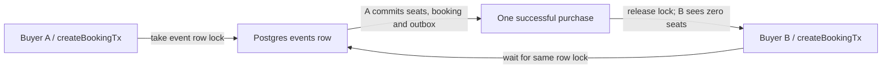

# Row locks: one clerk holds the seat ledger

History: see [CHANGELOG.md](../CHANGELOG.md) or run `pnpm docs:history`

Area: Data · Status: ✅ built in repository; live AWS acceptance is separate

<!-- interview-card: v2 -->

## 1. What is it?

A row lock gives one database transaction the turn to change a record. A transaction groups changes that succeed or fail together; competing writers wait until it ends.

## 2. Why do we need it?

Two MiniTickets buyers both see one seat left. Without coordinating their writes, both might buy it. A lock makes the second buyer check the updated count.

## 3. How does it work?

1. Start a transaction and lock the requested event.
2. Check the current seat count, then save all purchase changes together.
3. Commit or roll back to release the lock. The next writer checks again.

## 4. How do we use it in MiniTickets?

`createBookingTx` uses `SELECT ... FOR UPDATE` before changing seats. A saved booking key is checked before seat availability, so retrying a successful last-seat purchase still works. Redis can give an early inventory hint; Postgres makes the purchase decision.

## 5. Interview-ready answer

“MiniTickets locks the event row before checking and taking seats. Another buyer for that event waits, then sees the committed count. Seats, booking and outbox succeed together or roll back together. Ordinary reads can still see committed versions. It prevents overselling, but a popular event queues writers and can occupy database connections, so transactions must stay short.”

## 6. Important follow-up questions

- **Does it block the whole table?** No. Different event rows can proceed; ordinary readers can see committed versions.
- **What if the transaction fails?** Changes roll back and its locks release.
- **Will more API tasks fix a hot event?** No. They still compete for the same row and may add waiters.
- **Could a conditional update work?** Yes. It also locks the row; interpreting failure and replay still need care.

## 7. Advanced details

Technical reference

### Transaction semantics and safeguards

A [row lock](../glossary.md#row-lock) lives on one database connection until commit or rollback. `apps/api/src/queries/bookings.ts` → `createBookingTx` locks the `events` row, checks saved user/key, event start time and seats, then writes seats, booking and outbox. Insufficient seats returns **409**. Postgres computes `seats_left - quantity`; `events_seats_left_not_negative` enforces `CHECK seats_left >= 0` as a second defence.

The existing user/key check runs before seat availability so a successful last-seat purchase can replay. Different event locks do not coordinate cross-event duplicate intents; the unique booking-key constraint does. [Idempotency](idempotency.md) and [outbox](outbox.md) cover those adjacent guarantees.

Default READ COMMITTED isolation gives each statement a view of committed data. A waiting `FOR UPDATE` follows the updated row after the other transaction finishes. Ordinary reads use older committed versions through MVCC; schema changes can still block them. [Postgres locking documentation](https://www.postgresql.org/docs/17/explicit-locking.html).

### Connection and access limits

`apps/api/src/db/client.ts` → `pool` allows **10 connections per API task**. Acquisition/connect budget is **2 seconds**; `statement_timeout` is **5 seconds**, including row-lock waits. Hot-event waiters occupy pool slots; more tasks do not remove the contested row.

API reaches [RDS](rds-postgres.md) on TCP 5432: `minitickets-dev-db-sg` admits `minitickets-dev-api-sg`. Injected `DB_USER`/`DB_PASSWORD` authenticate over verified TLS. `apps/api/src/db/schema/events.ts` → `events` defines the row/constraint.

Console: RDS → Databases → `minitickets-dev-db` → Monitoring shows load. Inspect `pg_stat_activity` / `pg_locks` through authorized SQL for individual lock waits; there is no AWS row-lock map. Slow bookings for one event suggest contention; pool timeouts require shortening work and controlling admission.

### Alternatives and acceptance

A conditional `UPDATE ... WHERE seats_left >= quantity` also locks a row and saves a round trip, but zero rows alone cannot distinguish missing, started and sold-out events. Per-seat rows suit named seats. Shorter transactions or queued admission can reduce pressure; a durable seat rule is still required. `SKIP LOCKED` suits independent outbox jobs, but would skip a requested event rather than wait to book it.

This documentation-only card adds no code anchors. Repository implementation does not claim live AWS acceptance.

### Code anchors

This card has no code anchors; this documentation task adds none.

[Open this piece in the city explorer](../guides/infra-explorer.html?concept=row-locks#chapter=24&piece=rds).

## Where it appears in the story

- [App story: 9b. A booking reaches its transaction](../app-story.md#9b-a-booking-reaches-its-transaction)

