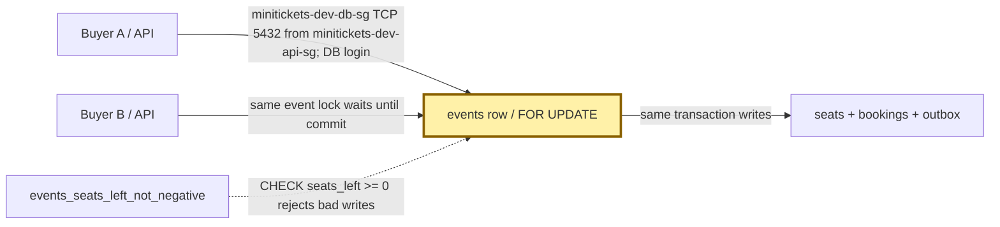
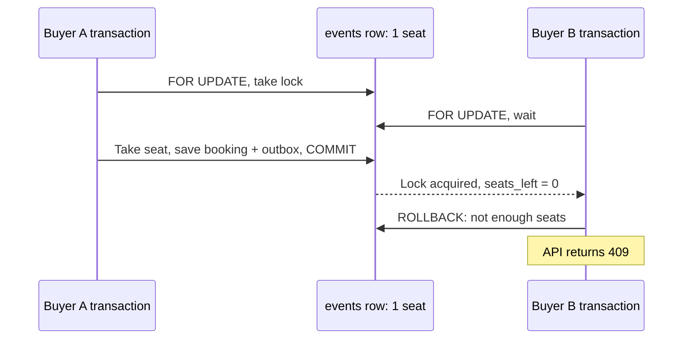

# Row locks: one clerk holds the seat ledger

History: see [CHANGELOG.md](../CHANGELOG.md) or run `pnpm docs:history`

Area: Data · Status: ✅ built in repository; live AWS acceptance is separate

<!-- interview-card: v1 -->

## 1. In one line

When two MiniTickets buyers want the last seat, a [row lock](../glossary.md#row-lock) lets only one change that event’s seat count at a time.

## 2. Where it sits

[Open this piece in the city explorer](../guides/infra-explorer.html?concept=row-locks#chapter=24&piece=rds).

## 3. How it works

## 4. What happens in MiniTickets

1. `createBookingTx` starts a transaction: all its writes succeed together or none do.
2. `SELECT ... FOR UPDATE` locks the chosen `events` row. Another booking for that event waits.
3. The holder checks the saved key, start time and seats, then changes seats and inserts booking plus outbox.
4. Commit releases the lock. The waiting buyer sees the new seat count.
5. A thrown error rolls everything back and releases the lock.

## 5. Reach / Allowed / Password

**Reach:** API → RDS :5432; minitickets-dev-db-sg admits minitickets-dev-api-sg.

**Allowed:** database login may run SQL; the lock orders competing writers.

**Password:** injected `DB_USER` and `DB_PASSWORD`, with verified TLS.

## 6. In our code

`apps/api/src/queries/bookings.ts` → `createBookingTx`

`apps/api/src/db/client.ts` → `pool`

`apps/api/src/db/schema/events.ts` → `events`

## 7. In the AWS console

RDS → Databases → `minitickets-dev-db` → Monitoring: database load. Individual locks need an authorized SQL session: inspect `pg_stat_activity` and `pg_locks`. There is no row-lock map in the AWS console.

## 8. Good / Bad

**Good:** prevents overselling; different event rows can proceed together.

**Bad:** a popular event becomes a queue; each waiter occupies a pool connection.

## 9. Other choices

- Pick one conditional `UPDATE ... WHERE seats_left >= quantity` when shorter SQL and fewer round trips matter.
- Pick separate seat rows when named seats need independent ownership.

## 10. Connected to

| Neighbor | Direction | What allows it | Console check |
| --- | --- | --- | --- |
| [RDS](rds-postgres.md) | ← stores lock | transaction on one connection | RDS → database |
| [Idempotency](idempotency.md) | → replay check | unique user/key | RDS → database; SQL |
| [Outbox](outbox.md) | → durable work | same transaction | RDS → database; SQL |

## 11. When it breaks

- Bookings slow for one event → SQL lock waits → shorten the transaction.
- Pool timeouts → waiting SQL connections → reduce contention; more API tasks alone cannot free a hot row.

## 12. Say it in 30 seconds

“MiniTickets locks one event row before checking and taking seats. A second buyer waits and then sees the updated count. Seats, booking and outbox commit together. Ordinary event reads can still use an older committed row. This is easy to explain, but a popular event can queue buyers and occupy the API’s small connection pool.”

## 13. Likely follow-ups

- **Is the whole table locked against readers?** No. Ordinary reads can see committed row versions.
- **Does Redis own the seats?** No. Its inventory hint can reject early; Postgres decides the purchase.

## 14. Remember it

One event ledger, one writing hand, until commit.

## 15. More detail

Source notes, earlier detail and code anchors

This card is new. No code anchors were added because this task changes documentation only.

The pool allows **10** connections per API task. Acquisition/connect budget is **2 seconds**; `statement_timeout` is **5 seconds**, including time spent waiting on row locks. A transaction releases its row locks on commit or rollback.

At the default READ COMMITTED isolation level, each statement sees committed data when it starts; a waiting `FOR UPDATE` follows the updated row after the other transaction finishes. Ordinary reads use older committed versions (MVCC), although schema changes can still block them. [Postgres locking documentation](https://www.postgresql.org/docs/17/explicit-locking.html).

The transaction checks for an existing user/key before testing seats, so a successful last-seat purchase still replays. Different event rows do not share this lock; the unique booking-key constraint handles cross-event duplicate intent races. Postgres computes `seats_left - quantity`; the nonnegative CHECK is a second defence.

The conditional-update alternative takes a row lock too. It saves a round trip but a zero-row result cannot alone distinguish missing, started and sold-out events. `SKIP LOCKED` is useful for independent outbox jobs; using it for a requested event would skip the event rather than wait to book it. Hot-event growth choices include shorter transactions, per-seat rows or queued admission; none removes the need for a durable seat rule.

## Where it appears in the story

- [App story: 9b. A booking reaches its transaction](../app-story.md#9b-a-booking-reaches-its-transaction)
