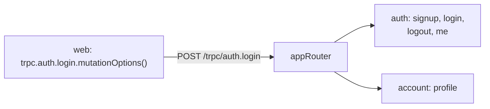

# RPC vs REST (why tRPC)

History: see [CHANGELOG.md](../CHANGELOG.md) or run `pnpm docs:history`

Area: API · Status: ✅ built · Step doc: [01 setup](../../01-setup.md)

## 1. In one line

**REST** models the API as resources and HTTP verbs (`GET /users/42`); **RPC** models it as named
functions (`auth.login(...)`). We use **tRPC**, an RPC style where the client calls server functions
with full TypeScript types and no schema file in between.

## 2. Real-life comparison

REST is a library catalogue: you ask for "book 42" or "all books by X" using fixed rules. RPC is
asking the librarian to do a named job: "renew my loans". Both work; RPC fits when the same team
owns both sides and the jobs are actions, not just records.

## 3. Picture it



## 4. Where in our code

- Anchor: `apps/api/src/trpc/router.ts` · `appRouter`: one key per feature, `auth` and `account`.

Step by step:

1. `appRouter = router({ auth: authRouter, account: accountRouter })`.
2. Each procedure is a **query** (read: `auth.me`, `account.profile`) or a **mutation** (change:
   `auth.signup`, `auth.login`, `auth.logout`).
3. On the wire it is still HTTP: queries are `GET /trpc/<path>?input=…`, mutations are
   `POST /trpc/<path>` with a JSON body ([trpc-client](trpc-client.md)).
4. Errors keep HTTP meaning: tRPC codes map to status codes (`UNAUTHORIZED` → 401)
   ([http-status-codes](http-status-codes.md)).
5. The web app gets the types from `type AppRouter`, not from a generated file
   ([end-to-end-types](end-to-end-types.md)).

## 5. See it yourself

```bash
curl -s localhost:4000/trpc/auth.me          # a query is a plain GET: {"result":{"data":null}}
curl -s -X POST localhost:4000/trpc/auth.logout -H 'content-type: application/json'
# {"result":{"data":{"ok":true}}}
```

**Break it on purpose:** `curl -s -X POST localhost:4000/trpc/auth.me -H 'content-type: application/json'`.
tRPC answers `405` with `"Unsupported POST-request to query procedure at path \"auth.me\""`
(recorded against a local api): the method is part of the contract.

## 6. How it connects

- **Uses ←** [fastify-app](fastify-app.md) (`fastifyTRPCPlugin`).
- **Gives →** [end-to-end-types](end-to-end-types.md), [trpc-client](trpc-client.md); the router
  is also the "one api, split by feature" of [monolith-vs-microservices](monolith-vs-microservices.md).

## 7. Our settings and WHY

tRPC v11 with no transformer (plain JSON) and no OpenAPI. WHY: the only client is our own web app in
the same repo, so shared types beat a published contract; JSON keeps curl readable.

## 8. Trade-offs

- **Pros:** no schema or codegen step; rename a procedure and TypeScript shows every caller; inputs
  validated by Zod at the edge.
- **Cons:** tied to TypeScript on both sides; not a public, language-neutral API; HTTP caching and
  URLs are less "pretty" than REST; batch URLs are hard to read in logs.

## 9. Alternatives and when to choose them

- **REST + OpenAPI:** public APIs, many client languages, HTTP caching by URL.
- **GraphQL:** many clients needing different shapes of the same data (explain-only card `graphql`).
- **gRPC:** service-to-service, binary, streaming (explain-only card `grpc`).
- **tRPC + OpenAPI adapter:** if a third party ever needs our API.

## 10. What breaks, and how we'd notice

- A breaking change to a procedure: the web app fails `pnpm typecheck` in CI, because both live in
  one repo. With a separately deployed web and api, an old browser tab could still call the old
  shape during a deploy.
- Using the wrong method (POST for a query): tRPC answers an error.

## 13. Interview answers at 3 levels

- **Simple:** The web app calls server functions by name, with types.
- **Senior:** tRPC over HTTP: queries are GETs, mutations POSTs, grouped by feature in `appRouter`.
  The web imports only the router's type, so changes show up as compile errors. Errors still map to
  HTTP status codes.
- **Lead:** RPC fits one team owning both ends in one repo; REST or GraphQL fit public or multi-client
  APIs. I'd revisit if we add a mobile app or third parties, and I'd keep procedures backward
  compatible during rolling deploys because browsers can run old code.

## 14. Follow-up questions interviewers ask

- *Is tRPC REST?* No: it uses HTTP, but URLs are procedure names, not resources.
- *How do you version it?* Add new procedures and deprecate old ones; avoid breaking shapes.

## 15. Say it in 30 seconds

"We use tRPC: the web app calls api functions like auth.login with full types and no codegen. On the
wire it's HTTP, queries as GET and mutations as POST, and errors keep their HTTP status. It's right
because one team owns both sides in one repo; for public clients I'd use REST with OpenAPI."

## 16. Status

✅ built.

## Where it appears in the story

- [App story: 3. The tRPC client](../app-story.md#3-the-trpc-client)
- [App story: 12. Monorepo and shared types](../app-story.md#12-monorepo-and-shared-types)
