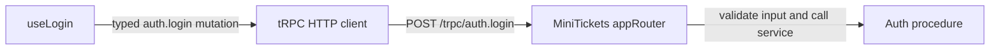

# RPC vs REST (why tRPC)

History: see [CHANGELOG.md](../CHANGELOG.md) or run `pnpm docs:history`

Area: API · Status: ✅ built · Step doc: [01 setup](../../01-setup.md)
<!-- interview-card: v2 -->

## 1. What is it?

RPC describes an API as named operations such as login. REST describes it through resources and HTTP methods, such as reading or updating a user.

## 2. Why do we need it?

MiniTickets has one TypeScript web app and API maintained together. Calling typed operations fits that setup without maintaining a separate public API specification.

## 3. How does it work?



1. Choose the named API procedure.
2. Serialize its validated input into the HTTP request.
3. Return its typed result or a structured error.

## 4. How do we use it in MiniTickets?

Feature routers group auth, account, events, bookings and other operations. Queries read; mutations change data. Web imports only the router’s type, while the API still validates external values at runtime.

## 5. Interview-ready answer

“MiniTickets uses tRPC because one team owns both TypeScript ends in a monorepo. Calls look like named operations, but still travel over HTTP with methods and status codes. Shared types make refactoring easier. For public or multi-language clients I would consider a language-neutral contract, and preserve compatibility across separately deployed versions.”

## 6. Important follow-up questions

- **Is every HTTP API REST?** No. tRPC uses HTTP, but addresses procedures rather than a resource-oriented contract.
- **Do types replace validation?** No. Network inputs remain untrusted and are checked by shared schemas.
- **What if an old browser tab calls a changed procedure?** Compilation cannot protect already deployed code; use additive changes and deprecation.
- **When prefer REST with OpenAPI?** When public clients, other languages or independently owned consumers need a published contract.

## 7. Advanced details

<details>
<summary>Technical reference</summary>

### Current reading notes

Router feature examples below started with auth/account; current appRouter includes later features too. tRPC v11 uses plain JSON without an OpenAPI generation step here. Queries use GET and mutations POST with the configured links; a wrong method can return 405. Alternatives remain REST/OpenAPI, GraphQL, gRPC or an adapter when requirements justify them.

### Implementation reference

- Anchor: `apps/api/src/trpc/router.ts` · `appRouter`: one key per feature, `auth` and `account`.

Step by step:

1. `appRouter = router({ auth: authRouter, account: accountRouter })`.
2. Each procedure is a **query** (read: `auth.me`, `account.profile`) or a **mutation** (change:
   `auth.signup`, `auth.login`, `auth.logout`).
3. On the wire it is still HTTP: queries are `GET /trpc/<path>?input=…`, mutations are
   `POST /trpc/<path>` with a JSON body ([trpc-client](trpc-client.md)).
4. Errors keep HTTP meaning: tRPC codes map to status codes (`UNAUTHORIZED` → 401)
   ([http-status-codes](http-status-codes.md)).
5. The web app gets the types from `type AppRouter`, not from a generated file
   ([end-to-end-types](end-to-end-types.md)).

### Inspection and historical evidence

```bash
curl -s localhost:4000/trpc/auth.me          # a query is a plain GET: {"result":{"data":null}}
curl -s -X POST localhost:4000/trpc/auth.logout -H 'content-type: application/json'
# {"result":{"data":{"ok":true}}}
```

**Break it on purpose:** `curl -s -X POST localhost:4000/trpc/auth.me -H 'content-type: application/json'`.
tRPC answers `405` with `"Unsupported POST-request to query procedure at path \"auth.me\""`
(recorded against a local api): the method is part of the contract.

### Settings and reasoning

tRPC v11 with no transformer (plain JSON) and no OpenAPI. WHY: the only client is our own web app in
the same repo, so shared types beat a published contract; JSON keeps curl readable.

### Trade-offs

- **Pros:** no schema or codegen step; rename a procedure and TypeScript shows every caller; inputs
  validated by Zod at the edge.
- **Cons:** tied to TypeScript on both sides; not a public, language-neutral API; HTTP caching and
  URLs are less "pretty" than REST; batch URLs are hard to read in logs.

### Alternatives and scaling

- **REST + OpenAPI:** public APIs, many client languages, HTTP caching by URL.
- **GraphQL:** many clients needing different shapes of the same data (explain-only card `graphql`).
- **gRPC:** service-to-service, binary, streaming (explain-only card `grpc`).
- **tRPC + OpenAPI adapter:** if a third party ever needs our API.

### Failure diagnosis

- A breaking change to a procedure: the web app fails `pnpm typecheck` in CI, because both live in
  one repo. With a separately deployed web and api, an old browser tab could still call the old
  shape during a deploy.
- Using the wrong method (POST for a query): tRPC answers an error.

### Further questions

- *Is tRPC REST?* No: it uses HTTP, but URLs are procedure names, not resources.
- *How do you version it?* Add new procedures and deprecate old ones; avoid breaking shapes.

### Related reading

- [fastify-app](fastify-app.md)
- [monolith-vs-microservices](monolith-vs-microservices.md)

[Open this piece in the city explorer](../guides/infra-explorer.html?concept=rpc-vs-rest#chapter=24&piece=code-trpc).

## Where it appears in the story

- [App story: 3. The tRPC client](../app-story.md#3-the-trpc-client)
- [App story: 12. Monorepo and shared types](../app-story.md#12-monorepo-and-shared-types)

</details>
