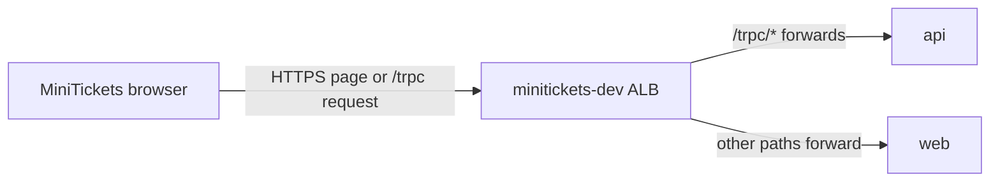

# Same-origin path routing: `/trpc/*` → api

History: see [CHANGELOG.md](../CHANGELOG.md) or run `pnpm docs:history`

Area: AWS Network · Status: ✅ built · Step docs: [16 ECR](../../16-infra-ecr.md) (section 3h), [18 ALB + web](../../18-infra-alb-web.md) (section 3.3)
<!-- interview-card: v2 -->

## 1. What is it?

An origin is a website address: scheme, host and port. Same-origin routing lets the browser use one origin for both MiniTickets pages and API calls.

## 2. Why do we need it?

Without it, the browser would call a second API address, adding cross-origin permission and cookie configuration. A single entrance can direct page requests and booking requests to different applications.

## 3. How does it work?



1. The web client builds a relative API URL.
2. The browser sends it to the same public host as the page.
3. The ALB selects api or web by path.

## 4. How do we use it in MiniTickets?

Production browser calls use `/trpc`. Current direct HTTPS entry routes those calls to api and other paths to web. Local development uses separate web and API ports, so its browser calls still need CORS. Server-rendered calls use a different private address.

## 5. Interview-ready answer

“MiniTickets keeps pages and browser API calls on one public origin. The client calls relative /trpc, and the ALB routes that path to the API. This simplifies browser cookies and avoids production cross-origin requests. Server-to-server discovery is separate, and same-origin routing does not replace authentication or mutation protection.”

## 6. Important follow-up questions

- **Does this remove authentication?** No. The API still validates sessions, ownership and mutation requests.
- **What if the catch-all rule wins first?** API calls reach Next.js and can return 404; inspect listener rule order.
- **Why leave the public API URL empty?** A relative URL avoids baking one environment address into the web image.
- **When use a separate API domain?** When external clients or ownership boundaries justify it; plan its browser and cookie contract explicitly.

## 7. Advanced details

<details>
<summary>Technical reference</summary>

### Current reading notes

Current mode is `cdnEnabled=false`: `infra/src/entry/https-listener.ts` routes `/trpc/*` at priority 100 and sends other paths to web by its default action. HTTP redirects to HTTPS. The older `listener.ts` priority 100/200 and origin-header references below describe optional CloudFront mode, not the active direct-HTTPS path. Live acceptance remains pending.

### Browser setup and optional CDN routing

- Anchor: `apps/web/src/lib/trpc/client.ts` · `API_URL`: empty means "same origin", so the client calls `/trpc`.
- Anchor: `infra/src/entry/listener.ts` · `trpcRule`: priority 100, secret header + `/trpc/*` → api target group.
- Anchor: `scripts/push-images.sh` · step 9: the web image is built **without** `NEXT_PUBLIC_API_URL`.

Step by step:

1. `push-images.sh` builds the web image with no `--build-arg NEXT_PUBLIC_API_URL`, so the
   Dockerfile's `ARG NEXT_PUBLIC_API_URL=""` stays empty.
2. `client.ts` → `API_URL = process.env.NEXT_PUBLIC_API_URL ?? ""`; `httpBatchLink` uses
   ``url: `${API_URL}/trpc` ``, i.e. just `/trpc`.
3. In optional CDN mode, CloudFront's `/trpc/*` behavior forwards all methods and the cookie to the ALB without caching
   (see [cdn-caching](cdn-caching.md)).
4. `infra/src/entry/listener.ts` → `trpcRule` (priority 100) matches `/trpc/*` **before** `webRule` (priority 200),
   which catches the rest. Lowest number wins.

### Inspection and historical evidence

```bash
cd infra && APP=$(pulumi stack output appUrl)
curl -s "$APP/trpc/auth.me"; echo                   # {"result":{"data":null}}  (api answered)
curl -s -o /dev/null -w '%{http_code}\n' "$APP/"    # 200 (web answered)
```

In DevTools → Network, the tRPC calls go to the **same** host as the page, and there are no CORS
`OPTIONS` preflight requests.

**Break it on purpose (thought experiment):** give `webRule` priority 50. It now matches first, so
`/trpc/auth.me` goes to Next.js, which answers 404 ([docs/19](../../19-infra-cloudfront.md),
section 5).

### Settings and reasoning

| Choice | Why |
| ------ | --- |
| Same origin on AWS | No cross-origin browser requests; cookies are first-party; the image stays portable. |
| `NEXT_PUBLIC_API_URL` empty = same origin | `NEXT_PUBLIC_*` values are baked in at build time; leaving it empty avoids baking an address into the image. |
| Locally still cross-origin | `pnpm dev` runs web on :3000 and api on :4000; `apps/web/.env.local` sets the URL and CORS allows it. |
| Rule priorities 100 / 200 | Specific rule first, catch-all second. |

### Trade-offs

- **Pros:** simpler security (no CORS, `SameSite=Lax` cookie just works), portable web image.
- **Cons:** web and api share one domain, so they share cookies and one CloudFront distribution;
  splitting them later needs a new routing plan. Local and AWS behave differently (CORS only
  locally).

### Alternatives and scaling

- **Separate api domain** (`api.example.com`): when other clients (mobile, partners) use the api or
  teams deploy independently. Needs CORS and careful cookie settings.
- **Next.js rewrites / route handlers proxying to the api:** one origin without an ALB rule; costs a
  hop through the web server.

### Failure diagnosis

- **Wrong rule order:** all api calls 404 from Next.js.
- **Web image built with a full `NEXT_PUBLIC_API_URL`:** the browser calls that address instead;
  cross-origin, so CORS errors and cookie problems.
- **CloudFront `/trpc/*` behavior missing:** the default behavior allows only GET/HEAD, so logins
  (POST) get CloudFront's 403.

### Access boundaries

**Reach:** the ALB rule is the path from the public address to the api's target group.
**Password:** optional CDN rules also require the secret header ([origin-protection](origin-protection.md)).
No IAM.

### Cost

Listener rules are free (the ALB's hourly price covers them).

### Further questions

- *Why is there no preflight on AWS?* Same origin: the browser never asks CORS permission.
- *Why not bake the api URL into the image?* `NEXT_PUBLIC_` variables are fixed at build time; an
  empty value keeps one image valid everywhere.

### Related reading

- [ALB](alb.md)
- [target groups](target-groups.md)
- [CloudFront](cloudfront.md)

[Open this piece in the city explorer](../guides/infra-explorer.html?concept=same-origin-routing#chapter=10&piece=alb).

## Where it appears in the story

- [App story: 3. The tRPC client](../app-story.md#3-the-trpc-client)
- [Infra story: 2. The ALB: security group, listener, rules, secret header](../infra-story.md#2-the-alb-security-group-listener-rules-secret-header)
- [Big picture: 4. Components](../00-big-picture.md#4-components)

</details>
