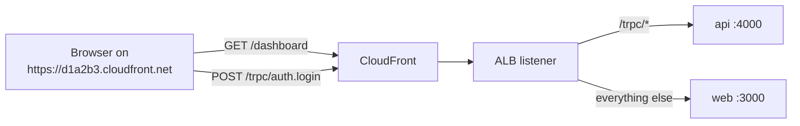

# Same-origin path routing: `/trpc/*` → api

History: see [CHANGELOG.md](../CHANGELOG.md) or run `pnpm docs:history`

Area: AWS Network · Status: ✅ built · Step docs: [16 ECR](../../16-infra-ecr.md) (section 3h), [18 ALB + web](../../18-infra-alb-web.md) (section 3.3)

## 1. In one line

The browser calls the api at `/trpc` on the **same address** that served the page, and the ALB
splits traffic by path: `/trpc/*` goes to the api, everything else to web.

## 2. Real-life comparison

One shop address with two counters inside. Customers never need a second address; the person at the
door looks at what they ask for and points them to the right counter.

## 3. Picture it



## 4. Where in our code

- Anchor: `apps/web/src/lib/trpc/client.ts` · `API_URL`: empty means "same origin", so the client calls `/trpc`.
- Anchor: `infra/src/entry/listener.ts` · `trpcRule`: priority 100, secret header + `/trpc/*` → api target group.
- Anchor: `scripts/push-images.sh` · step 9: the web image is built **without** `NEXT_PUBLIC_API_URL`.

Step by step:

1. `push-images.sh` builds the web image with no `--build-arg NEXT_PUBLIC_API_URL`, so the
   Dockerfile's `ARG NEXT_PUBLIC_API_URL=""` stays empty.
2. `client.ts` → `API_URL = process.env.NEXT_PUBLIC_API_URL ?? ""`; `httpBatchLink` uses
   ``url: `${API_URL}/trpc` ``, i.e. just `/trpc`.
3. CloudFront's `/trpc/*` behavior forwards all methods and the cookie to the ALB without caching
   (see [cdn-caching](cdn-caching.md)).
4. `listener.ts` → `trpcRule` (priority 100) matches `/trpc/*` **before** `webRule` (priority 200),
   which catches the rest. Lowest number wins.

## 5. See it yourself

```bash
cd infra && APP=$(pulumi stack output appUrl)
curl -s "$APP/trpc/auth.me"; echo                   # {"result":{"data":null}}  (api answered)
curl -s -o /dev/null -w '%{http_code}\n' "$APP/"    # 200 (web answered)
```

In DevTools → Network, the tRPC calls go to the **same** host as the page, and there are no CORS
`OPTIONS` preflight requests.

**Break it on purpose (thought experiment):** give `webRule` priority 50. It now matches first, so
`/trpc/auth.me` goes to Next.js, which answers 404 ([docs/19](../../19-infra-cloudfront.md),
section 5).

## 6. How it connects

- **Uses ←** the [ALB](alb.md) listener and [target groups](target-groups.md); [CloudFront](cloudfront.md)
  behaviors.
- **Gives →** no CORS on AWS (the app-side `cors` card in Phase 3); the `sid` cookie works as a
  first-party cookie; one web image for every environment.

## 7. Our settings and WHY

| Choice | Why |
| ------ | --- |
| Same origin on AWS | No CORS questions, cookie is first-party, one image works anywhere. |
| `NEXT_PUBLIC_API_URL` empty = same origin | `NEXT_PUBLIC_*` values are baked in at build time; leaving it empty avoids baking an address into the image. |
| Locally still cross-origin | `pnpm dev` runs web on :3000 and api on :4000; `apps/web/.env.local` sets the URL and CORS allows it. |
| Rule priorities 100 / 200 | Specific rule first, catch-all second. |

## 8. Trade-offs

- **Pros:** simpler security (no CORS, `SameSite=Lax` cookie just works), portable web image.
- **Cons:** web and api share one domain, so they share cookies and one CloudFront distribution;
  splitting them later needs a new routing plan. Local and AWS behave differently (CORS only
  locally).

## 9. Alternatives and when to choose them

- **Separate api domain** (`api.example.com`): when other clients (mobile, partners) use the api or
  teams deploy independently. Needs CORS and careful cookie settings.
- **Next.js rewrites / route handlers proxying to the api:** one origin without an ALB rule; costs a
  hop through the web server.

## 10. What breaks, and how we'd notice

- **Wrong rule order:** all api calls 404 from Next.js.
- **Web image built with a full `NEXT_PUBLIC_API_URL`:** the browser calls that address instead;
  cross-origin, so CORS errors and cookie problems.
- **CloudFront `/trpc/*` behavior missing:** the default behavior allows only GET/HEAD, so logins
  (POST) get CloudFront's 403.

## 11. Reach / Allowed / Password

**Reach:** the ALB rule is the path from the public address to the api's target group.
**Password:** the same rule also requires the secret header ([origin-protection](origin-protection.md)).
No IAM.

## 12. Cost

Listener rules are free (the ALB's hourly price covers them).

## 13. Interview answers at 3 levels

- **Simple:** The page and the api share one address; the load balancer sends `/trpc` to the api.
- **Senior:** The web image is built with an empty `NEXT_PUBLIC_API_URL`, so the tRPC client calls
  relative `/trpc`. CloudFront forwards `/trpc/*` uncached with all methods, and ALB rule 100 (header
  + `/trpc/*`) sends it to the api target group before rule 200 catches everything else for web.
  That removes CORS from production entirely.
- **Lead:** Same-origin routing is a security simplification as much as a convenience: first-party
  cookies, no CORS allow-list to get wrong. I would revisit it once a second client needs the api;
  then I'd add a versioned api domain with explicit CORS.

## 14. Follow-up questions interviewers ask

- *Why is there no preflight on AWS?* Same origin: the browser never asks CORS permission.
- *Why not bake the api URL into the image?* `NEXT_PUBLIC_` variables are fixed at build time; an
  empty value keeps one image valid everywhere.

## 15. Say it in 30 seconds

"The browser calls `/trpc` on the same address that served the page. CloudFront forwards it
uncached, and ALB rule 100 sends `/trpc/*` to the api, while rule 200 sends everything else to
Next.js. So production has no CORS, the cookie is first-party, and the web image has no api address
baked in."

## 16. Status

✅ built.

## Where it appears in the story

- [App story: 3. The tRPC client](../app-story.md#3-the-trpc-client)
- [Infra story: 2. The ALB: security group, listener, rules, secret header](../infra-story.md#2-the-alb-security-group-listener-rules-secret-header)
- [Big picture: 4. Components](../00-big-picture.md#4-components)
