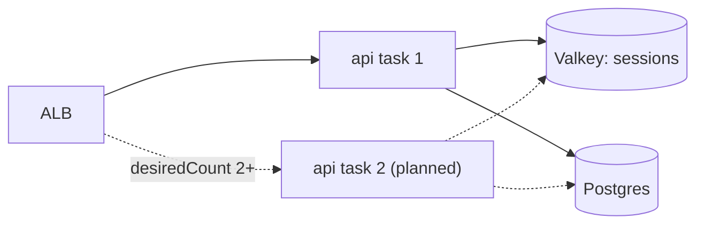

# Vertical vs horizontal scaling

History: see [CHANGELOG.md](../CHANGELOG.md) or run `pnpm docs:history`

Area: Reliability · Status: 🟡 partial (ready to scale out, runs 1 task) · Step doc: [17 ECS api](../../17-infra-ecs-api.md)

## 1. In one line

**Vertical scaling** gives one server more CPU and memory; **horizontal scaling** adds more copies.
Our api is stateless, so it can scale out, but today it runs one task.

## 2. Real-life comparison

Vertical: hire a faster cashier. Horizontal: open more tills. More tills only help if any cashier can
serve any customer, i.e. no customer's details live in one cashier's head.

## 3. Picture it



Any task can answer any request, because sessions live in Valkey, not in the task's memory.

## 4. Where in our code

- Anchor: `infra/src/compute/service.ts` · `desiredCount: 1`: the number of api copies.

What makes horizontal scaling possible, step by step:

1. Sessions are in Valkey (Phase 3 `stateless-servers` card), so no request depends on which task
   served the previous one.
2. The ALB target group spreads requests over all registered tasks.
3. Each task has its own connection pool of up to 10 Postgres connections
   (`apps/api/src/db/client.ts` → `pool`, Phase 3 `connection-pooling`). N tasks → up to 10·N
   connections; `db.t4g.micro` has a limited `max_connections` (exact number not checked).
4. Vertical: `cpu` and `memory` in `task.ts` (256 / 512 today).

## 5. See it yourself

```bash
aws ecs update-service --profile ticketlite --cluster minitickets-dev --service minitickets-dev-api --desired-count 2
```

This changes the service outside Pulumi (the next `pulumi up` sets it back to 1). Log in, reload a few
times: you stay logged in whichever task answers. Look at `aws logs tail /minitickets/dev/api` to see
two stream names.

## 6. How it connects

- **Uses ←** [ecs-service](ecs-service.md), [target-groups](target-groups.md), Valkey sessions.
- **Gives →** the base for [high availability](high-availability.md) and auto scaling (explain-only
  card `autoscaling`, Phase 5).

## 7. Our settings and WHY

`desiredCount: 1` and the smallest size: dev traffic is near zero, and each task costs money every hour.

## 8. Trade-offs

- **Horizontal:** no single point of failure, scales far; needs stateless code and watches database
  connection counts.
- **Vertical:** no code changes; has a ceiling and a single point of failure.

## 9. Alternatives and when to choose them

- **Target tracking auto scaling** on CPU or ALB requests per target: variable traffic.
- **Scheduled scaling:** predictable peaks.
- **RDS Proxy:** when task count × pool size approaches the database's connection limit.

## 10. What breaks, and how we'd notice

- Too many connections: `remaining connection slots are reserved` errors from Postgres.
- In-memory state added by mistake (a local cache, rate limit counters): inconsistent behaviour between
  tasks.

## 11. Reach / Allowed / Password

New tasks wear the same security group and roles, so nothing changes.

## 12. Cost

Linear: each extra api task ≈ $0.003 an hour on Spot plus $0.005 for its public IP.

## 13. Interview answers at 3 levels

- **Simple:** We can run more copies of the api because it keeps no user data in memory.
- **Senior:** Sessions in Valkey make the api stateless, the ALB spreads load, so scaling out is
  changing `desiredCount`. The limit to watch is Postgres connections: 10 per task.
- **Lead:** I'd scale on a metric tied to user experience (requests per target or p95 latency), cap
  max tasks below the database connection budget, and put RDS Proxy in front before that budget runs
  out.

## 14. Follow-up questions interviewers ask

- *What makes a service stateless?* No per-user state in process memory between requests.
- *What is the first bottleneck when scaling the api?* Database connections and the database itself.

## 15. Say it in 30 seconds

"The api is stateless because sessions live in Valkey, so scaling out is just more tasks behind the
ALB. Today it's one task to save money; the thing to watch when scaling is ten Postgres connections per
task."

## 16. Status

🟡 partial. **To make it production-grade:** 2+ tasks, auto scaling, connection budget.
