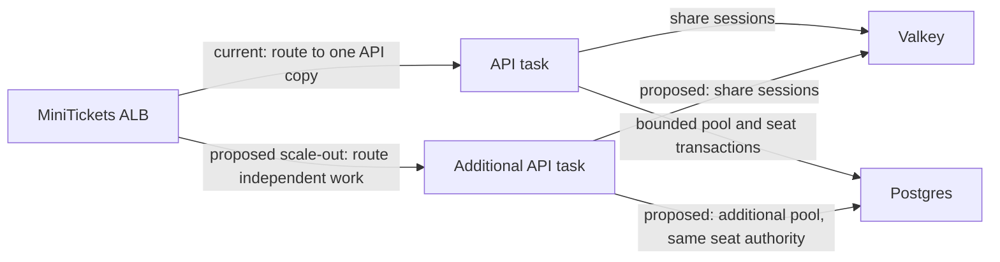

# Vertical vs horizontal scaling

History: see [CHANGELOG.md](../CHANGELOG.md) or run `pnpm docs:history`

Area: Reliability · Status: 🟡 partial (ready to scale out, runs 1 task) · Step doc: [17 ECS api](../../17-infra-ecs-api.md)

<!-- interview-card: v2 -->

## 1. What is it?

Vertical scaling makes one application copy larger. Horizontal scaling runs more copies, spreading work that can be handled independently.

## 2. Why do we need it?

MiniTickets may need more capacity for browsing during a sale. A larger task can do more work, while additional tasks can serve different requests—but neither automatically fixes one locked event row.

## 3. How does it work?

1. Measure whether compute or a shared dependency is limiting requests.
2. Increase task size or add copies within connection and cost budgets.
3. Load-test the resulting latency and failure behavior.

## 4. How do we use it in MiniTickets?

The API uses shared sessions and can support additional copies, but current services run one task each. Every API task creates its own database pool. Scaling policies, reliable spare capacity and data-tier availability are separate work.

## 5. Interview-ready answer

“MiniTickets can scale independent API work horizontally because session authority is shared. Vertical scaling instead increases one task’s resources. I would first identify the bottleneck and budget total database connections. Adding tasks does not parallelize a hot event row or make a single database highly available; capacity changes need load and failure testing, not just a desired-count edit.”

## 6. Important follow-up questions

- **What limits horizontal growth?** Database capacity, connection totals, hot rows, downstream quotas and cost.
- **Does horizontal scaling remove every single failure point?** No. Shared stores and routing remain dependencies.
- **What breaks if local state becomes authoritative?** Different tasks can disagree or require fragile client affinity.
- **When might larger tasks help?** When per-task CPU or memory is the actual measured bottleneck.

## 7. Advanced details

Technical reference

### Current sizes and connection budget

`infra/src/compute/service.ts` sets API `desiredCount: 1`; web also has one copy. With Service Connect enabled in the current entry-enabled shape, API uses **512 CPU units / 1024 MiB**; web uses that size too. API without Service Connect and the separate migration task use **256 / 512**. `apps/api/src/db/client.ts` allows **10 Postgres connections per API task**, so N tasks can open up to **10 × N**. The small `db.t4g.micro` has a finite connection budget; exact deployed `max_connections` was not checked.

Shared Valkey sessions and target-group routing support additional copies, but do not prove application/data HA. New tasks inherit intended groups/roles; capacity, health and downstream limits still need verification. Local nonauthoritative caches are acceptable; user authority or rate counters isolated per task can cause inconsistency.

### Owner-only example and alternatives

Historical owner exercise: `aws ecs update-service --profile ticketlite --cluster minitickets-dev --service minitickets-dev-api --desired-count 2`. This is an AWS write, not executed here; it creates drift and the next approved Pulumi deployment would restore committed count. Prefer reviewed infrastructure changes. Inspect separate `/minitickets/dev/api` log streams and sustained session behavior during an authorized exercise.

Options include target tracking, scheduled scaling and RDS Proxy near connection limits. They do not eliminate hot-row serialization. The old Spot/public-IP estimates (**$0.003/$0.005 per hour**) are historical unverified figures, not current prices or linear-total-cost guarantees. Current status is partial; 2+ copies, automatic policies and a measured connection/availability budget remain future work.

### Code anchors

- Anchor: `infra/src/compute/service.ts` · `desiredCount: 1`: the number of api copies.

### Related reading

[ecs-service](ecs-service.md) · [target-groups](target-groups.md) · [high availability](high-availability.md)

[Open this concept in the city explorer](../guides/infra-explorer.html?concept=scaling#chapter=8&piece=ecs).

## Where it appears in the story

- [Infra story: 4. ECS: cluster, service, task definition, task, Spot](../infra-story.md#4-ecs-cluster-service-task-definition-task-spot)

