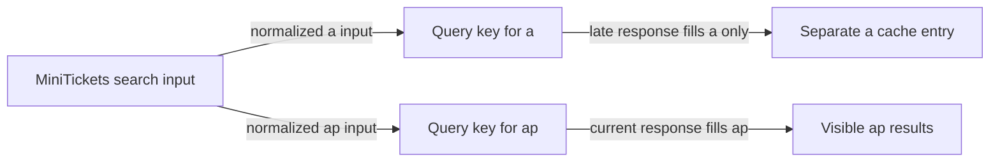

# Search races

History: see [CHANGELOG.md](../CHANGELOG.md) or run `pnpm docs:history`

Area: Frontend · Status: ✅ built in repository; live AWS acceptance is separate

<!-- interview-card: v2 -->

## 1. What is it?

A response race happens when an older search finishes after a newer one. Search identity keeps that old response from replacing the visitor’s current results.

## 2. Why do we need it?

A MiniTickets visitor types “a”, then “ap”. If the first request is slower, its answer must not overwrite results for “ap” just because it arrived last.

## 3. How does it work?

1. Give each complete search input its own query identity.
2. Associate responses and pages with that identity.
3. Use debounce and cancellation to reduce work, while identity preserves correctness.

## 4. How do we use it in MiniTickets?

`useEventSearch` uses tRPC infinite-query options keyed by canonical input. The interface labels typing/loading while retaining earlier rows. Venue and date changes matter too; pages remain attached to their matching search. Booking always rechecks authoritative availability.

## 5. Interview-ready answer

“MiniTickets prevents stale search completions from winning by giving each input its own query key. An old response can fill only its own cache entry, even if cancellation is ignored. Debounce reduces request frequency; it does not order responses. We keep previous results visibly marked while loading and test a deliberately delayed older request to exercise the actual race.”

## 6. Important follow-up questions

- **Does abort guarantee the server stopped?** No. It may save work, but response identity is the correctness boundary.
- **Does debounce fix response order?** No. Requests can still complete out of order.
- **Can filters race too?** Yes. Include every result-changing filter and keep paging within the matching query.
- **Can previously displayed seats be trusted?** No. Purchase availability is checked in the database transaction.

## 7. Advanced details

Technical reference

### Hook contract and verification

`apps/web/src/features/events/hooks/use-event-search.ts` → `useEventSearch` debounces **250 ms**, uses canonical tRPC infinite-query input, consumes cancellation and keeps previous data. Query identity includes result-changing inputs; the infinite query owns its matching page cursors. Component loading/typing labels make retained rows understandable.

`pnpm demo:search` includes a browser spec that deliberately delays an older response. This rewrite claims no new execution/live acceptance. For manual fetch, a monotonically increasing request ID can reject obsolete completions; abort alone is insufficient. A shared result variable without request identity permits stale overwrites.

### Trade-offs and growth

Measure input-to-result latency and bound retained pages. Cancellation is an optimization, not a database rollback guarantee. Add relevance/search infrastructure only after query plans and actual traffic justify it; UI race prevention remains necessary regardless of backend.

### Code anchors

- Anchor: `apps/web/src/features/events/hooks/use-event-search.ts` — `useEventSearch`; follow the numbered comments at this boundary.

### Related reading

[current system](../00-big-picture.md) · [scenario](../guides/interview-scenarios.md#search-races) · [explorer tour](../guides/infra-explorer.html?tour=search)

[Open this concept in the city explorer](../guides/infra-explorer.html?concept=search-races#chapter=8&piece=web-task).

## Where it appears in the story

- [app-story: 1b. Search input, hydration and bounded rows](../app-story.md#1b-search-input-hydration-and-bounded-rows)

