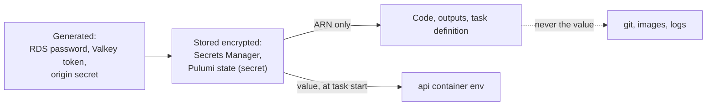

# Secrets management: never in code, images or state

Area: Auth & Security · Status: ✅ built · Step docs: [11 Docker](../../11-docker.md), [14 data](../../14-infra-data.md), [17 ECS api](../../17-infra-ecs-api.md)

## 1. In one line

**Secrets management** is the practice of keeping passwords, tokens and keys out of code, images,
logs and plain config, and delivering them to the running app only when and where it needs them.

## 2. Real-life comparison

A hotel never prints the safe code on the room key card. The code is set at check-in, given only to
the guest, and changed for the next guest.

## 3. Picture it



## 4. Where in our code

- Anchor: `infra/src/data/cache.ts` · `authToken`: generated by `random.RandomPassword`, a Pulumi secret.
- Anchor: `infra/src/compute/task.ts` · `secrets`: values injected by ECS; the task definition holds only ARNs.
- Anchor: `infra/index.ts` · step 26 outputs: addresses and secret ARNs only, never passwords or tokens.

Every place a secret could leak, and what we do:

| Place | What we do | Where |
| ----- | ---------- | ----- |
| Source code / git | No secret values; `Pulumi.dev.yaml` holds only non-secret config (the alert email is `secure:` encrypted) | `infra/Pulumi.dev.yaml` |
| Pulumi state | Generated values are Pulumi secrets (encrypted, shown as `[secret]`) | `cache.ts` → `authToken`, `secrets.ts` → `pulumi.secret(...)`, `origin-secret.ts` |
| RDS password | Never in our hands at all: RDS creates and stores it | `postgres.ts` → `manageMasterUserPassword` |
| Docker images | `.env` files excluded from the build context | `.dockerignore` |
| Task definition | ARNs in `secrets`, values injected at start | `task.ts` → `secrets` |
| Stack outputs | ARNs and addresses only | `index.ts` step 26 |
| Logs | Passwords redacted (Phase 3 card `log-redaction`) | `apps/api/src/app.ts` → `logger.redact` |

## 5. See it yourself

```bash
cd infra
pulumi stack output                     # no passwords, only ARNs and addresses
pulumi preview --diff | grep -i secret  # values show as [secret]
git grep -nE 'password[[:space:]]*[:=][[:space:]]*"[^"]+"' -- infra apps ':!*.test.ts'   # expect nothing real
```

**Break it on purpose (thought experiment):** export `authToken` as a stack output. Pulumi still masks
it (it is a secret Output) but anyone with `pulumi stack output --show-secrets` gets it, and the
"outputs never hold secrets" rule is broken.

## 6. How it connects

- **Uses ←** [Secrets Manager](secrets-manager.md), [RDS-managed password](rds-managed-password.md),
  [execution role](execution-vs-task-role.md), [KMS](kms.md).
- **Gives →** the **Password** answers for Postgres and Valkey; safe repos and images.

## 7. Our settings and WHY

- Generate secrets by machine (RDS, `RandomPassword`); no human ever types one.
- Pass ARNs, not values, between layers.
- Inject at start so the app has no AWS SDK and no permission to fetch secrets itself.

## 8. Trade-offs

- **Pros:** values never in git, images, outputs or task definitions; every read is logged.
- **Cons:** values sit in the container's environment (visible to anything inside it and to ECS Exec
  users); read once at start, so rotation needs a restart; the origin secret is visible in the
  CloudFront and listener config.

## 9. Alternatives and when to choose them

- **Runtime fetch with caching:** rotation without restarts.
- **IAM auth / short-lived credentials:** remove the secret altogether.
- **Secret scanning in CI** (gitleaks, GitHub secret scanning): catch mistakes before merge.

## 10. What breaks, and how we'd notice

- A secret committed to git: only a scanner or a reviewer notices; it must be rotated, not just
  deleted.
- A missing injected secret: the api exits at start with `Invalid environment variables`.

## 11. Reach / Allowed / Password

This card is about the **Password** column and how the passwords get there safely.

## 12. Cost

Secrets Manager ≈ $0.80 a month for our two secrets; the rest is free.

## 13. Interview answers at 3 levels

- **Simple:** No passwords in code or images; AWS stores them and gives them to the app at start.
- **Senior:** RDS generates its own password in Secrets Manager; Pulumi generates the Valkey token and
  origin secret as Pulumi secrets; the redis URL goes into Secrets Manager. Code and outputs carry only
  ARNs, `.dockerignore` keeps `.env` out of images, and ECS injects three values at start using the
  execution role.
- **Lead:** Next steps would be secret scanning in CI, rotation for every secret with runtime reads,
  and moving to identity-based access (IAM auth, OIDC for CI) so fewer long-lived secrets exist at all.

## 14. Follow-up questions interviewers ask

- *Are env vars safe for secrets?* Safer than code or images, but readable by anything in the container;
  runtime fetch is stronger.
- *What do you do when a secret leaks?* Rotate it first, then remove it from history, then find out
  how it leaked.

## 15. Say it in 30 seconds

"No secret is typed by a human or stored in git, images or outputs. RDS generates its password, Pulumi
generates the cache token and origin secret as encrypted Pulumi secrets, and ECS injects three values
from Secrets Manager at task start. Everything else passes only ARNs."

## 16. Status

✅ built. **To make it production-grade:** rotation everywhere, runtime reads, secret scanning in CI.
