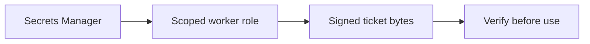

# Secrets management: never in code, images or state

History: see [CHANGELOG.md](../CHANGELOG.md) or run `pnpm docs:history`

Area: Auth & Security · Status: ✅ built in repository; live acceptance is separate

## 1. In one line

Secrets stay out of source, logs and public browser config. Env examples hold placeholders; AWS uses scoped Secrets Manager injection. CI credentials are short-lived OIDC and Pulumi tokens remain environment secrets. Do not equate a secret ARN with the secret value.

## 2. Real-life comparison

A durable work tray keeps the task after the customer leaves; a completed stamp identifies a repeat.

## 3. Picture it

## 4. Where in our code

- Anchor: `infra/src/data/cache.ts` · `authToken`: generated by `random.RandomPassword`, a Pulumi secret.
- Anchor: `infra/src/compute/task.ts` · `secrets`: values injected by ECS; the task definition holds only ARNs.
- Anchor: `infra/index.ts` · step 26 outputs: addresses and secret ARNs only, never passwords or tokens.

`apps/worker/src/tickets/token.ts` signs/verifies bounded strict claims; `infra/src/tickets/iam.ts` grants only ticket worker secret access; `services/tickets.ts` owner-scopes reads. Run `pnpm demo:tickets` and `pnpm demo:p4-assets` separately. Proposed rotation adds key id plus verification key ring, staged rollout and old-key retirement; this key-ring is not built.

## 5. See it yourself

`apps/worker/src/tickets/token.ts` signs/verifies bounded strict claims; `infra/src/tickets/iam.ts` grants only ticket worker secret access; `services/tickets.ts` owner-scopes reads. Run `pnpm demo:tickets` and `pnpm demo:p4-assets` separately. Proposed rotation adds key id plus verification key ring, staged rollout and old-key retirement; this key-ring is not built.

Failure thought experiment: Are signed QR claims private? No; base64url is readable.

## 6. How it connects

Uses the [current system](../00-big-picture.md); gives a concrete decision to the [scenario](../guides/interview-scenarios.md#secrets-forgery) and [explorer tour](../guides/infra-explorer.html?tour=check-in).

## 7. Our settings and WHY

Secrets stay out of source, logs and public browser config. Env examples hold placeholders; AWS uses scoped Secrets Manager injection. CI credentials are short-lived OIDC and Pulumi tokens remain environment secrets. Do not equate a secret ARN with the secret value. A client must never receive the signing secret or invent a valid ticket.

## 8. Trade-offs

Rotating a single key immediately invalidates old QR tokens unless a key ring is supported. OWASP review also needs abuse, dependency, authorization, logging and incident practices beyond code checks.

## 9. Alternatives and when to choose them

10x: expiry/rotation drills and audit access. 100x: per-environment/key versioning, compromise playbooks and threat modeling.

## 10. What breaks and how we notice

Are signed QR claims private? No; base64url is readable.

## 13. Interview answers at 3 levels

- **Simple:** Secrets stay out of source, logs and public browser config. Env examples hold placeholders; AWS uses scoped Secrets Manager injection. CI credentials are short-lived OIDC and Pulumi tokens remain environment secrets. Do not equate a secret ARN with the secret value.
- **Senior:** Store signing/database credentials in Secrets Manager, expose them only to the runtime that needs them and never log them. HMAC authenticates the original ticket bytes and constant-time comparison rejects tampering; it does not encrypt the payload or prevent reuse. Authorization still checks owner/role and uploads remain untrusted.
- **Lead:** 10x: expiry/rotation drills and audit access. 100x: per-environment/key versioning, compromise playbooks and threat modeling.

## 14. Follow-up questions with answers

Are signed QR claims private? No; base64url is readable.

## 15. Say it in 30 seconds

Store signing/database credentials in Secrets Manager, expose them only to the runtime that needs them and never log them. HMAC authenticates the original ticket bytes and constant-time comparison rejects tampering; it does not encrypt the payload or prevent reuse. Authorization still checks owner/role and uploads remain untrusted.

## 16. Status and production work

Repository implementation and local evidence are described above. Live AWS/CI execution remains owner acceptance. 10x: expiry/rotation drills and audit access. 100x: per-environment/key versioning, compromise playbooks and threat modeling.

## Where it appears in the story

- [Infra story: 6. Secrets Manager](../infra-story.md#6-secrets-manager)
