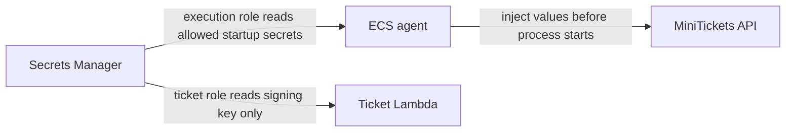

# Secrets management: never in code, images or state

History: see [CHANGELOG.md](../CHANGELOG.md) or run `pnpm docs:history`

Area: Auth & Security · Status: ✅ built in repository; live acceptance is separate
<!-- interview-card: v2 -->

## 1. What is it?

Secrets management controls where passwords and signing keys live, who can read them and how they change safely. Secret values should not spread through source files, images or logs.

## 2. Why do we need it?

MiniTickets needs database credentials, but copying them into each Docker image makes every image a password archive. Runtime delivery keeps the application package separate from its sensitive settings.

## 3. How does it work?

1. Store the value centrally and grant its intended readers access.
2. Deliver it through the workload identity instead of copying it into source.
3. Coordinate rotation with every reader and any data signed using the old key.

## 4. How do we use it in MiniTickets?

ECS injects API/web startup secrets. Only the ticket worker reads the signing key. Ticket-key rotation needs a staged transition; a verification key ring is proposed, not built.

## 5. Interview-ready answer

“MiniTickets keeps secrets out of code and images and supplies them only to the runtimes that need them. An ARN identifies a secret; it is not the value. Rotation is an application change too: startup readers retain old values, and replacing a signing key can invalidate existing tickets.”

## 6. Important follow-up questions

- **Does hiding a value in an image layer work?** No. Keep it out of the build context and inject it at runtime.
- **Can app code still leak an injected value?** Yes. Limit readers and avoid logging values.
- **Are signed QR claims confidential?** No. Their encoding is readable; a signature protects authenticity.
- **What if the signing key leaks?** Use a compromise and rotation plan; changing one key immediately affects old ticket verification.

## 7. Advanced details

Technical reference

### Source references

- Anchor: `infra/src/data/cache.ts` · `authToken`: generated by `random.RandomPassword`, a Pulumi secret.
- Anchor: `infra/src/compute/task.ts` · `secrets`: values injected by ECS; the task definition holds only ARNs.
- Anchor: `infra/index.ts` · step 26 outputs: addresses and secret ARNs only, never passwords or tokens.

`apps/worker/src/tickets/token.ts` signs/verifies bounded strict claims; `infra/src/tickets/iam.ts` grants only ticket worker secret access; `services/tickets.ts` owner-scopes reads. Run `pnpm demo:tickets` and `pnpm demo:p4-assets` separately. Proposed rotation adds key id plus verification key ring, staged rollout and old-key retirement; this key-ring is not built.

### Configuration and design

Secrets stay out of source, logs and public browser config. Env examples hold placeholders; AWS uses scoped Secrets Manager injection. CI credentials are short-lived OIDC and Pulumi tokens remain environment secrets. Do not equate a secret ARN with the secret value. A client must never receive the signing secret or invent a valid ticket.

### Checks and troubleshooting

Are signed QR claims private? No; base64url is readable.

### Trade-offs and alternatives

Rotating a single key immediately invalidates old QR tokens unless a key ring is supported. OWASP review also needs abuse, dependency, authorization, logging and incident practices beyond code checks.

10x: expiry/rotation drills and audit access. 100x: per-environment/key versioning, compromise playbooks and threat modeling.

### Further technical context

Store signing/database credentials in Secrets Manager, expose them only to the runtime that needs them and never log them. HMAC authenticates the original ticket bytes and constant-time comparison rejects tampering; it does not encrypt the payload or prevent reuse. Authorization still checks owner/role and uploads remain untrusted.

### Related reading

Uses the [current system](../00-big-picture.md); gives a concrete decision to the [scenario](../guides/interview-scenarios.md#secrets-forgery) and [explorer tour](../guides/infra-explorer.html?tour=check-in).

[Open this piece in the city explorer](../guides/infra-explorer.html?concept=secrets-management#chapter=6&piece=secrets).

## Where it appears in the story

- [Infra story: 6. Secrets Manager](../infra-story.md#6-secrets-manager)

