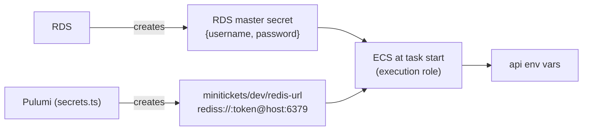

# Secrets Manager

History: see [CHANGELOG.md](../CHANGELOG.md) or run `pnpm docs:history`

Area: AWS Data · Status: ✅ built · Step doc: [14 data](../../14-infra-data.md) (section 3.7)

## 1. In one line

**Secrets Manager** is AWS's locked safe for passwords and tokens: each read is checked by IAM and
logged, and only the secret's ARN travels through our code.

## 2. Real-life comparison

A bank safe-deposit box. Your paperwork mentions only the box number (the ARN). To open it, the bank
checks your ID against its list (IAM) and writes the visit in its logbook (CloudTrail).

## 3. Picture it



## 4. Where in our code

- Anchor: `infra/src/data/secrets.ts` · `createSecrets`: the redis-url secret and its value.

Step by step:

1. `aws.secretsmanager.Secret` named `minitickets/dev/redis-url`, with `recoveryWindowInDays: 0`.
   By default a deleted secret is kept 7-30 days and its **name** is blocked; switching the data
   layer back on would then fail. Production keeps the default window.
2. `aws.secretsmanager.SecretVersion` with ``secretString: pulumi.secret(pulumi.interpolate`rediss://:${authToken}@${redisEndpoint}:6379`)``.
   `pulumi.secret` keeps it encrypted in Pulumi state and hidden in previews.
3. Only `secret.arn` leaves the file (`redisUrlSecretArn`).
4. No secret for Postgres here: RDS made its own ([rds-managed-password](rds-managed-password.md)).
5. Both are read by ECS with the [execution role](execution-vs-task-role.md) (`read-secrets` policy)
   and injected via `task.ts` → `secrets`.

## 5. See it yourself

```bash
aws secretsmanager list-secrets --profile ticketlite --query "SecretList[].[Name,LastAccessedDate]" --output table
aws secretsmanager describe-secret --profile ticketlite --secret-id minitickets/dev/redis-url --query "[Name,KmsKeyId]"
```

`KmsKeyId` empty means the default `aws/secretsmanager` key ([kms](kms.md)). Never print values on a
shared screen.

**Break it on purpose:** see [aws-foundations, chapter 5](../aws-foundations.md#5-roles-sts-and-the-confused-deputy):
remove one ARN from `read-secrets` and the task cannot start.

## 6. How it connects

- **Uses ←** [Valkey](elasticache-valkey.md) endpoint and token; [KMS](kms.md) for encryption.
- **Gives →** `REDIS_URL`, `DB_USER`, `DB_PASSWORD` for the [task definition](task-definition.md);
  the backbone of [secrets management](secrets-management.md).

## 7. Our settings and WHY

| Setting | Value | Why |
| ------- | ----- | --- |
| Whole URL as one secret | `rediss://…` | The api needs one value, exactly like `apps/api/.env`. |
| `recoveryWindowInDays` | 0 | Lets the data switch turn off and on again with the same name. |
| Default KMS key | `aws/secretsmanager` | No extra key, no `kms:Decrypt` permission needed. |

## 8. Trade-offs

- **Pros:** IAM-checked, logged, rotation support, values never in code or images.
- **Cons:** per-secret monthly price; a recovery window of 0 means no undo on delete.

## 9. Alternatives and when to choose them

- **SSM Parameter Store (SecureString):** many simple values, lower cost, no built-in rotation.
- **A customer-managed KMS key:** cross-account access or key policies for audits.
- **HashiCorp Vault:** multi-cloud or dynamic database credentials.

## 10. What breaks, and how we'd notice

- "secret is scheduled for deletion" when recreating a name (if the window were not 0).
- Execution role lacks the ARN: `ResourceInitializationError: unable to pull secrets`.

## 11. Reach / Allowed / Password

**Reach:** a regional public endpoint, reached by tasks through the internet gateway. **Allowed:** IAM
(`secretsmanager:GetSecretValue` on exact ARNs). **Password:** none of its own; calls are signed with
STS credentials.

## 12. Cost

About $0.40 per secret per month plus $0.05 per 10,000 API calls: two secrets ≈ $0.80 a month while
the data layer is on.

## 13. Interview answers at 3 levels

- **Simple:** A safe for passwords that only allowed roles can open.
- **Senior:** Two secrets: the RDS-managed master secret and our `minitickets/dev/redis-url`, written
  by Pulumi as a Pulumi secret. The execution role may read only those two ARNs, and ECS injects them
  as env vars at start.
- **Lead:** Secrets Manager centralises access and audit. I'd add rotation for the cache token,
  runtime reads for rotation safety, and alerts on unexpected `GetSecretValue` callers in CloudTrail.

## 14. Follow-up questions interviewers ask

- *Is the secret in Pulumi state?* The redis URL is, encrypted (`pulumi.secret`); the RDS password is
  not, because RDS generated it.
- *Who can read it?* Only principals with `GetSecretValue` on that ARN.

## 15. Say it in 30 seconds

"Two secrets in Secrets Manager: the RDS-managed password and the full `rediss://` URL with the cache
token. Code and outputs only carry ARNs, the execution role may read exactly those two, and ECS
injects them as env vars when a task starts."

## 16. Status

✅ built.
