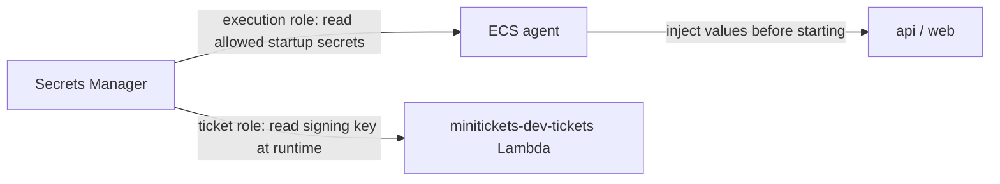

# Secrets Manager: the locked key safe

History: see [CHANGELOG.md](../CHANGELOG.md) or run `pnpm docs:history`

Area: AWS Data · Status: ✅ built in repository; live acceptance is separate
<!-- interview-card: v2 -->

## 1. What is it?

[Secrets Manager](../glossary.md#secrets-manager) is an AWS service that stores sensitive values and controls who can read them. MiniTickets uses it for database credentials and shared keys.

## 2. Why do we need it?

The API needs a database password, but putting it in source code or a container recipe would spread copies. A central safe lets authorized readers fetch it when needed.

## 3. How does it work?

1. Store the value and grant access to its intended reader.
2. ECS reads application secrets when starting tasks.
3. Running tasks keep that snapshot; ticket Lambda separately reads and caches its signing key.

## 4. How do we use it in MiniTickets?

API receives database credentials, the Redis URL and a revalidation key. Web receives only that shared revalidation key. Ticket Lambda has separate access to the ticket-signing key; API cannot read it.

## 5. Interview-ready answer

“MiniTickets stores sensitive values centrally and gives each reader access only to what it needs. ECS injects startup snapshots into API and web. Changing a stored secret does not refresh running tasks, so rotation needs coordinated deployment. Ticket signing has a separate runtime reader and needs to preserve old tickets during rotation.”

## 6. Important follow-up questions

- **Does rotation update a running task?** No. New tasks must load the changed value.
- **Can application code still leak a secret?** Yes, if it receives that value. Avoid logging it and limit access.
- **What if startup access is denied?** Check the execution role and exact secret reference.
- **Can we instantly replace the signing key?** Existing tickets would fail verification; a staged key transition is needed and is not built.

## 7. Advanced details

Technical reference

### Secret names, readers and operations

RDS owns its managed username/password secret. `infra/src/data/secrets.ts` → `createSecrets` stores `minitickets/dev/redis-url`. `infra/src/compute/revalidate-secret.ts` → `createRevalidateSecret` stores `minitickets/dev/revalidate-secret`. Only ticket Lambda reads `minitickets/dev/ticket-signing`; `apps/worker/src/tickets/assets.ts` → `signingSecret` caches a successful runtime read in memory.

API startup fields are `DB_USER`, `DB_PASSWORD`, `REDIS_URL` and `REVALIDATE_SECRET`; web receives `REVALIDATE_SECRET`. API/web execution roles need scoped `secretsmanager:GetSecretValue`; `minitickets-dev-tickets-role` has the signing-key grant. Tasks use the public outbound HTTPS path; ticket Lambda is outside the VPC. An ARN identifies a secret but is not its value. Permission is still required to read it.

Secrets Manager → Secrets → named secret → Overview / Rotation shows metadata; do not use “Retrieve secret value” for a documentation check. IAM → Roles → reading role → Permissions shows access. RDS → Databases → `minitickets-dev-db` → Configuration links its managed secret. Live secrets were not read. After rotation, failed new database connections can mean stale process credentials: coordinate a reader rollout. Runtime reads with bounded caching are an alternative when refresh without rollout is required.

- Anchor: `infra/src/data/secrets.ts` · `createSecrets`: the redis-url secret and its value.

### Exact value shape and lifetime

`createSecrets` stores `rediss://:<token>@<primary-endpoint>:6379`: TLS, empty/default username and a 32-character alphanumeric token. `pulumi.secret` keeps the URL encrypted in Pulumi state and hidden in previews. Only the ARN leaves this layer.

RDS uses `manageMasterUserPassword: true`. API task fields `<secret-arn>:username::` and `:password::` select JSON keys; empty version slots select the current version. RDS normally rotates its managed master password every seven days; confirm live rotation configuration. Injected credentials do not follow rotation, so later database reconnects can fail until a safe rollout refreshes them. [AWS injection guide](https://docs.aws.amazon.com/AmazonECS/latest/developerguide/specifying-sensitive-data.html) requires new tasks for changed values.

The shared revalidation value is 64 alphanumeric characters. API and web task definitions reference the same secret, but deployments at different times can hold different snapshots. Rotate both readers coherently. Its ARN waits for the secret version to exist to avoid `AWSCURRENT` startup races.

Redis/revalidation secrets use `recoveryWindowInDays: 0` for dev teardown; deleted values cannot be recovered. Ticket signing uses seven days, stays outside compute/data switches and must agree with durable issued ticket records. `createTicketStorage` creates 32 random bytes represented by 64 hex characters. `TicketSigningSecret` validates that form; `signTicket` authenticates strict bounded claims with HMAC, and `verifyTicket` uses constant-time comparison. It neither encrypts claims nor makes a ticket single-use. The API role does not read that key.

No signing key ring or automatic signing-key rotation is built. A future transition needs key IDs, old verification keys, staged rollout and retirement after old ticket validity ends. Instantly replacing the only key invalidates old tokens.

Secrets Manager encrypts stored values and checks IAM. Default AWS-managed encryption keys are used here; a customer key requires its own policy/grant review. Secret reads are auditable through CloudTrail; do not log values. Separate expiry/rotation drills, access audits, compromise playbooks and per-environment keys are useful growth steps. OWASP review also covers abuse, dependencies, authorization and incident response.

The prior card's useful local checks remain `pnpm demo:tickets` and `pnpm demo:p4-assets`, run separately. They are demonstrations with local infrastructure, not evidence of live AWS authorization or delivery. Secrets Manager has storage/read charges; consult current pricing rather than an old estimate.

### Related reading

- [AWS access guide](https://docs.aws.amazon.com/secretsmanager/latest/userguide/auth-and-access_overview.html)
- [IAM badges](execution-vs-task-role.md)
- [RDS](rds-postgres.md)
- [Valkey](elasticache-valkey.md)
- [Lambda](aws-lambda.md)

[Open this piece in the city explorer](../guides/infra-explorer.html?concept=secrets-manager#chapter=24&piece=secrets).

## Where it appears in the story

- [Infra story: 6. Secrets Manager](../infra-story.md#6-secrets-manager)
- [Big picture: 4. Components](../00-big-picture.md#4-components)

