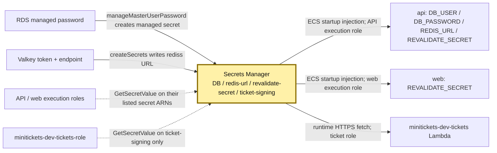
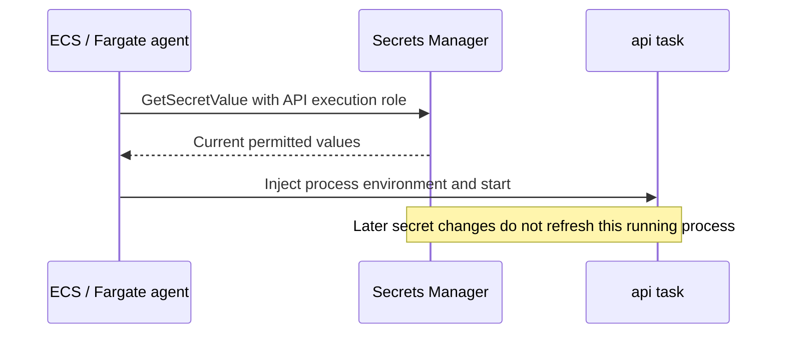

# Secrets Manager: the locked key safe

History: see [CHANGELOG.md](../CHANGELOG.md) or run `pnpm docs:history`

Area: AWS Data · Status: ✅ built in repository; live acceptance is separate
<!-- interview-card: v1 -->

## 1. In one line

Before MiniTickets api starts, ECS reads allowed values from [Secrets Manager](../glossary.md#secrets-manager), our key safe, and puts them into the worker process.

## 2. Where it sits

[Open this piece in the city explorer](../guides/infra-explorer.html?concept=secrets-manager#chapter=24&piece=secrets).

## 3. How it works

## 4. What happens in MiniTickets

1. RDS owns its managed username/password secret.
2. `minitickets/dev/redis-url` holds the full encrypted-connection URL.
3. `minitickets/dev/revalidate-secret` supplies the same value to api and web.
4. ECS reads those at task start. A rollout is needed to load changed values.
5. Only the ticket Lambda fetches `minitickets/dev/ticket-signing`; it caches a successful read in memory.

## 5. Reach / Allowed / Password

**Reach:** ECS tasks use their public outbound path to AWS HTTPS endpoints. Ticket Lambda is outside the VPC.

**Allowed:** the reading role needs `secretsmanager:GetSecretValue` for that ARN.

**Password:** AWS uses temporary role credentials to unlock the safe; the returned value authenticates the later app operation.

## 6. In our code

`infra/src/data/secrets.ts` → `createSecrets`.

`infra/src/compute/revalidate-secret.ts` → `createRevalidateSecret`.

`apps/worker/src/tickets/assets.ts` → `signingSecret`.

## 7. In the AWS console

Secrets Manager → Secrets → named secret → Overview / Rotation. Inspect metadata, not “Retrieve secret value.” IAM → Roles → reading role → Permissions shows its grant. [AWS access guide](https://docs.aws.amazon.com/secretsmanager/latest/userguide/auth-and-access_overview.html). RDS → Databases → `minitickets-dev-db` → Configuration links its managed secret. Live secrets were not read.

## 8. Good / Bad

**Good:** task definitions hold references; each reader gets only needed secrets.

**Bad:** injected values become stale; application code can still leak values it receives.

## 9. Other choices

- Pick runtime reads with bounded caching when updates must load without a task rollout.
- Pick a staged key ring when rotating signing keys must preserve existing tickets; it is not built here.

## 10. Connected to

| Neighbor | Direction | What allows it | Console check |
| --- | --- | --- | --- |
| [IAM badges](execution-vs-task-role.md) | Role → safe | Scoped `GetSecretValue` | Role → Permissions |
| [RDS](rds-postgres.md) | Managed credential → safe | RDS-managed password | RDS → Configuration |
| [Valkey](elasticache-valkey.md) | URL → api | Execution role + startup reference | Task definition → api → Secrets |
| [Lambda](aws-lambda.md) | Ticket worker → key | Ticket role + secret ARN | Lambda → Configuration → Permissions |

## 11. When it breaks

- Startup says access denied → attached execution policy and secret ARN → fix scoped grant.
- New connections reject password after rotation → compare process lifetime → roll out readers with fresh values.

## 12. Say it in 30 seconds

“We keep passwords in a key safe. ECS reads only the secrets its execution role allows, then injects a startup snapshot. The running task does not refresh automatically. Ticket signing has a separate runtime reader and key; rotation must preserve valid tickets.”

## 13. Likely follow-ups

- **Is a secret ARN secret?** No. It identifies the safe; permission unlocks it.
- **Does signing hide QR claims?** No. It proves authenticity; readable claims still need authorization.

## 14. Remember it

Changing the safe does not change keys already in a worker’s pocket.

## 15. More detail

Reference notes, source anchors and earlier useful detail

- Anchor: `infra/src/data/secrets.ts` · `createSecrets`: the redis-url secret and its value.

### Exact value shape and lifetime

`createSecrets` stores `rediss://:<token>@<primary-endpoint>:6379`: TLS, empty/default username and a 32-character alphanumeric token. `pulumi.secret` keeps the URL encrypted in Pulumi state and hidden in previews. Only the ARN leaves this layer.

RDS uses `manageMasterUserPassword: true`. API task fields `<secret-arn>:username::` and `:password::` select JSON keys; empty version slots select the current version. RDS normally rotates its managed master password every seven days; confirm live rotation configuration. Injected credentials do not follow rotation, so later database reconnects can fail until a safe rollout refreshes them. [AWS injection guide](https://docs.aws.amazon.com/AmazonECS/latest/developerguide/specifying-sensitive-data.html) requires new tasks for changed values.

The shared revalidation value is 64 alphanumeric characters. API and web task definitions reference the same secret, but deployments at different times can hold different snapshots. Rotate both readers coherently. Its ARN waits for the secret version to exist to avoid `AWSCURRENT` startup races.

Redis/revalidation secrets use `recoveryWindowInDays: 0` for dev teardown; deleted values cannot be recovered. Ticket signing uses seven days, stays outside compute/data switches and must agree with durable issued ticket records. `createTicketStorage` creates 32 random bytes represented by 64 hex characters. `TicketSigningSecret` validates that form; `signTicket` authenticates strict bounded claims with HMAC, and `verifyTicket` uses constant-time comparison. It neither encrypts claims nor makes a ticket single-use. The API role does not read that key.

No signing key ring or automatic signing-key rotation is built. A future transition needs key IDs, old verification keys, staged rollout and retirement after old ticket validity ends. Instantly replacing the only key invalidates old tokens.

Secrets Manager encrypts stored values and checks IAM. Default AWS-managed encryption keys are used here; a customer key requires its own policy/grant review. Secret reads are auditable through CloudTrail; do not log values. Separate expiry/rotation drills, access audits, compromise playbooks and per-environment keys are useful growth steps. OWASP review also covers abuse, dependencies, authorization and incident response.

The prior card's useful local checks remain `pnpm demo:tickets` and `pnpm demo:p4-assets`, run separately. They are demonstrations with local infrastructure, not evidence of live AWS authorization or delivery. Secrets Manager has storage/read charges; consult current pricing rather than an old estimate.

## Where it appears in the story

- [Infra story: 6. Secrets Manager](../infra-story.md#6-secrets-manager)
- [Big picture: 4. Components](../00-big-picture.md#4-components)
