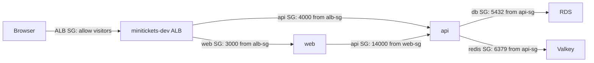

# Security groups: door guards with guest lists

History: see [CHANGELOG.md](../CHANGELOG.md) or run `pnpm docs:history`

Area: AWS Network · Status: ✅ built · Step docs: [13 security groups](../../13-infra-security-groups.md), [19 CloudFront](../../19-infra-cloudfront.md)
<!-- interview-card: v2 -->

## 1. What is it?

A [security group](../glossary.md#security-group) is a network guest list attached to an AWS resource. It allows connections from specified callers to specified ports.

## 2. Why do we need it?

Having a public address should not let anyone call the MiniTickets API directly. We admit the ALB, then let api reach the data stores it needs.

## 3. How does it work?

1. A new connection reaches the destination's security group.
2. Its caller and port must match an allow rule.
3. Replies pass automatically because the group remembers the connection.

## 4. How do we use it in MiniTickets?

Five groups guard ALB, web, api, RDS and Valkey. Source-group rules follow changing task addresses. Service Connect has separate proxy rules; database passwords remain a separate check.

## 5. Interview-ready answer

“MiniTickets uses security groups to allow only expected network connections: visitors to the ALB, ALB to applications, and api to data stores. Rules identify caller groups rather than temporary task addresses. Replies are automatically allowed. This controls network access; it does not grant AWS permissions or authenticate application users.”

## 6. Important follow-up questions

- **Can a security group deny one caller?** No. Its rules only allow; explicit denial needs another suitable layer.
- **Why reference groups instead of IPs?** Replaced tasks get new addresses but retain their assigned groups.
- **What if connections time out?** Check destination inbound rules, caller outbound rules and routes.
- **What is the main trade-off here?** Broad outbound access is simple, but gives compromised applications more destinations.

## 7. Advanced details

Technical reference

### Implementation, exact connections and operations

`infra/src/security.ts` → `createSecurityGroups` creates `minitickets-dev-alb-sg`, `minitickets-dev-web-sg`, `minitickets-dev-api-sg`, `minitickets-dev-db-sg` and `minitickets-dev-redis-sg`. Current ALB-only ingress is TCP 80/443 from `allowedCidrs`, default `0.0.0.0/0`, supplied by `infra/src/entry/alb-public-ingress.ts` → `createAlbPublicIngress`.

ALB→web uses 3000 from `alb-sg`; ALB→api uses 4000 from `alb-sg`. `infra/src/compute/service-connect.ts` → `createServiceConnect` adds web→api on 14000 and api→web on 13000, each from the caller's group. API→RDS uses 5432 and API→Valkey uses 6379, both from `api-sg`. Prefixes above abbreviate the real `minitickets-dev-` group names.

EC2 → Security Groups → filter `Project=minitickets` → Inbound / Outbound rules shows source IDs and ports. ECS → task → Networking shows attached groups; Tag Editor can find supported tagged resources. Live rules were not checked. Routes provide reach; IAM governs AWS calls; the database/cache/application separately authenticate credentials. Unexpected replacement in preview can come from a description change.

- Anchor: `infra/src/security.ts` · `createSecurityGroups`: five groups and their ingress/egress rules.

### Complete current rule picture

`security.ts` creates five groups, four unconditional app/data ingress rules, one optional CloudFront ingress rule and three outbound rules. `alb-public-ingress.ts` adds two ingress rules per allowed CIDR in current ALB-only mode. `service-connect.ts` adds two private proxy ingress rules. The old “five ingress rules total” count was stale.

ALB, web and api allow all IPv4 outbound traffic (`ipProtocol: "-1"`, `0.0.0.0/0`). `dbSg` and `redisSg` explicitly use `egress: []`; they initiate no app connections, and stateful replies still work. Rules are separate `aws.vpc.SecurityGroupIngressRule` resources so both referenced groups can exist first. Groups belong to the VPC and attach through the resource's group fields.

Optional CDN mode uses TCP 80 from `com.amazonaws.global.cloudfront.origin-facing`; it does not use today's `allowedCidrs` rules. The managed prefix list covers all CloudFront distributions, so the listener must also check `X-Origin-Verify`. AWS maintains the address list. Its documented weight has been 55 toward a default 60-rule quota; confirm current account quotas before adding rules. Group descriptions predate these changes; rules are authoritative. Changing the group description can force replacement, so it is deliberately left stale in code.

Default subnet network ACLs remain allow-all. ACLs are stateless and require return-path rules; security groups are stateful. Network Firewall/WAF address different inspection needs, and are not built here. Security groups have no separate hourly charge.

Missing ingress or a wrong port commonly gives ALB `Target.Timeout`. Removing `db-in-5432` would make new DB connections time out and `/ready` fail; this is a thought experiment, not a live change to perform. Read-only inspection: `aws ec2 describe-security-group-rules --filters Name=group-id,Values=<actual-group-id>`. Check api ingress includes both ALB 4000 and web proxy 14000 today.

### Related reading

- [ALB](alb.md)
- [Service Connect](service-connect.md)
- [RDS](rds-postgres.md)
- [Valkey](elasticache-valkey.md)

[Open this piece in the city explorer](../guides/infra-explorer.html?concept=security-groups#chapter=24&piece=alb-sg).

## Where it appears in the story

- [Infra story: 11. Security groups](../infra-story.md#11-security-groups)
- [Big picture: 4. Components](../00-big-picture.md#4-components)

