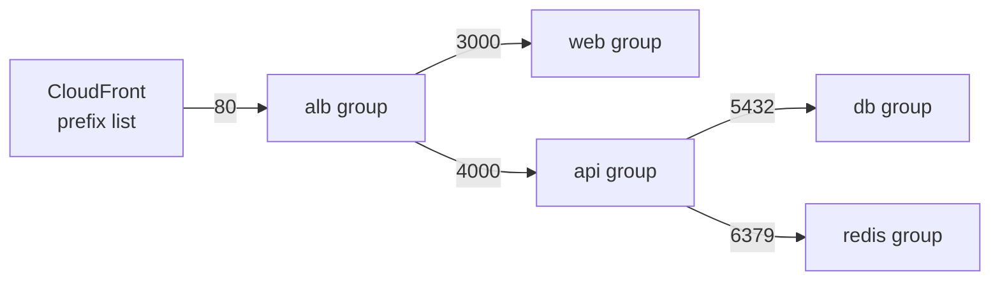

# Security groups: stateful, group references

History: see [CHANGELOG.md](../CHANGELOG.md) or run `pnpm docs:history`

Area: AWS Network · Status: ✅ built · Step docs: [13 security groups](../../13-infra-security-groups.md), [19 CloudFront](../../19-infra-cloudfront.md)

## 1. In one line

A **security group** is a stateful firewall attached to a resource: it lists which connections are
allowed in and out, everything else is blocked, and replies to allowed connections pass by
themselves.

## 2. Real-life comparison

A badge reader on each office door. The door to the server room says "only people wearing the api
badge". Whoever wears that badge today gets in, whatever desk they sit at.

## 3. Picture it



Every arrow is one ingress rule. Nothing else can reach anything.

## 4. Where in our code

- Anchor: `infra/src/security.ts` · `createSecurityGroups`: 5 groups, 5 ingress rules, 3 egress rules.

Step by step:

1. Five groups: `albSg`, `webSg`, `apiSg`, `dbSg`, `redisSg`, all in our VPC.
2. `dbSg` and `redisSg` have `egress: []`: AWS's default "allow all out" rule is removed. Postgres
   and Valkey never start connections; replies still work because groups are stateful.
3. Ingress rules are **separate resources** (`aws.vpc.SecurityGroupIngressRule`), created after both
   groups they mention exist:
   - `alb-in-80`: port 80 from the CloudFront prefix list (see [origin-protection](origin-protection.md)),
   - `web-in-3000` and `api-in-4000`: from `referencedSecurityGroupId: albSg.id`,
   - `db-in-5432` and `redis-in-6379`: from `referencedSecurityGroupId: apiSg.id`.
4. Egress rules: `alb`, `web` and `api` may go anywhere (`ipProtocol: "-1"`, `0.0.0.0/0`).
5. The groups are worn by: the ALB (`alb.ts` → `securityGroups`), the tasks
   (`service.ts`, `web-service.ts` → `networkConfiguration.securityGroups`), RDS
   (`postgres.ts` → `vpcSecurityGroupIds`) and Valkey (`cache.ts` → `securityGroupIds`).

## 5. See it yourself

```bash
cd infra
aws ec2 describe-security-group-rules --profile ticketlite \
  --filters Name=group-id,Values=$(pulumi stack output apiSgId) \
  --query "SecurityGroupRules[].[IsEgress,FromPort,ReferencedGroupInfo.GroupId,CidrIpv4]" --output table
```

Expect one inbound rule (4000 from the alb group's id) and one outbound rule (all, `0.0.0.0/0`).

**Break it on purpose (data + compute on, scratch branch, owner runs `pulumi up`, undo after):**
remove `db-in-5432`. New database connections hang and time out; `/ready` (via ECS Exec) answers 503.

## 6. How it connects

- **Uses ←** the [VPC](vpc.md).
- **Gives →** the **Reach** answer for every connection in the app; the first lock of
  [origin protection](origin-protection.md); network-level [least privilege](least-privilege.md).

## 7. Our settings and WHY

| Choice | Why |
| ------ | --- |
| Source = another **group**, not an IP range | Tasks get a new IP on every start. "From the api group" always means "whatever wears the api badge now". |
| One group per role (5) | Each door names exactly one expected caller. |
| No egress on db and redis | They never start connections; less to misuse. |
| Open egress on alb, web, api | They call several things (tasks, RDS, Valkey, AWS endpoints); listing them all would be brittle. |
| Rules as separate resources | A rule can reference a group that is created later; changing one rule does not touch the others. |
| alb group description left stale | AWS cannot edit a description; changing it would replace the group and everything wearing it. |

## 8. Trade-offs

- **Pros:** precise, identity-like rules that survive IP changes; default deny.
- **Cons:** open egress on three groups means a compromised task could call anywhere on the internet.

## 9. Alternatives and when to choose them

- **Network ACLs:** stateless, per subnet, allow and deny rules. Use as a coarse second layer (for
  example to block an IP range); we keep the default allow-all NACL.
- **Tight egress** (only 443 to VPC endpoints, 5432 to the db group): production with private
  subnets and endpoints.
- **AWS Network Firewall / WAF:** inspection by domain or HTTP content.

## 10. What breaks, and how we'd notice

| Mistake | Sign |
| ------- | ---- |
| Missing ingress rule | Timeouts; ALB target health `Target.Timeout` |
| Rule on the wrong port | Same as missing |
| Changing a group's description | `pulumi preview` shows a **replace** of the group |
| Second prefix-list rule on the alb group | Quota error: the CloudFront list counts as 55 of 60 rules |

## 11. Reach / Allowed / Password

The core of **Reach**. A security group never checks IAM or passwords.

## 12. Cost

Free.

## 13. Interview answers at 3 levels

- **Simple:** A security group is a firewall on a resource. Ours let each part talk only to the
  next one.
- **Senior:** They are stateful and default-deny. Our rules reference other groups instead of CIDRs:
  only the alb group reaches web on 3000 and api on 4000, only the api group reaches Postgres on
  5432 and Valkey on 6379, and the ALB accepts port 80 only from CloudFront's managed prefix list.
  The db and redis groups have no egress at all.
- **Lead:** Group references make the network rules read like an architecture diagram and survive
  autoscaling. For production I would also restrict egress, add VPC endpoints, and watch for
  group changes (Config rules or CloudTrail alerts), because one bad ingress rule undoes the design.

## 14. Follow-up questions interviewers ask

- *Stateful vs stateless?* Stateful remembers the connection and allows the reply; NACLs are
  stateless and need rules both ways.
- *Can a security group deny?* No, only allow. Use NACLs for explicit denies.
- *Why reference groups?* IPs change; group membership is the real identity.

## 15. Say it in 30 seconds

"Five security groups, one per role. Each ingress rule names exactly one caller group: ALB to web
and api, api to Postgres and Valkey, and CloudFront's prefix list to the ALB. They are stateful, so
the database groups don't even have outbound rules."

## 16. Status

✅ built.
