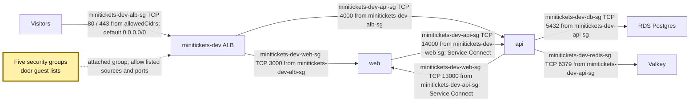
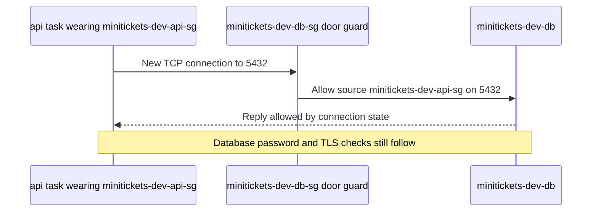

# Security groups: door guards with guest lists

History: see [CHANGELOG.md](../CHANGELOG.md) or run `pnpm docs:history`

Area: AWS Network · Status: ✅ built · Step docs: [13 security groups](../../13-infra-security-groups.md), [19 CloudFront](../../19-infra-cloudfront.md)
<!-- interview-card: v1 -->

## 1. In one line

When the MiniTickets ALB calls api, its [security group](../glossary.md#security-group) admits `minitickets-dev-alb-sg` on `4000`; other callers need their own listed rule.

## 2. Where it sits

[Open this piece in the city explorer](../guides/infra-explorer.html?concept=security-groups#chapter=24&piece=alb-sg).

## 3. How it works

## 4. What happens in MiniTickets

1. Five groups guard ALB, web, api, Postgres and Valkey.
2. Current ALB-only mode opens `80/443` from `allowedCidrs`, default `0.0.0.0/0`.
3. ALB reaches web `3000` and api `4000` through source-group rules.
4. Private Service Connect calls use `14000` toward api and `13000` toward web.
5. Only api reaches Postgres `5432` and Valkey `6379`. Replies pass automatically: this is “stateful.”

## 5. Reach / Allowed / Password

**Reach:** routes plus the destination guard's source/port rule.

**Allowed:** AWS API calls also need IAM permission; guards do not grant it.

**Password:** not checked by security groups; the database, cache or app checks it.

## 6. In our code

`infra/src/security.ts` → `createSecurityGroups`.

`infra/src/entry/alb-public-ingress.ts` → `createAlbPublicIngress`.

`infra/src/compute/service-connect.ts` → `createServiceConnect`.

## 7. In the AWS console

EC2 → Security Groups → filter `Project=minitickets` → group → Inbound rules / Outbound rules. Match the actual source group ID and port. ECS → task → Networking shows groups on a worker. Resource Groups & Tag Editor → Tag Editor can find tagged resources. Live rules were not checked.

## 8. Good / Bad

**Good:** source groups survive changing task IPs; replies need no extra return rule.

**Bad:** broad outbound rules allow unwanted calls after compromise; one wide inbound rule can expose a public task.

## 9. Other choices

- Pick tighter outbound rules plus endpoints when destinations are controlled.
- Pick network ACLs, subnet checkpoints, when explicit deny rules are needed.
- Pick WAF when inspecting HTTP content rather than network connections.

## 10. Connected to

| Neighbor | Direction | What allows it | Console check |
| --- | --- | --- | --- |
| [ALB](alb.md) | Visitor → reception | `allowedCidrs`, TCP 80/443 | minitickets-dev-alb-sg → Inbound |
| [Service Connect](service-connect.md) | web ↔ api | Source groups, 14000/13000 | minitickets-dev-api-sg / minitickets-dev-web-sg → Inbound |
| [RDS](rds-postgres.md) | api → data | minitickets-dev-db-sg, TCP 5432 from minitickets-dev-api-sg | minitickets-dev-db-sg → Inbound |
| [Valkey](elasticache-valkey.md) | api → sessions | minitickets-dev-redis-sg, TCP 6379 from minitickets-dev-api-sg | minitickets-dev-redis-sg → Inbound |

## 11. When it breaks

- Connection times out → destination Inbound and caller Outbound → fix port/source.
- Preview replaces a group → check changed description → avoid an unintended replacement.

## 12. Say it in 30 seconds

“Our door guards list exact callers: ALB to app ports, web and api to proxy ports, api to data ports. They remember allowed connections, so replies pass automatically. That is network access only; IAM permission and passwords remain separate.”

## 13. Likely follow-ups

- **Can a group deny one IP?** No. Rules only allow; use a suitable deny layer.
- **Why groups instead of task IPs?** Workers change addresses when replaced.

## 14. Remember it

A guard checks the caller and door number, not the application password.

## 15. More detail

Reference notes, source anchors and earlier useful detail

- Anchor: `infra/src/security.ts` · `createSecurityGroups`: 5 groups, 5 ingress rules, 3 egress rules.

### Complete current rule picture

`security.ts` creates five groups, four unconditional app/data ingress rules, one optional CloudFront ingress rule and three outbound rules. `alb-public-ingress.ts` adds two ingress rules per allowed CIDR in current ALB-only mode. `service-connect.ts` adds two private proxy ingress rules. The old “five ingress rules total” count was stale.

ALB, web and api allow all IPv4 outbound traffic (`ipProtocol: "-1"`, `0.0.0.0/0`). `dbSg` and `redisSg` explicitly use `egress: []`; they initiate no app connections, and stateful replies still work. Rules are separate `aws.vpc.SecurityGroupIngressRule` resources so both referenced groups can exist first. Groups belong to the VPC and attach through the resource's group fields.

Optional CDN mode uses TCP 80 from `com.amazonaws.global.cloudfront.origin-facing`; it does not use today's `allowedCidrs` rules. The managed prefix list covers all CloudFront distributions, so the listener must also check `X-Origin-Verify`. AWS maintains the address list. Its documented weight has been 55 toward a default 60-rule quota; confirm current account quotas before adding rules. Group descriptions predate these changes; rules are authoritative. Changing the group description can force replacement, so it is deliberately left stale in code.

Default subnet network ACLs remain allow-all. ACLs are stateless and require return-path rules; security groups are stateful. Network Firewall/WAF address different inspection needs, and are not built here. Security groups have no separate hourly charge.

Missing ingress or a wrong port commonly gives ALB `Target.Timeout`. Removing `db-in-5432` would make new DB connections time out and `/ready` fail; this is a thought experiment, not a live change to perform. Read-only inspection: `aws ec2 describe-security-group-rules --filters Name=group-id,Values=<actual-group-id>`. Check api ingress includes both ALB 4000 and web proxy 14000 today.

## Where it appears in the story

- [Infra story: 11. Security groups](../infra-story.md#11-security-groups)
- [Big picture: 4. Components](../00-big-picture.md#4-components)
