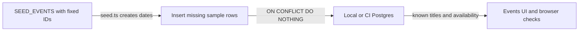

# Seed data

History: see [CHANGELOG.md](../CHANGELOG.md) or run `pnpm docs:history`

Area: Data · Status: ✅ built · Step doc: [21 events list](../../21-events-list.md)
<!-- interview-card: v2 -->

## 1. What is it?

Seed data is sample content loaded for development and tests. It gives a new MiniTickets database known events without mixing sample content into production migrations.

## 2. Why do we need it?

A fresh events page would otherwise be empty, and browser tests would have nothing predictable to find. Repeating setup should not duplicate every concert or overwrite someone’s edits unexpectedly.

## 3. How does it work?



1. Create sample event values with stable IDs.
2. Insert only rows that are missing during normal setup.
3. Close the script’s database connection when finished.

## 4. How do we use it in MiniTickets?

The normal seed preserves existing rows and their edits. A separate explicit local reset restores sample events and deletes their bookings transactionally. Reset checks that the database host is local. Seeds are absent from the production image.

## 5. Interview-ready answer

“MiniTickets seeds known sample events with fixed identifiers and insert-on-conflict-do-nothing. Normal reruns add missing rows without duplicating or overwriting them. Relative dates are set when rows are created, so old data does not move forward automatically. An explicit local reset has different, destructive semantics and must be treated separately from ordinary setup.”

## 6. Important follow-up questions

- **Why fixed IDs?** A rerun can identify the same logical sample row rather than create another copy.
- **Does rerunning refresh old dates?** No. Existing rows are preserved; resetting sample data is a separate operation.
- **Why keep seeds outside migrations?** Schema changes belong in every environment; demonstration content does not.
- **What is the test-isolation trade-off?** Shared seed data is fast, but per-test fixtures reduce interference between tests and repeated runs.

## 7. Advanced details

<details>
<summary>Technical reference</summary>

### Current reading notes

Current seed.ts imports SEED_EVENTS from seed-events.ts. Normal mode uses a one-connection pool and skips conflicts; --reset verifies a loopback host, deletes sample-event bookings and upserts restored events in one transaction. It deliberately changes those sample bookings. Historical first/second-run counts below are recorded evidence, not a seed executed during this rewrite.

### Implementation reference

- Anchor: `apps/api/src/db/seed.ts` · `rows`, `onConflictDoNothing()`: the sample events and the safe insert.

Step by step:

1. Like `migrate.ts`, the script reads only the database settings (`DatabaseEnvSchema`) and fails fast if they are wrong.
2. Dates are "days from now": 3 past events, 9 upcoming ones (45 to 400 days out). One upcoming and one past event have `seats_left = 0`.
3. Ids are fixed (`00000000-0000-4000-8000-0000000000NN`), so the same event is always the same row.
4. `insert ... on conflict do nothing` skips rows whose id exists. Local result: first run `12 new events, 0 already there`; second run `0 new events, 12 already there`.
5. It uses a one-connection pool and closes it at the end, like `migrate.ts`.

### Inspection and historical evidence

```bash
pnpm --filter @minitickets/api db:seed   # run it twice and compare the two messages
```

**Break it on purpose:** remove `.onConflictDoNothing()` and run it twice: the second run fails on
the duplicate primary key.

### Settings and reasoning

| Setting | Value | Why |
| ------- | ----- | --- |
| Ids | fixed | Makes "do nothing on conflict" possible. |
| Conflict rule | do nothing (not update) | A re-run never overwrites rows you changed by hand. |
| Dates | relative to the run | There is always a mix of past and upcoming events. |
| Where it runs | laptop and CI only | It is not in the production image. |

### Trade-offs

- **Pros:** one command gives a usable database; safe to repeat.
- **Cons:** relative dates are fixed when the row is first created, so after about 40 days the
  earliest "upcoming" events become past and a re-run will not refresh them (empty the table to reseed).

### Alternatives and scaling

- **Fixtures created inside each test:** best for isolation, slower and more code.
- **`on conflict do update`:** when the seed should reset rows to a known state.
- **Production data dumps:** realistic, but may hold personal data; avoid.

### Failure diagnosis

- Seed not run: `/events` shows "No upcoming events" and the events e2e test fails.
- Old local data: past "upcoming" events make the e2e test fail until the table is emptied and reseeded.

### Further questions

- *Why not random ids?* A second run would insert 12 more rows.
- *Why is the seed not part of migrations?* Migrations change structure and run everywhere, including AWS; sample data must not.

### Related reading

- [drizzle-schema](drizzle-schema.md)
- [migrations](migrations.md)
- [db-check-constraints](db-check-constraints.md)
- [e2e-tests](e2e-tests.md)

[Open this piece in the city explorer](../guides/infra-explorer.html?concept=seed-data#chapter=0&piece=laptop-postgres).

## Where it appears in the story

- [App story: 10b. Reading events](../app-story.md#10b-reading-events)

</details>
