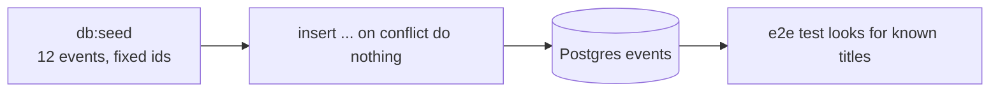

# Seed data

History: see [CHANGELOG.md](../CHANGELOG.md) or run `pnpm docs:history`

Area: Data · Status: ✅ built · Step doc: [21 events list](../../21-events-list.md)

## 1. In one line

**Seed data** is sample rows loaded by a script (`pnpm --filter @minitickets/api db:seed`), so a fresh
database has something to show and the e2e tests have known data to look for.

## 2. Real-life comparison

Stocking the shelves of a new shop before opening day. If you run the stocking job twice, you do not
want two copies of every product.

## 3. Picture it



## 4. Where in our code

- Anchor: `apps/api/src/db/seed.ts` · `rows`, `onConflictDoNothing()`: the sample events and the safe insert.

Step by step:

1. Like `migrate.ts`, the script reads only the database settings (`DatabaseEnvSchema`) and fails fast if they are wrong.
2. Dates are "days from now": 3 past events, 9 upcoming ones (45 to 400 days out). One upcoming and one past event have `seats_left = 0`.
3. Ids are fixed (`00000000-0000-4000-8000-0000000000NN`), so the same event is always the same row.
4. `insert ... on conflict do nothing` skips rows whose id exists. Local result: first run `12 new events, 0 already there`; second run `0 new events, 12 already there`.
5. It uses a one-connection pool and closes it at the end, like `migrate.ts`.

## 5. See it yourself

```bash
pnpm --filter @minitickets/api db:seed   # run it twice and compare the two messages
```

**Break it on purpose:** remove `.onConflictDoNothing()` and run it twice: the second run fails on
the duplicate primary key.

## 6. How it connects

- **Uses ←** [drizzle-schema](drizzle-schema.md), [migrations](migrations.md) (the tables must exist first), [db-check-constraints](db-check-constraints.md) (the seed rows must obey them).
- **Gives →** known data for [e2e-tests](e2e-tests.md); the CI e2e job runs it after the migrations.

## 7. Our settings and WHY

| Setting | Value | Why |
| ------- | ----- | --- |
| Ids | fixed | Makes "do nothing on conflict" possible. |
| Conflict rule | do nothing (not update) | A re-run never overwrites rows you changed by hand. |
| Dates | relative to the run | There is always a mix of past and upcoming events. |
| Where it runs | laptop and CI only | It is not in the production image. |

## 8. Trade-offs

- **Pros:** one command gives a usable database; safe to repeat.
- **Cons:** relative dates are fixed when the row is first created, so after about 40 days the
  earliest "upcoming" events become past and a re-run will not refresh them (empty the table to reseed).

## 9. Alternatives and when to choose them

- **Fixtures created inside each test:** best for isolation, slower and more code.
- **`on conflict do update`:** when the seed should reset rows to a known state.
- **Production data dumps:** realistic, but may hold personal data; avoid.

## 10. What breaks, and how we'd notice

- Seed not run: `/events` shows "No upcoming events" and the events e2e test fails.
- Old local data: past "upcoming" events make the e2e test fail until the table is emptied and reseeded.

## 13. Interview answers at 3 levels

- **Simple:** A script that fills the database with sample data.
- **Senior:** Fixed ids plus `on conflict do nothing` make it idempotent, so it is safe in CI and on a laptop that already has data.
- **Lead:** Seeds are for development and tests, never production. Decide between shared seed data (fast, couples tests) and per-test data (isolated, slower), and keep seed rules in line with the database constraints.

## 14. Follow-up questions interviewers ask

- *Why not random ids?* A second run would insert 12 more rows.
- *Why is the seed not part of migrations?* Migrations change structure and run everywhere, including AWS; sample data must not.

## 15. Say it in 30 seconds

"A db:seed script inserts 12 events with fixed ids using on conflict do nothing, so it is safe to run
twice. Dates are relative to now, so there are past and upcoming events. It runs on my laptop and in
CI before the e2e tests, never in production."

## 16. Status

✅ built.

## Where it appears in the story

- [App story: 10b. Reading events](../app-story.md#10b-reading-events)
