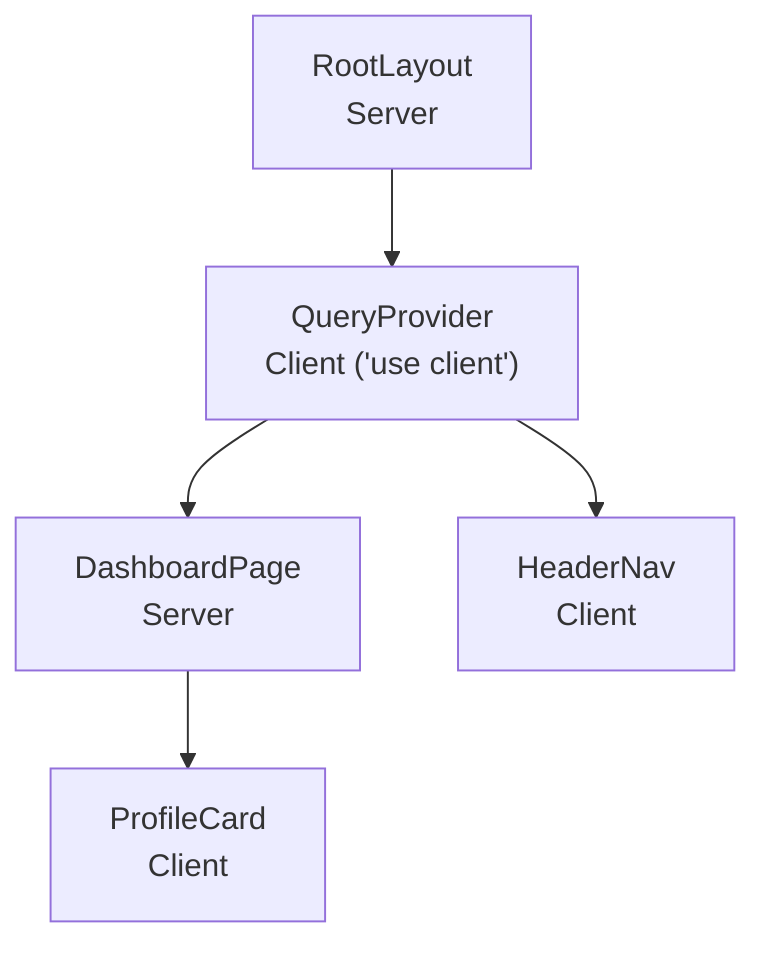
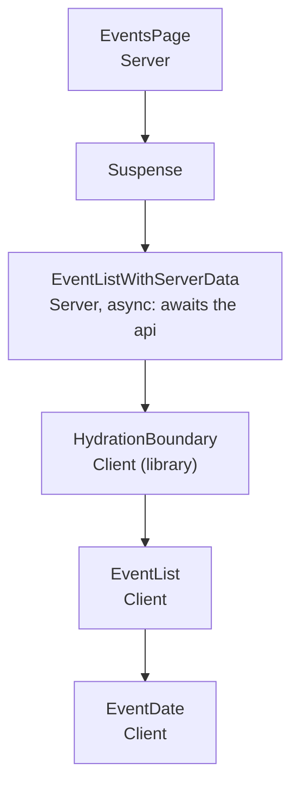

# Server Components vs Client Components

History: see [CHANGELOG.md](../CHANGELOG.md) or run `pnpm docs:history`

Area: Frontend · Status: ✅ built · Step doc: [03 landing](../../03-landing.md), [04 signup form](../../04-signup-form.md), [22 events SSR](../../22-events-ssr.md)

## 1. In one line

A **Server Component** runs only on the server and sends HTML (no component JavaScript); a
**Client Component** (`"use client"`) is also sent to the browser as JavaScript so it can use
state, effects and click handlers. A Server Component can also be `async` and **await data** while
it renders; `/events` does this since Step 22.

## 2. Real-life comparison

A printed menu versus a waiter. The printed menu (Server Component) is made once in the back and
handed over; it can't answer questions. The waiter (Client Component) stays at your table and
reacts to what you say, but you have to "pay" for them: more JavaScript to download.

## 3. Picture it



The Server `DashboardPage` is passed *into* the Client `QueryProvider` as `children`, so it stays a
Server Component.

The events page (Step 22) mixes both kinds, and one Server Component is `async`:



## 4. Where in our code

- Anchor: `apps/web/src/app/layout.tsx` · `RootLayout`: a Server Component (no state, no handlers).
- Anchor: `apps/web/src/providers/query-provider.tsx` · `QueryProvider`: a Client Component; it holds the `QueryClient` in `useState`.

Step by step:

1. Every file under `app/` is a Server Component unless it says `"use client"`. Ours:
   `RootLayout`, `HomePage`, `LoginPage`, `SignupPage`, `DashboardPage`, `EventsPage`,
   `LandingPage`, `FeaturesList`. `EventListSkeleton` has no directive and no state, so it works on
   either side (the `<Suspense>` fallback on the server, `EventList`'s loading state in the browser).
2. Files that start with `"use client"` (9): `QueryProvider`, `HeaderNav`, `Hero`, `LoginForm`,
   `SignupForm`, `ProfileCard`, `EventList`, `EventDate`, and `app/events/error.tsx`. Each needs a
   hook (`useState`, `useQuery`, `useRouter`, `useEffect`, `useSyncExternalStore`) or a click handler.
3. A Client Component can render Server Components it receives as props (`children`). That is why
   `RootLayout` can wrap the whole app in `QueryProvider` without turning every page into client
   code (the comment in `layout.tsx` explains this).
4. The server renders both kinds to HTML for the first load. Client Components are then
   **hydrated** in the browser: React attaches their state and event handlers to that HTML.
5. Data: most Client Components fetch through TanStack Query in the browser
   ([tanstack-query](tanstack-query.md)). Since Step 22 one Server Component fetches: on `/events`,
   `EventListWithServerData` (`app/events/page.tsx`) is `async` and awaits `prefetchEvents()`, which
   calls the api from the web server ([server-to-server-calls](server-to-server-calls.md)). It hands
   the data to the Client `EventList` through `HydrationBoundary` ([hydration](hydration.md)).
6. Props from a Server Component to a Client Component must be serialisable (plain JSON-like data):
   the dehydrated cache is, a function would not be.

## 5. See it yourself

```bash
grep -rl '^"use client"' apps/web/src     # the nine Client Component files
```

In the browser: open `/` with JavaScript disabled (DevTools → Command menu → "Disable JavaScript").
The landing text (Server) still shows. The header stays empty, because `HeaderNav` needs JavaScript
to ask `auth.me`.

**Break it on purpose:** delete `"use client"` from `profile-card.tsx`. `next build` fails: hooks
like `useQuery` cannot run in a Server Component.

## 6. How it connects

- **Uses ←** [app-router](app-router.md).
- **Gives →** the boundary where [tanstack-query](tanstack-query.md) and forms
  ([accessible-forms](accessible-forms.md)) live; less JavaScript for the static landing page;
  server-side data fetching for [csr-vs-ssr](csr-vs-ssr.md) and [streaming-suspense](streaming-suspense.md).

## 7. Our settings and WHY

| Component | Kind | Why |
| --------- | ---- | --- |
| `RootLayout`, pages, `FeaturesList` | Server | No state or handlers; ship no component JS. |
| `EventListWithServerData` | Server, `async` | Awaits the api on the server, so the list is in the HTML. |
| `EventList`, `EventDate` | Client | `useEvents` (query); `EventDate` re-renders once with the visitor's timezone. |
| `app/events/error.tsx` | Client | Error boundaries must be Client Components (Retry needs a click handler). |
| `QueryProvider` | Client | Holds the query cache for the browser session. |
| `HeaderNav`, `Hero`, `ProfileCard` | Client | Read `useMe` / `useProfile`. |
| `LoginForm`, `SignupForm` | Client | Form state, validation, focus. |

## 8. Trade-offs

- **Pros:** less JavaScript for static parts; secrets and server-only code can never reach the
  browser from a Server Component.
- **Cons:** a mental model to learn (which side does this run on?); a hook in the wrong file is a
  build error; our logged-in data is fetched only after hydration, so the header is empty for a
  moment (we render an empty `<nav>` instead of flashing the wrong links). An `async` Server Component
makes the server wait for data, so it needs a `<Suspense>` around it or the whole page waits.

## 9. Alternatives and when to choose them

- **All client (a single-page app):** simplest model, more JavaScript, slower first paint.
- **Fetch in Server Components** (call the api while rendering): the data is in the first HTML.
  Done for the public `/events` page (Step 22). For private pages (the dashboard) it would also need
  the session cookie forwarded; not done.

## 10. What breaks, and how we'd notice

- A hook in a Server Component: build error.
- A big library imported into a Client Component: bigger bundle; seen in `next build` output.
- Passing a non-serializable prop (a function) from Server to Client: build or runtime error.

## 13. Interview answers at 3 levels

- **Simple:** Server Components become HTML on the server; Client Components also run in the
  browser so they can be interactive.
- **Senior:** Pages and the layout are Server Components; the interactive pieces opt in with
  `"use client"`. The root layout wraps everything in a Client `QueryProvider`, but pages are passed
  as `children`, so they stay server-only. Most data is fetched client-side with TanStack Query;
  `/events` uses an `async` Server Component that prefetches on the server and hands the cache to
  the Client `EventList`.
- **Lead:** The boundary is a performance and security line: keep it as low in the tree as possible
  and push interactivity into small leaves. We fetch on the server for the public events page; doing
  it for the dashboard would remove its loading state, at the cost of forwarding the session cookie
  and never caching one user's render for another.

## 14. Follow-up questions interviewers ask

- *Does `"use client"` mean "not rendered on the server"?* No: it is still server-rendered to HTML
  on first load, then hydrated.
- *What is hydration?* React attaching state and handlers to server-made HTML.
- *Can a Server Component import a Client Component?* Yes. The reverse only works by passing it as
  `children` or another prop.

## 15. Say it in 30 seconds

"Our pages and layout are Server Components: HTML only, no component JavaScript. The interactive
parts, like the forms, the header and the event list, are Client Components. The layout wraps
everything in a client-side QueryProvider, but pages go in as children, so they stay on the server.
On /events an async Server Component fetches the data first and hands it to the client list."

## 16. Status

✅ built.

## Where it appears in the story

- [App story: 1. Browser → Next.js: layout, server vs client components, proxy guard](../app-story.md#1-browser--nextjs-layout-server-vs-client-components-proxy-guard)
- [App story: 10b. Reading events](../app-story.md#10b-reading-events) (an `async` Server Component that fetches)
