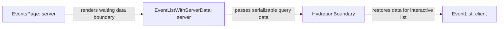

# Server Components vs Client Components

History: see [CHANGELOG.md](../CHANGELOG.md) or run `pnpm docs:history`

Area: Frontend · Status: ✅ built · Step doc: [03 landing](../../03-landing.md), [04 signup form](../../04-signup-form.md), [22 events SSR](../../22-events-ssr.md)
<!-- interview-card: v2 -->

## 1. What is it?

A Server Component runs on the server and sends its rendered result. A Client Component also ships JavaScript so the browser can manage state and respond to interaction.

## 2. Why do we need it?

MiniTickets headings do not need browser code, but signup forms need typing, validation and clicks. Splitting them keeps static work on the server while making only the needed parts interactive.

## 3. How does it work?



1. Render server-owned content and fetch the first search page.
2. Pass serializable data into the client boundary.
3. The browser attaches the interactive component’s state and handlers.

## 4. How do we use it in MiniTickets?

Pages and layout are server-owned. Forms, navigation and the event list use client components. A client provider can receive server-rendered children without turning their implementation into browser code. Current event prefetch uses `events.search`.

## 5. Interview-ready answer

“MiniTickets uses Server Components for route composition and server data loading, then small Client Components for interactions. Client Components can still produce initial server HTML before browser hydration. The boundary controls shipped code, not automatic secrecy: any data deliberately rendered or passed to the browser must be safe to expose.”

## 6. Important follow-up questions

- **Does use client disable server rendering?** No. It declares a browser-capable module boundary; initial HTML can still be rendered on the server.
- **Can server code pass any prop?** No. Boundary values must be supported for serialization; arbitrary client callbacks cannot cross from server code.
- **What if a client hook runs in a Server Component?** The build reports the invalid boundary; move the interaction into a client component.
- **What costs grow with client components?** Downloaded JavaScript, hydration work and browser state management.

## 7. Advanced details

<details>
<summary>Technical reference</summary>

### Current reading notes

Current examples below include older `events.list`/`useEvents` descriptions; catalogue prefetch and EventList now use infinite `events.search`/`useEventSearch`. The exact client-file count and old component inventory are historical, not a current limit. Server-only code must stay outside client imports; serializable props and rendered text still expose their contents.

### Implementation reference

- Anchor: `apps/web/src/app/layout.tsx` · `RootLayout`: a Server Component (no state, no handlers).
- Anchor: `apps/web/src/providers/query-provider.tsx` · `QueryProvider`: a Client Component; it holds the `QueryClient` in `useState`.

Step by step:

1. App Router pages/layouts begin in the server module graph. A use-client directive marks a client module boundary and its imported dependencies; render-tree ancestry alone does not decide where code runs. Earlier examples:
   `RootLayout`, `HomePage`, `LoginPage`, `SignupPage`, `DashboardPage`, `EventsPage`,
   `LandingPage`, `FeaturesList`. `EventListSkeleton` has no directive and no state, so it works on
   either side (the `<Suspense>` fallback on the server, `EventList`'s loading state in the browser).
2. Examples of files that start with `"use client"` include `QueryProvider`, `HeaderNav`, `Hero`, `LoginForm`,
   `SignupForm`, `ProfileCard`, `EventList`, `EventDate`, and `app/events/error.tsx`. Each needs a
   hook (`useState`, `useQuery`, `useRouter`, `useEffect`, `useSyncExternalStore`) or a click handler.
3. A Client Component can render server-prepared content passed as children/props; it must not import server-only implementation into its client module graph. That is why
   `RootLayout` can wrap the whole app in `QueryProvider` without turning every page into client
   code (the comment in `layout.tsx` explains this).
4. The server renders both kinds to HTML for the first load. Client Components are then
   **hydrated** in the browser: React attaches their state and event handlers to that HTML.
5. Data: most Client Components fetch through TanStack Query in the browser
   ([tanstack-query](tanstack-query.md)). Since Step 22 one Server Component fetches: on `/events`,
   `EventListWithServerData` (`app/events/page.tsx`) is `async` and awaits `prefetchEvents()`, which
   calls the api from the web server ([server-to-server-calls](server-to-server-calls.md)). It hands
   the data to the Client `EventList` through `HydrationBoundary` ([hydration](hydration.md)).
6. Props crossing from server to client must use React-supported serializable values, which include more than JSON. Our dehydrated query data fits. Arbitrary callbacks do not cross this boundary; supported Server Functions are a separate case.

### Inspection and historical evidence

```bash
grep -rl '^"use client"' apps/web/src     # list current Client Component files
```

In the browser: open `/` with JavaScript disabled (DevTools → Command menu → "Disable JavaScript").
The landing text (Server) still shows. The header stays empty, because `HeaderNav` needs JavaScript
to ask `auth.me`.

**Break it on purpose:** delete `"use client"` from `profile-card.tsx`. `next build` fails: hooks
like `useQuery` cannot run in a Server Component.

### Settings and reasoning

| Component | Kind | Why |
| --------- | ---- | --- |
| `RootLayout`, pages, `FeaturesList` | Server | No state or handlers; ship no component JS. |
| `EventListWithServerData` | Server, `async` | Awaits the api on the server, so the list is in the HTML. |
| `EventList`, `EventDate` | Client | `useEventSearch` (current catalogue query; `useEvents` remains the legacy list hook); `EventDate` re-renders once with the visitor's timezone. |
| `app/events/error.tsx` | Client | Error boundaries must be Client Components (Retry needs a click handler). |
| `QueryProvider` | Client | Holds the query cache for the browser session. |
| `HeaderNav`, `Hero`, `ProfileCard` | Client | Read `useMe` / `useProfile`. |
| `LoginForm`, `SignupForm` | Client | Form state, validation, focus. |

### Trade-offs

- **Pros:** less JavaScript for static parts; server-only implementation stays out of the browser bundle. Values deliberately passed to client props or rendered into the response still reach the browser.
- **Cons:** a mental model to learn (which side does this run on?); a hook in the wrong file is a
  build error; our logged-in data is fetched only after hydration, so the header is empty for a
  moment (we render an empty `<nav>` instead of flashing the wrong links). An `async` Server Component
makes the server wait for data, so it needs a `<Suspense>` around it or the whole page waits.

### Alternatives and scaling

- **All client (a single-page app):** simplest model, more JavaScript, slower first paint.
- **Fetch in Server Components** (call the api while rendering): the data is in the first HTML.
  Done for the public `/events` page (Step 22). For private pages (the dashboard) it would also need
  the session cookie forwarded; not done.

### Failure diagnosis

- A hook in a Server Component: build error.
- A big library imported into a Client Component: bigger bundle; seen in `next build` output.
- Passing a non-serializable prop (a function) from Server to Client: build or runtime error.

### Further questions

- *Does `"use client"` mean "not rendered on the server"?* No: it is still server-rendered to HTML
  on first load, then hydrated.
- *What is hydration?* React attaching state and handlers to server-made HTML.
- *Can a Server Component import a Client Component?* Yes. A client component can receive server-prepared content as children/props; it must not pull server-only implementation into the client module graph.

[React use-client reference](https://react.dev/reference/rsc/use-client) explains module boundaries and supported serialization.

### Related reading

- [app-router](app-router.md)
- [accessible-forms](accessible-forms.md)
- [csr-vs-ssr](csr-vs-ssr.md)
- [streaming-suspense](streaming-suspense.md)

[Open this piece in the city explorer](../guides/infra-explorer.html?concept=server-client-components#chapter=0&piece=laptop-web).

## Where it appears in the story

- [App story: 1. Browser → Next.js: layout, server vs client components, proxy guard](../app-story.md#1-browser--nextjs-layout-server-vs-client-components-proxy-guard)
- [App story: 10b. Reading events](../app-story.md#10b-reading-events) (an `async` Server Component that fetches)

</details>
