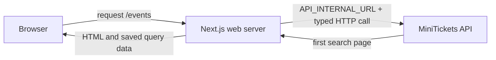

# Server-to-server calls (web server → API)

History: see [CHANGELOG.md](../CHANGELOG.md) or run `pnpm docs:history`

Area: Frontend · Status: ✅ built in repository; live AWS acceptance is separate
<!-- interview-card: v2 -->

## 1. What is it?

A server-to-server call goes from one backend process to another. For MiniTickets, the Next.js web server calls the separate API while preparing an events page.

## 2. Why do we need it?

The browser should receive an initial event list without first downloading JavaScript and requesting it. Web needs its own usable API address; a browser-relative URL is not enough on the server.

## 3. How does it work?

1. Read and validate the server-only API address at request time.
2. Call the API over HTTP and prepare the first result page.
3. Send rendered content and matching query data to the browser.

## 4. How do we use it in MiniTickets?

Web uses localhost locally and the api service name in Compose or ECS Service Connect. Browser calls have separate public configuration. Current event search is public, so this server client does not forward the visitor’s session cookie.

## 5. Interview-ready answer

“MiniTickets web and API remain separate applications. During event rendering, web uses a runtime server-only URL and a typed HTTP client to fetch data. The browser receives HTML and query data, then uses its own public API route. Private rendering would additionally need deliberate cookie forwarding and strict cache isolation.”

## 6. Important follow-up questions

- **Can the browser resolve the internal API name?** No. Use public same-origin routing for browser calls.
- **What if the internal URL is missing?** Lazy validation throws a clear server error; the events error boundary handles the render failure.
- **Does import type run API code in web?** No. The server client still makes a real HTTP request.
- **Could we prefetch private data the same way?** Only with deliberate credentials and per-user isolation; never put private responses in a shared cache.

## 7. Advanced details

Technical reference

### Current implementation

`apps/web/src/lib/server-env.ts` validates and memoizes `API_INTERNAL_URL` lazily, so image builds do not require runtime configuration. `apps/web/src/lib/trpc/server.ts` uses `httpLink` and a per-request QueryClient with no server retries. `prefetch-events.ts` now calls `events.search` as an infinite query. ECS Service Connect is implemented; old statements calling this integration proposed or saying AWS cannot reach api are obsolete. Live AWS acceptance remains pending.

### Technical limits and diagnosis

getServerEnv lazily validates and memoizes the runtime URL, keeping image build configuration separate. getServerTrpc is request-scoped and uses httpLink; browser batching is a separate client. The per-request QueryClient retries no server queries. Current public search forwards no visitor cookie. Private SSR would need explicit credential forwarding and isolation from shared caches.

Missing/invalid configuration throws at request time and can reach the events error boundary. A private-network failure needs alias, endpoint, route and source-group diagnosis before application passwords. Service Connect is built. The browser cannot resolve its private aliases. Public tasks avoid NAT in dev; private placement changes outbound reach and cost. No deployment or live network check occurred in this rewrite.

### Source anchors

- Anchor: `.github/workflows/ci.yml` — `module configuration`; follow the numbered comments at this boundary.
- Anchor: `apps/web/src/lib/server-env.ts` — `ServerEnvSchema`; follow the numbered comments at this boundary.
- Anchor: `apps/web/src/lib/trpc/server.ts` — `getServerTrpc`; follow the numbered comments at this boundary.
- Anchor: `docker-compose.yml` — `module configuration`; follow the numbered comments at this boundary.

### Related reading

- [current system](../00-big-picture.md)
- [scenario](../guides/interview-scenarios.md#network-boundaries)
- [explorer tour](../guides/infra-explorer.html?tour=database-reach)
- [infra-story: 4b. Private service discovery and asynchronous workers](../infra-story.md#4b-private-service-discovery-and-asynchronous-workers)

[Open this piece in the city explorer](../guides/infra-explorer.html?concept=server-to-server-calls#chapter=8&piece=web-task).

## Where it appears in the story

- [infra-story: 4b. Private service discovery and asynchronous workers](../infra-story.md#4b-private-service-discovery-and-asynchronous-workers)

