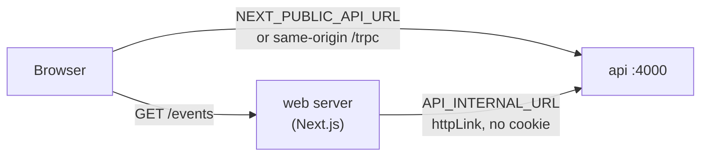

# Server-to-server calls (web server → API)

History: see [CHANGELOG.md](../CHANGELOG.md) or run `pnpm docs:history`

Area: Frontend · Status: 🟡 partial (verified locally; docker compose and CI configured; AWS not yet) · Step doc: [22 events SSR](../../22-events-ssr.md)

## 1. In one line

When the Next.js **server** renders `/events`, it calls the API itself, over HTTP, at a separate
address meant for servers (`API_INTERNAL_URL`), while the **browser** keeps using its own address.

## 2. Real-life comparison

Customers enter a shop by the front door; staff use the corridor behind the counters. Same shop,
different door, and the staff corridor is not on the customers' map.

## 3. Picture it

## 4. Where in our code

- Anchor: `apps/web/src/lib/server-env.ts` · `ServerEnvSchema`, `getServerEnv`: Zod-checks `API_INTERNAL_URL` (http/https) the first time a page needs it.
- Anchor: `apps/web/src/lib/trpc/server.ts` · `getServerTrpc`: a typed tRPC client with `httpLink({ url: API_INTERNAL_URL + "/trpc" })`, built once per request.
- Anchor: `docker-compose.yml` · `web.environment.API_INTERNAL_URL: http://api:4000` (the compose service name).
- Anchor: `.github/workflows/ci.yml` · e2e job `env.API_INTERNAL_URL: http://localhost:4000`.

Step by step:

1. `getServerEnv()` parses `process.env` with `ServerEnvSchema`. It runs at request time, not on
   import, because `next build` imports every page and the Docker image is built without run-time
   settings. A missing value throws `Invalid web server environment: …`, which the page's
   `error.tsx` catches.
2. No `NEXT_PUBLIC_` prefix: Next.js copies only `NEXT_PUBLIC_*` values into browser JavaScript, so
   this one stays on the server.
3. `getServerTrpc()` builds `createTRPCOptionsProxy<AppRouter>({ client, queryClient })`. The web
   still imports only `type AppRouter`; it talks to the API over HTTP like the browser does.
4. `httpLink`, not `httpBatchLink`: one call per render today, so batching buys nothing, and the
   API log shows a plain `/trpc/events.list`.
5. No cookies are forwarded: `events.list` is a `publicProcedure`. A private page would have to pass
   the visitor's `sid` cookie on purpose (and must never cache the result for other visitors).
6. If the call fails, `prefetchEvents` logs it and the browser fetches by itself (CSR fallback).

| Where | Browser uses | Web server uses |
| ----- | ------------ | --------------- |
| `pnpm dev` | `http://localhost:4000` | `http://localhost:4000` |
| docker compose | `http://localhost:4100` | `http://api:4000` |
| CI e2e | `http://localhost:4000` | `http://localhost:4000` |
| AWS | same origin `/trpc` | **not set** (planned: Service Connect) |

## 5. See it yourself

Watch the API's terminal while you `curl -s localhost:3000/events > /dev/null`: a request
`GET /trpc/events.list` appears, sent by the web server (no browser involved).

**Break it on purpose:** start the web app with `API_INTERNAL_URL=http://localhost:4119` (nothing
listens there). The page still shows the events (the browser fetches them), and the web server logs
`prefetchEvents: events.list failed on the server … ECONNREFUSED`. Remove the variable entirely and
`/events` shows the error boundary.

## 6. How it connects

- **Uses ←** [config-validation](config-validation.md) (Zod, fail with a clear message),
  [end-to-end-types](end-to-end-types.md) (`type AppRouter` only), [twelve-factor-config](twelve-factor-config.md)
  (run-time config, one image everywhere).
- **Gives →** [hydration](hydration.md) and [csr-vs-ssr](csr-vs-ssr.md): the data the server renders with.
  On AWS it needs [service-connect](service-connect.md) (planned).

## 7. Our settings and WHY

- **HTTP, not a direct function call** into the API's router: web and api stay separate services that
  can deploy and scale apart, and every call goes through the API's validation and logging.
- **A separate variable** from `NEXT_PUBLIC_API_URL`: the browser's address is often wrong from inside
  a server (published ports, the same-origin `/trpc` that a server cannot use, firewalls).
- **Required, not defaulted to localhost:** a silent default would hide a missing setting on AWS.

The decision and the options are recorded in [ADR 0001](../decisions/0001-ssr-calls-api-over-http.md).

## 8. Trade-offs

- **Pros:** short, fast path between servers; the browser makes one request fewer; typed end to end.
- **Cons:** one more setting per environment; the web server now depends on the API being up for
  the fastest path; the network must allow web → api (it does not on AWS today).

## 9. Alternatives and when to choose them

- **Call the router in-process** (`createTRPCOptionsProxy({ router, ctx })`): no network hop, but the
  web would run API code and need its database access: a monolith. Fine for a single Next.js app.
- **Go through the public URL** (CloudFront): works without network changes, but is slow and leaves the VPC.
- **No server call at all** (CSR, Step 21): simplest, but no data in the HTML.

## 10. What breaks, and how we'd notice

- Not set: `/events` shows the error boundary; the web log says `Invalid web server environment`.
- Wrong or unreachable: slower page (CSR fallback); the web log says `prefetchEvents: events.list failed`.
- Unreachable but **silent** (a firewall that drops packets instead of refusing): the list waits
  for the connection timeout before falling back. Not measured; a reason to add a timeout later.

## 13. Interview answers at 3 levels

- **Simple:** The web server asks the API for data before sending the page, using its own internal address.
- **Senior:** `API_INTERNAL_URL` is Zod-validated at request time, separate from the browser's
  `NEXT_PUBLIC_API_URL`; a per-request typed tRPC client calls the public `events.list` with no
  cookies; failures fall back to the browser fetch and are logged.
- **Lead:** Server-to-server traffic needs its own path, identity and limits: service discovery
  (Service Connect), a security-group rule web → api, timeouts and retries tuned for the render
  budget, and care with forwarded cookies so per-user data is never cached for everyone.

## 14. Follow-up questions interviewers ask

- *Why not reuse `NEXT_PUBLIC_API_URL` on the server?* On AWS it is empty (same origin), and a server
  cannot call a relative URL; in docker compose it points at a port published for the browser.
- *Is `API_INTERNAL_URL` a secret?* No, it is an address; it just has no reason to be public.
- *What about auth?* Not needed for public data. For private data, forward the `sid` cookie explicitly.

## 15. Say it in 30 seconds

"Rendering /events on the server means the Next.js server calls our API itself, at API_INTERNAL_URL,
validated with Zod at request time. The browser keeps its own address. It works locally, in docker
compose and in CI; on AWS the web task can't reach the API yet, so that part is planned with ECS
Service Connect."

## 16. Status

🟡 partial. Built and verified locally on a production build. Configured, but not run in this step:
docker compose (`http://api:4000`) and the CI e2e job. **Missing for AWS:** the web task cannot reach the API (the ALB accepts
only CloudFront, the api group only the ALB) and the web task definition has no `API_INTERNAL_URL`;
deploying this image today would show the error page on `/events`. Planned: [service-connect](service-connect.md).
Also missing for production: a request timeout on the server call.

## Where it appears in the story

- [App story: 10b. Reading events](../app-story.md#10b-reading-events)
- [Infra story: 4. ECS: cluster, service, task definition, task, Spot](../infra-story.md#4-ecs-cluster-service-task-definition-task-spot)
- [Big picture: 1. The whole system today](../00-big-picture.md#1-the-whole-system-today)
