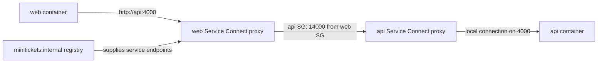

# ECS Service Connect and Cloud Map (service discovery)

History: see [CHANGELOG.md](../CHANGELOG.md) or run `pnpm docs:history`

Area: AWS Compute · Status: ✅ built in repository; live AWS acceptance is separate
<!-- interview-card: v2 -->

## 1. What is it?

Service Connect lets ECS applications find and call each other using private names. Small helper containers carry those calls between tasks even when task addresses change.

## 2. Why do we need it?

When MiniTickets web renders events, it must find api. Hard-coded task addresses would break after replacements; sending a neighbour request through the public website adds an unnecessary path.

## 3. How does it work?

1. ECS registers the services in a shared name registry.
2. Web calls the short api name; its proxy selects a destination.
3. The receiving proxy passes the request to the API container.

## 4. How do we use it in MiniTickets?

Web uses private api calls for server rendering. API uses the reverse private web path for signed cache revalidation. Browsers keep using the public ALB. Direct ALB traffic has its own application ports and does not traverse these receiving proxy ports.

## 5. Interview-ready answer

“Service Connect gives MiniTickets stable private application names backed by ECS-managed proxies and a shared registry. Web can call api without knowing task addresses, and api can call web for revalidation. Discovery, network permission and application authentication are separate checks. Existing tasks may need replacement to learn newly introduced endpoints.”

## 6. Important follow-up questions

- **Can browser JavaScript call api by this name?** No. The alias belongs to the task-side private discovery path.
- **What if a name exists but calls time out?** Check proxy readiness, routes and caller-to-proxy security-group rules.
- **Does the private path authenticate revalidation?** No. The web endpoint still checks its signed request.
- **Why separate ALB and proxy ports?** It preserves the public request path and its client-IP trust assumptions.

## 7. Advanced details

Technical reference

### Current implementation

Built source: `infra/src/compute/service-connect.ts` → `createServiceConnect` creates Cloud Map HTTP namespace `minitickets.internal`, API proxy 14000 from web SG, and web proxy 13000 from API SG. Application aliases remain api:4000/web:3000. No Route 53 DNS namespace is created. Fresh tasks learn endpoints; adding web initially can require one API redeployment. The loopback proxy path must not make arbitrary forwarded headers trusted. Live AWS acceptance remains pending.

### Technical limits and diagnosis

The Cloud Map HTTP namespace is a proxy service registry, not a Route 53 private DNS zone. Each task has an ENI (network interface). Fresh tasks learn the service endpoints; web waits for API creation, and introducing web initially can require one API redeployment. The ALB calls application ports directly, separate from the private proxy ingress path. Proxy loopback forwarded headers are untrusted.

For private call failures, inspect alias registration, proxy health, task age, routes and source-group rules separately. Routes provide reach, security groups permit network sources/ports, and application credentials protect application operations. AWS API calls use scoped IAM grants. Security groups are stateful; subnet NACLs are stateless. No AWS endpoint needs inbound task security-group rules merely because an outside-VPC Lambda calls it.

Public dev tasks avoid NAT but need strict inbound rules. Private tasks require deliberate outbound NAT/endpoints. Map real egress and proxy trust before adding segmentation, IPv6 or flow logs. This is a built integration; earlier proposed-feature text was obsolete.

### Related reading

- [current system](../00-big-picture.md)
- [scenario](../guides/interview-scenarios.md#network-boundaries)
- [explorer tour](../guides/infra-explorer.html?tour=database-reach)
- [Every IAM badge](../guides/infra-build-along.md#every-iam-badge-who--what--attached)
- [infra-story: 4b. Private service discovery and asynchronous workers](../infra-story.md#4b-private-service-discovery-and-asynchronous-workers)

[Open this piece in the city explorer](../guides/infra-explorer.html?concept=service-connect#chapter=11&piece=namespace).

## Where it appears in the story

- [infra-story: 4b. Private service discovery and asynchronous workers](../infra-story.md#4b-private-service-discovery-and-asynchronous-workers)

