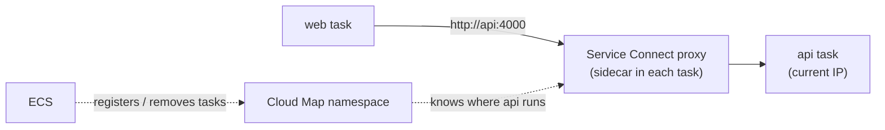
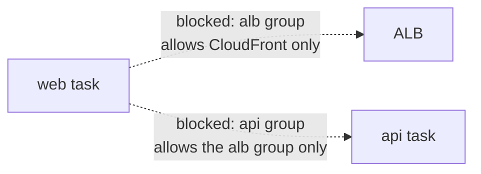

# ECS Service Connect and Cloud Map (service discovery)

History: see [CHANGELOG.md](../CHANGELOG.md) or run `pnpm docs:history`

Area: AWS Compute · Status: 📋 planned · Step doc: [22 events SSR](../../22-events-ssr.md) (section 7, why it is needed)

## 1. In one line

**Service Connect** is an ECS feature that gives each service a private name (for example
`http://api:4000`) that other services in the same namespace can call directly inside the VPC;
**Cloud Map** is the AWS name registry it uses behind the scenes. We plan it so the web task can
reach the api task for server-side rendering.

## 2. Real-life comparison

An internal phone directory. Instead of calling the company's public number and going through
reception (CloudFront and the ALB), staff dial the colleague's extension. The directory always knows
which desk the colleague sits at today, even after they move (a task is replaced and gets a new IP).

## 3. Picture it

Today (the reason we need it): the web task cannot reach the api at all.

## 4. Where in our code

Not in our app yet. What we would build, and where (an infra step, run by the owner with `pulumi up`):

1. A Cloud Map namespace for the cluster (a new file in `infra/src/compute/`, next to `cluster.ts`).
2. A **port name** on the api container's port mapping in `infra/src/compute/task.ts` (`createApiTask`),
   because Service Connect refers to ports by name.
3. `serviceConnectConfiguration` on the api service (`infra/src/compute/service.ts`, `createApiService`):
   a server with the client alias `api` on port 4000.
4. `serviceConnectConfiguration` on the web service (`infra/src/compute/web-service.ts`,
   `createWebService`) as a client only.
5. A security-group rule in `infra/src/security.ts`: the api group allows the **web** group on 4000
   (today only the alb group).
6. `API_INTERNAL_URL=http://api:4000` in the web task definition (`infra/src/compute/web-task.ts`).

Nothing in the app changes: the web server already reads `API_INTERNAL_URL`
([server-to-server-calls](server-to-server-calls.md)).

## 5. See it yourself

Not in our app yet. After the infra step: ECS Exec into the web task and run
`node -e "fetch('http://api:4000/health').then(r => r.text()).then(console.log)"`, then check that
`/events` on CloudFront has the titles in its HTML (`curl -s https://<id>.cloudfront.net/events`).
Break it on purpose: remove the web → api security-group rule; `/events` still shows events (browser
fallback) but the web log says `prefetchEvents: events.list failed on the server`.

## 6. How it connects

- **Uses ←** [ecs-service](ecs-service.md), [task-definition](task-definition.md),
  [security-groups](security-groups.md), [vpc](vpc.md).
- **Gives →** [server-to-server-calls](server-to-server-calls.md) on AWS, which completes
  [csr-vs-ssr](csr-vs-ssr.md) ("SSR on AWS").

## 7. Our settings and WHY

Planned settings: one namespace for the dev cluster, the api as the only server, the web as a client,
port 4000, plain HTTP inside the VPC (like the ALB → task hop today). WHY Service Connect over the
other options: it keeps the path inside the VPC and needs no second load balancer.

## 8. Trade-offs

- **Pros:** short private path; names survive task replacement; no extra load balancer; per-call
  metrics from the proxy (according to AWS docs; not tried yet).
- **Cons:** a proxy sidecar in every task uses some of our small task's CPU and memory (¼ vCPU,
  512 MB); more ECS settings to learn; only works between ECS services in the same namespace.

## 9. Alternatives and when to choose them

| Option | Choose it when |
| ------ | -------------- |
| Service Connect / Cloud Map (planned) | services on ECS talking to each other inside one VPC |
| Plain Cloud Map DNS (service discovery without the proxy) | you want only DNS names, no sidecar; clients handle retries themselves |
| Internal ALB | you need ALB features (path rules, health checks) between services, and can pay for a second ALB |
| The API's public URL (CloudFront) | a quick stopgap: works with today's infra by only setting `API_INTERNAL_URL`, but slow and leaves the VPC |

## 10. What breaks, and how we'd notice

- Missing security-group rule: the web server's call fails; the CSR fallback hides it from users,
  but the web log shows `prefetchEvents: events.list failed`.
- Name not resolvable (web service not in the namespace as a client): same symptom.
- The proxy sidecar unhealthy or short of memory: calls fail or tasks restart; seen in ECS events and
  task stopped reasons.

## 11. Reach / Allowed / Password

- **Reach:** a new ingress rule on the api group: port 4000 from the web group. Both tasks are in
  our VPC, so no route changes.
- **Allowed:** no new IAM role is expected for the tasks; ECS registers the tasks in Cloud Map
  itself. To be verified in the infra step (and drawn with trust/permission/attached diagrams if any
  IAM changes after all).
- **Password:** none. `events.list` is public. A private page would forward the visitor's `sid` cookie.

## 12. Cost

Not measured, and we are unsure of the exact numbers. Check the current AWS pricing pages for ECS
Service Connect and Cloud Map before building. The extra CPU and memory used by the proxy sidecar
counts against our Fargate task size.

## 13. Interview answers at 3 levels

- **Simple:** It gives each ECS service a private name so other services can call it directly.
- **Senior:** Our web task must call the api for SSR, but the ALB accepts only CloudFront and the
  api accepts only the ALB. Service Connect registers the api in a Cloud Map namespace and injects a
  proxy into each task, so the web calls `http://api:4000`; we add one security-group rule web → api.
- **Lead:** Service discovery is the first step of service-to-service networking: identity,
  timeouts, retries and observability follow. For two services, Service Connect beats an internal
  ALB on cost; for many services or other runtimes, a mesh or internal load balancers become reasonable.

## 14. Follow-up questions interviewers ask

- *Why not just use the task's IP?* It changes every time the task is replaced (deploys, Spot interruptions).
- *Why not call the public URL?* It leaves the VPC, adds CloudFront latency and cost, and depends on the edge.
- *Is the traffic encrypted?* Plain HTTP inside the VPC in our plan, like ALB → task today; production
  would consider TLS between services.

## 15. Say it in 30 seconds

"For server-side rendering on AWS the web task has to call the api directly, but our ALB accepts only
CloudFront. The plan is ECS Service Connect: the api registers as `api:4000` in a Cloud Map namespace,
the web task calls that name through a sidecar proxy, and one security-group rule allows web to api."

## 16. Status

📋 planned. Until it is built, "SSR on AWS" stays 🟡 ([csr-vs-ssr](csr-vs-ssr.md)).

## Where it appears in the story

- [Infra story: 4. ECS: cluster, service, task definition, task, Spot](../infra-story.md#4-ecs-cluster-service-task-definition-task-spot)
- [Big picture: 1. The whole system today](../00-big-picture.md#1-the-whole-system-today)
