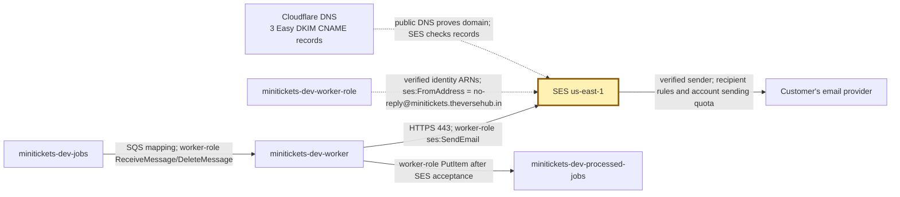
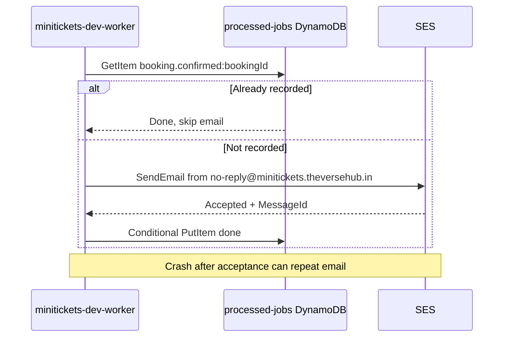

# SES: the city mail office

History: see [CHANGELOG.md](../CHANGELOG.md) or run `pnpm docs:history`

Area: AWS Compute · Status: ✅ built in repository; live AWS acceptance is separate
<!-- interview-card: v1 -->

## 1. In one line

MiniTickets gives its booking email to [SES](../glossary.md#ses), AWS's mail service; SES accepting it does not prove it reached an inbox.

## 2. Where it sits

[Open this piece in the city explorer](../guides/infra-explorer.html?concept=ses-email#chapter=24&piece=ses).

## 3. How it works

## 4. What happens in MiniTickets

1. The worker validates the booking message; it needs no Postgres lookup.
2. It checks whether this booking's email was already recorded.
3. `SesMailer.send` uses `no-reply@minitickets.theversehub.in`, UTF-8 subject and text body.
4. SES checks sender identity, IAM and account limits; sandbox accounts also restrict recipients.
5. After acceptance, the worker records done and logs the SES ID, not the customer's address.

## 5. Reach / Allowed / Password

**Reach:** worker outside the VPC calls SES over HTTPS 443.

**Allowed:** `minitickets-dev-worker-role` grants `ses:SendEmail` on named identities with an exact FromAddress.

**Password:** temporary role credentials; no SMTP password because we use the API.

## 6. In our code

`apps/worker/src/ses-mailer.ts` → `SesMailer.send`; `apps/worker/src/handlers/booking-confirmed.ts` → `handleBookingConfirmed`.

`infra/src/jobs/email.ts` → `createEmail`; `infra/src/jobs/worker-iam.ts` → `createWorkerRole`.

## 7. In the AWS console

`us-east-1` → **Amazon SES → Configuration → Verified identities → minitickets.theversehub.in → Authentication**: DKIM records/status. **Account dashboard** shows sandbox/production access and quotas. These account facts were not rechecked live; code comments record an earlier sandbox state.

## 8. Good / Bad

**Good:** booking does not wait for email; sender permissions are narrow.

**Bad:** accepted mail may bounce or land in spam; retry/crash windows can send twice.

## 9. Other choices

- Pick SES when AWS identity/permission integration fits your mail needs.
- Pick another mail provider when its delivery tools or templates justify the integration.

## 10. Connected to

| Neighbor | Direction | What allows it | Console check |
| --- | --- | --- | --- |
| [Lambda](aws-lambda.md) | in | `ses:SendEmail` + identity | IAM → worker-role → Permissions |
| [DynamoDB](dynamodb.md) | after | Completed booking job key | DynamoDB → processed-jobs → Items |
| [DLQ](dead-letter-queue.md) | failure | Source queue redrive policy | SQS → jobs → Dead-letter queue |

## 11. When it breaks

- Identity/recipient rejected → SES identities and sandbox state → verify required identities; owner requests production access when needed.
- Throttled → account sending rate → reduce/pace work; concurrency does not raise the quota.

## 12. Say it in 30 seconds

“MiniTickets sends confirmation mail in a dedicated worker through SES. The domain is verified by DNS records, and IAM limits the sender. A successful API call means SES accepted the email, not inbox delivery. We record completion afterward, accepting a small duplicate window. Bounce and complaint processing is still future work.”

## 13. Likely follow-ups

**What does DKIM do?** A DNS-published key lets recipients check our mail signature.

**Does more Lambda concurrency raise SES capacity?** No.

## 14. Remember it

A mail-office receipt proves handover, not arrival.

## 15. More detail

Identity, delivery gaps and later work

- Anchor: `apps/worker/src/ses-mailer.ts` — `SesMailer`; follow the numbered comments at this boundary.
- Anchor: `infra/src/jobs/email.ts` — `createEmail`; follow the numbered comments at this boundary.

Easy DKIM creates and rotates signing keys; MiniTickets requests `RSA_2048_BIT`. Add its three CNAME records in Cloudflare with proxy off (DNS only). Tokens are public, not secret. SES verifies records asynchronously; historical source comments allow up to 72 hours. Domain identities exist whenever domainName is configured, independently of compute switches. `no-reply` needs no mailbox; MiniTickets receives no mail. An optional verified test recipient comes from secret Pulumi config. No private address is printed here.

New SES sandbox accounts normally have 200 messages/day and 1/second limits, but current account/region state must be checked rather than inferred from old comments. [AWS explains sandbox and verification restrictions](https://docs.aws.amazon.com/ses/latest/dg/request-production-access.html). Identity status is in [Verified identities](https://docs.aws.amazon.com/ses/latest/dg/verify-addresses-and-domains.html). Our role lists configured identity ARNs and a FromAddress restriction. No custom MAIL FROM, DMARC workflow, provider feedback processing, suppression preferences or production quota drill is built. A proposed feedback route would fan out into another queue/service; an email API success is not a delivery/read receipt.

Local `LogMailer` writes safe logs without sending real mail. `SesMailer` logs the recipient domain and SES MessageId; failed messages retry then reach the email DLQ. Send-before-record and simultaneous workers leave duplicate windows. Provider-side idempotency or a processing lease would change those trade-offs; neither is built. At greater scale, plan sender reputation, feedback/suppression, templates/localization and sending-rate control. See [scenario](../guides/interview-scenarios.md#ses-email) and deploy-day runbook §3.10. Live inbox delivery is not claimed; costs require current regional/account checks.

## Where it appears in the story

- [app-story: 9c. Side path: outbox, fan-out and recoverable work](../app-story.md#9c-side-path-outbox-fan-out-and-recoverable-work)
