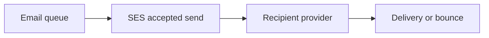

# Amazon SES (sending email)

History: see [CHANGELOG.md](../CHANGELOG.md) or run `pnpm docs:history`

Area: AWS Compute · Status: ✅ built in repository; live AWS acceptance is separate

## 1. In one line

SES sends confirmation mail using a verified identity and FromAddress IAM constraint. Acceptance is not inbox delivery; sandbox/quotas are account state to recheck. DKIM is defined, feedback processing/custom MAIL FROM/DMARC are not built.

## 2. Real-life comparison

A durable work tray keeps the task after the customer leaves; a completed stamp identifies a repeat.

## 3. Picture it

## 4. Where in our code

- Anchor: `apps/worker/src/ses-mailer.ts` — `SesMailer`; follow the numbered comments at this boundary.
- Anchor: `infra/src/jobs/email.ts` — `createEmail`; follow the numbered comments at this boundary.

`infra/src/jobs/email.ts` configures the SES identity; `apps/worker/src/ses-mailer.ts` sends with a stable configured sender. `docs/20-deploy-day.md` §3.10 covers owner acceptance. Proposed feedback events would fan into a separate queue/service updating suppression preferences. No live inbox delivery claim.

## 5. See it yourself

Use the linked scenario and tour to trace the existing integration point. This proposed extension has no runnable feature demo.

Failure thought experiment: Does more Lambda concurrency increase SES quota? No. Do not change a live stack to demonstrate it.

## 6. How it connects

Uses the [current system](../00-big-picture.md); gives a concrete decision to the [scenario](../guides/interview-scenarios.md#ses-email) and [explorer tour](../guides/infra-explorer.html?tour=failing-email).

## 7. Our settings and WHY

SES sends confirmation mail using a verified identity and FromAddress IAM constraint. Acceptance is not inbox delivery; sandbox/quotas are account state to recheck. DKIM is defined, feedback processing/custom MAIL FROM/DMARC are not built. Offloading mail protects booking latency but delivery is still an external outcome.

## 8. Trade-offs

SES quotas can bottleneck a fast Lambda. Retrying permanent bad addresses wastes work. Mark-after-send leaves a duplicate window.

## 9. Alternatives and when to choose them

10x: production quota/rate and suppression. 100x: reputation monitoring, templates/localization and provider outcome ingestion.

## 10. What breaks and how we notice

Does more Lambda concurrency increase SES quota? No.

## 11. Reach / Allowed / Password

Prove the network path separately from the scoped IAM action and the runtime credential. [Every IAM badge](../guides/infra-build-along.md#every-iam-badge-who--what--attached) shows trust, permissions and attachment. No AWS endpoint needs an inbound SG simply because a non-VPC Lambda calls it.

## 12. Cost

Existing resource/usage costs are detailed in the corresponding infra guide chapter. No new resources were deployed by this documentation change. Historical phase costs are illustrative snapshots, not a current quote; inspect billing and current regional pricing before a capacity decision.

## 13. Interview answers at 3 levels

- **Simple:** SES sends confirmation mail using a verified identity and FromAddress IAM constraint.
- **Senior:** A successful SendEmail means SES accepted the request, not that the recipient read it. Verify identity/DKIM, respect sandbox/production access and sending rate, then handle bounce/complaint outcomes. MiniTickets has a dedicated mail worker and scoped SES permission. Custom MAIL FROM/SPF/DMARC workflows and bounce processing are explain-only.
- **Lead:** 10x: production quota/rate and suppression. 100x: reputation monitoring, templates/localization and provider outcome ingestion.

## 14. Follow-up questions with answers

Does more Lambda concurrency increase SES quota? No.

What does SendEmail success prove? **SES accepted the request.**

## 15. Say it in 30 seconds

A successful SendEmail means SES accepted the request, not that the recipient read it. Verify identity/DKIM, respect sandbox/production access and sending rate, then handle bounce/complaint outcomes. MiniTickets has a dedicated mail worker and scoped SES permission. Custom MAIL FROM/SPF/DMARC workflows and bounce processing are explain-only.

## 16. Status and production work

Repository implementation and local evidence are described above. Live AWS/CI execution remains owner acceptance. 10x: production quota/rate and suppression. 100x: reputation monitoring, templates/localization and provider outcome ingestion.

## Where it appears in the story

- [app-story: 9c. Side path: outbox, fan-out and recoverable work](../app-story.md#9c-side-path-outbox-fan-out-and-recoverable-work)
