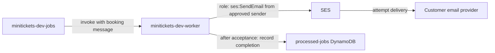

# SES: the city mail office

History: see [CHANGELOG.md](../CHANGELOG.md) or run `pnpm docs:history`

Area: AWS Compute · Status: ✅ built in repository; live AWS acceptance is separate
<!-- interview-card: v2 -->

## 1. What is it?

[SES](../glossary.md#ses) is AWS's email-sending service. Accepting a message means SES took responsibility for sending it, not that it reached the customer's inbox.

## 2. Why do we need it?

MiniTickets needs booking confirmations without making checkout depend on an email provider. A worker sends mail after booking, and retries temporary failures separately from the purchase.

## 3. How does it work?

1. The worker validates the message and checks whether it already completed.
2. It asks SES to send the confirmation.
3. After SES accepts, it records completion for later retries.

## 4. How do we use it in MiniTickets?

`SesMailer.send` uses our configured no-reply sender. Booking messages contain the required facts, so no database lookup is needed. Local development uses `LogMailer`; live inbox delivery remains owner acceptance. Repeated failures eventually reach the email DLQ.

## 5. Interview-ready answer

“MiniTickets sends confirmation email asynchronously through SES. We verify the sender and restrict what the worker may send. SES acceptance is a handover receipt, not proof of inbox delivery. Recording completion afterward reduces repeated sends but leaves a crash window. Bounce, complaint and suppression handling still need separate work.”

## 6. Important follow-up questions

- **What if sending succeeds but recording fails?** A retry may send again; our current flow cannot promise exactly one email.
- **What does DKIM prove?** A recipient can verify a signature using the sender domain's published key; inbox placement is separate.
- **Can more workers fix throttling?** No. Pace sends to the provider's current limits.
- **How would we know about bounces?** We need provider feedback processing; that workflow is not built.

## 7. Advanced details

Technical reference

### Configuration and security

`minitickets-dev-worker-role` allows sending from `no-reply@minitickets.theversehub.in` using `ses:SendEmail`; IAM permits configured verified identity ARNs and the exact `ses:FromAddress`. This uses API role credentials rather than an SMTP password. Its role records completion with DynamoDB `PutItem` only after SES acceptance.

`SesMailer.send` uses a UTF-8 subject and text body. The booking message supplies the facts; no Postgres lookup is needed. SES checks identity, IAM and account limits; sandbox recipients are restricted too. Successful acceptance logs the SES MessageId rather than the customer address; worker HTTPS reach alone does not grant sending permission.

### Implementation and operational limits

- Anchor: `apps/worker/src/ses-mailer.ts` — `SesMailer`; follow the numbered comments at this boundary.
- Anchor: `infra/src/jobs/email.ts` — `createEmail`; follow the numbered comments at this boundary.

Easy DKIM creates and rotates signing keys; MiniTickets requests `RSA_2048_BIT`. Add its three CNAME records in Cloudflare with proxy off (DNS only). Tokens are public, not secret. SES verifies records asynchronously; historical source comments allow up to 72 hours. Domain identities exist whenever domainName is configured, independently of compute switches. `no-reply` needs no mailbox; MiniTickets receives no mail. An optional verified test recipient comes from secret Pulumi config. No private address is printed here.

New SES sandbox accounts normally have 200 messages/day and 1/second limits, but current account/region state must be checked rather than inferred from old comments. [AWS explains sandbox and verification restrictions](https://docs.aws.amazon.com/ses/latest/dg/request-production-access.html). Identity status is in [Verified identities](https://docs.aws.amazon.com/ses/latest/dg/verify-addresses-and-domains.html). Our role lists configured identity ARNs and a FromAddress restriction. No custom MAIL FROM, DMARC workflow, provider feedback processing, suppression preferences or production quota drill is built. A proposed feedback route would fan out into another queue/service; an email API success is not a delivery/read receipt.

Local `LogMailer` writes safe logs without sending real mail. `SesMailer` logs the recipient domain and SES MessageId; failed messages retry then reach the email DLQ. Send-before-record and simultaneous workers leave duplicate windows. Provider-side idempotency or a processing lease would change those trade-offs; neither is built. At greater scale, plan sender reputation, feedback/suppression, templates/localization and sending-rate control. See [scenario](../guides/interview-scenarios.md#ses-email) and deploy-day runbook §3.10. Live inbox delivery is not claimed; costs require current regional/account checks.

### Source references

`apps/worker/src/ses-mailer.ts` → `SesMailer.send`; `apps/worker/src/handlers/booking-confirmed.ts` → `handleBookingConfirmed`.

`infra/src/jobs/email.ts` → `createEmail`; `infra/src/jobs/worker-iam.ts` → `createWorkerRole`.

### Console and troubleshooting

`us-east-1` → **Amazon SES → Configuration → Verified identities → minitickets.theversehub.in → Authentication**: DKIM records/status. **Account dashboard** shows sandbox/production access and quotas. These account facts were not rechecked live; code comments record an earlier sandbox state.

- Identity/recipient rejected → SES identities and sandbox state → verify required identities; owner requests production access when needed.
- Throttled → account sending rate → reduce/pace work; concurrency does not raise the quota.

### Trade-offs and related concepts

- Pick SES when AWS identity/permission integration fits your mail needs.
- Pick another mail provider when its delivery tools or templates justify the integration.

| Neighbor | Direction | What allows it | Console check |
| --- | --- | --- | --- |
| [Lambda](aws-lambda.md) | in | `ses:SendEmail` + identity | IAM → worker-role → Permissions |
| [DynamoDB](dynamodb.md) | after | Completed booking job key | DynamoDB → processed-jobs → Items |
| [DLQ](dead-letter-queue.md) | failure | Source queue redrive policy | SQS → jobs → Dead-letter queue |

[Open this piece in the city explorer](../guides/infra-explorer.html?concept=ses-email#chapter=24&piece=ses).

## Where it appears in the story

- [app-story: 9c. Side path: outbox, fan-out and recoverable work](../app-story.md#9c-side-path-outbox-fan-out-and-recoverable-work)

