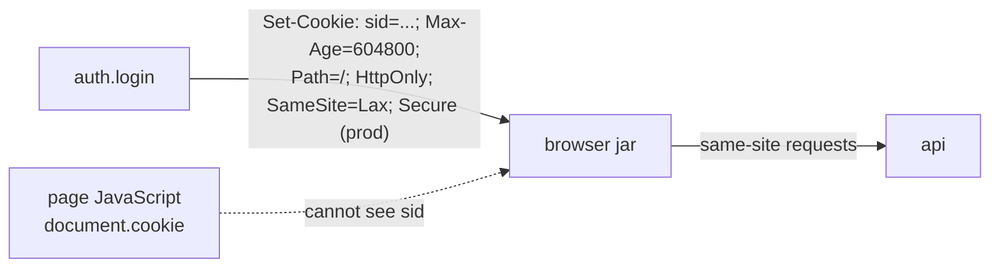

# Session cookie flags: HttpOnly, SameSite, Secure

History: see [CHANGELOG.md](../CHANGELOG.md) or run `pnpm docs:history`

Area: Auth & Security · Status: ✅ built · Step doc: [07 login](../../07-login-session.md)

## 1. In one line

The `sid` cookie is **HttpOnly** (page JavaScript can't read it), **SameSite=Lax** (not sent on
cross-site POSTs), **Secure** in production (HTTPS only), `Path=/`, and lives 7 days.

## 2. Real-life comparison

A hotel key card that works only on your door (Path), can't be photocopied by the shop next door
(HttpOnly), only works when you come in through the hotel's own entrance (SameSite), and only over
the secure corridor (Secure).

## 3. Picture it



## 4. Where in our code

- Anchor: `apps/api/src/procedures/auth.ts` · `cookieOptions`, `login` (`setCookie`), `logout` (`clearCookie`).
- Anchor: `apps/web/e2e/login.spec.ts` · step 3: `document.cookie` does not contain `sid`.

Step by step:

1. `cookieOptions = { httpOnly: true, sameSite: "lax", path: "/", secure: env.NODE_ENV === "production" }`.
2. Login: `ctx.res.setCookie("sid", sessionId, { ...cookieOptions, maxAge: SESSION_MAX_AGE_SECONDS })`.
3. Logout: `clearCookie("sid", cookieOptions)`. The same attributes matter: a browser only replaces
   the cookie when name, path (and domain) match.
4. `Secure` is on wherever `NODE_ENV=production` (the Docker images and ECS). On AWS the browser
   talks HTTPS to CloudFront, so it works; plain-HTTP `localhost` dev keeps it off.
5. No `Domain` attribute: the cookie belongs to the exact host that set it.

## 5. See it yourself

Recorded against a local api:

```text
set-cookie: sid=aZzY…; Max-Age=604800; Path=/; HttpOnly; SameSite=Lax
set-cookie: sid=; Max-Age=0; Path=/; Expires=Thu, 01 Jan 1970 00:00:00 GMT; HttpOnly; SameSite=Lax   (logout)
```

In the browser: DevTools → Application → Cookies: `sid` with ✓ HttpOnly, SameSite `Lax`, and on
AWS ✓ Secure. In the Console, `document.cookie` does not show `sid`.

**Break it on purpose:** set `httpOnly: false`. The e2e test `login.spec.ts` fails at "The session
cookie is HttpOnly", and any XSS bug could now read the session.

## 6. How it connects

- **Uses ←** [sessions-vs-jwt](sessions-vs-jwt.md) (the value), [config-validation](config-validation.md)
  (`NODE_ENV`), HTTPS from [cloudfront](cloudfront.md).
- **Gives →** protection against [xss](xss.md) cookie theft and part of [csrf](csrf.md); read by
  [route-guard-proxy](route-guard-proxy.md) (exists or not).

## 7. Our settings and WHY

| Flag | Value | Why |
| ---- | ----- | --- |
| `HttpOnly` | true | XSS can't steal the session. |
| `SameSite` | `Lax` | Not sent on cross-site POSTs or fetches; still sent when a user follows a link to us. |
| `Secure` | production only | HTTPS only; localhost is HTTP. |
| `Path` | `/` | Valid for pages and `/trpc`. |
| `Max-Age` | 604800 | Same as the Redis TTL. |

## 8. Trade-offs

- **Pros:** strong browser-enforced defaults with no extra code.
- **Cons:** `Lax` still sends the cookie on top-level GET navigations from other sites (so GETs
  must never change data); local dev runs without `Secure`.

## 9. Alternatives and when to choose them

- **`SameSite=Strict`:** never sent from another site, even following a link (user arrives logged
  out). Good for admin apps.
- **`__Host-` cookie prefix:** forces `Secure`, `Path=/` and no `Domain` (needs HTTPS everywhere,
  including dev).
- **Tokens in `localStorage`:** readable by any script; avoid for sessions.

## 10. What breaks, and how we'd notice

- `Secure` on plain HTTP: the browser drops the cookie; login "succeeds" but you stay logged out.
- Different attributes on clear: logout leaves the cookie. The logout e2e test reloads and checks.

## 13. Interview answers at 3 levels

- **Simple:** The login cookie is locked down so scripts and other sites can't use it.
- **Senior:** `sid` is HttpOnly, SameSite=Lax, Path=/, Secure in production, Max-Age 7 days, set in
  the procedure (an HTTP concern), and cleared with the same attributes. An e2e test proves page
  JavaScript can't read it.
- **Lead:** Cookie flags are the cheapest strong defence: HttpOnly limits XSS impact, SameSite cuts
  most CSRF, Secure needs HTTPS end to end at the browser. I'd add the `__Host-` prefix and an Origin
  check for state-changing requests.

## 14. Follow-up questions interviewers ask

- *Lax vs Strict?* Strict never sends cross-site; Lax allows top-level GET navigations.
- *Why isn't HttpOnly enough against XSS?* The script can still send requests as the user; it just
  can't steal the cookie.

## 15. Say it in 30 seconds

"The sid cookie is HttpOnly, SameSite=Lax, Path=/, Secure in production, and lives 7 days like the
Redis session. It's set in the procedure, cleared with identical attributes, and an e2e test checks
that page JavaScript can't see it."

## 16. Status

✅ built.

## Where it appears in the story

- [App story: 7. The procedure](../app-story.md#7-the-procedure)
