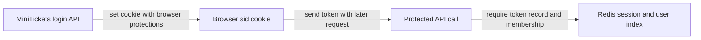

# Session cookie flags: HttpOnly, SameSite, Secure

History: see [CHANGELOG.md](../CHANGELOG.md) or run `pnpm docs:history`

Area: Auth & Security · Status: ✅ built in repository; live AWS acceptance is separate
<!-- interview-card: v2 -->

## 1. What is it?

A session cookie carries a random login token between the browser and MiniTickets. Its flags control when browsers send it and whether page JavaScript may read it.

## 2. Why do we need it?

The browser needs to remember a login without holding a password on every request. A random token lets the server recognize that login and revoke it centrally.

## 3. How does it work?

1. Login sets a fresh random token in the cookie.
2. The browser sends it according to the cookie rules.
3. The API checks the corresponding server-side session before trusting it.

## 4. How do we use it in MiniTickets?

Our cookie is HttpOnly, uses SameSite=Lax and is Secure in production. Page guards check only presence for navigation. The Redis record and user-index membership remain the login authority.

## 5. Interview-ready answer

“MiniTickets puts only a random session token in its cookie. HttpOnly prevents page JavaScript reading it, SameSite limits some cross-site sending, and Secure requires HTTPS in production. These flags reduce exposure but do not establish authorization. The API still verifies the server-side session and checks permission for the requested action.”

## 6. Important follow-up questions

- **Does HttpOnly stop every XSS effect?** No. Injected code can still act through the trusted page even without reading the cookie.
- **Does cookie presence mean logged in?** No. It may be fake, expired or revoked.
- **Why is Secure off locally?** Local development uses HTTP; production requires HTTPS.
- **What if Redis loses membership?** The session fails closed and the user must log in again.

## 7. Advanced details

Technical reference

### Source references

- Anchor: `apps/api/src/procedures/auth.ts` — `cookieOptions`; follow the numbered comments at this boundary.
- Anchor: `apps/web/e2e/login.spec.ts` — `module configuration`; follow the numbered comments at this boundary.

`apps/api/src/queries/sessions.ts` implements indexed creation/read/revokeAll; `services/users.ts` revokes around makeAdmin. `pnpm demo:security` checks old-cookie, all-device and role revocation. Cookies are HttpOnly/SameSite with Secure in production. An in-flight authorized request cannot be recalled; two-store role/revocation is not a global transaction.

### Configuration and design

The sid cookie carries only an opaque random token. HttpOnly/SameSite apply, Secure is production-only, max age is seven days, and server-side token/index membership is authoritative; page cookie presence is UX only. A role embedded forever in a session becomes stale after a privilege change.

### Checks and troubleshooting

Run `pnpm demo:security` and inspect the asserted outcome described above.

Is the presence cookie authorization? No; it only avoids a predictable redirect flash; API verifies the real session. Do not change a live stack to demonstrate it.

What happens if session membership is missing? **Authentication fails closed.**

### Trade-offs and alternatives

Redis/index eviction fails closed and forces login. The 20-device bound makes revoke work bounded. Session-versioning/transactional role changes are proposed improvements for larger deployments.

10x: monitor auth-store failures and session churn. 100x: coordinated auth versioning, device management and key/credential rotation.

### Further technical context

Opaque session cookies keep revocation server-side; JWTs reduce lookup dependence but revocation/role changes need expiry or another authoritative version. MiniTickets hashes random tokens in Redis, rotates login sessions, indexes at most 20 devices and checks membership on every read. Admin authorization reads Postgres; role changes revoke sessions before and after the update.

### Related reading

Uses the [current system](../00-big-picture.md); gives a concrete decision to the [scenario](../guides/interview-scenarios.md#sessions-roles) and [explorer tour](../guides/infra-explorer.html?tour=security-layers).

[Open this piece in the city explorer](../guides/infra-explorer.html?concept=session-cookie#chapter=5&piece=valkey).

## Where it appears in the story

- [app-story: 5b. Session identity, roles and revocation](../app-story.md#5b-session-identity-roles-and-revocation)

