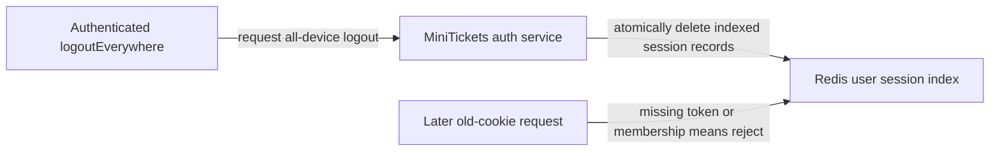

# Session revocation

History: see [CHANGELOG.md](../CHANGELOG.md) or run `pnpm docs:history`

Area: Auth & Security · Status: ✅ built in repository; live AWS acceptance is separate
<!-- interview-card: v2 -->

## 1. What is it?

Session revocation cancels an existing login on the server. The old browser cookie can remain present while its authority has disappeared.

## 2. Why do we need it?

If someone loses a laptop, simply clearing a cookie on their phone will not log the laptop out. MiniTickets needs a way to cancel every stored session belonging to that user.

## 3. How does it work?

1. Find the user’s bounded session index.
2. Delete its session records and the index together.
3. Reject later requests whose token or membership no longer exists.

## 4. How do we use it in MiniTickets?

Every read checks both the hashed token record and index membership. Login rotates the previous token; logoutEverywhere revokes indexed devices. Role changes revoke before and after their Postgres update, with explicit cross-store and in-flight limits.

## 5. Interview-ready answer

“MiniTickets uses server-side sessions so we can revoke access before cookie expiry. Every read requires both the token record and user-index membership. All-device logout removes the bounded set atomically in Redis. This stops later checks, but it cannot recall work already authorized or make a role change across two stores one transaction.”

## 6. Important follow-up questions

- **Why check the index as well as the token?** If membership disappears, surviving records cannot revive access.
- **Does revocation stop an in-flight action?** No. It affects subsequent authority checks.
- **Why limit devices?** It bounds storage and all-device revocation work.
- **What is the larger-scale improvement?** A coordinated session-version or authorization design can make role transitions easier to reason about.

## 7. Advanced details

Technical reference

### Source references

- Anchor: `apps/api/src/queries/sessions.ts` — `SESSION_TTL_SECONDS`; follow the numbered comments at this boundary.
- Anchor: `apps/api/src/services/users.ts` — `makeAdmin`; follow the numbered comments at this boundary.

`apps/api/src/queries/sessions.ts` implements indexed creation/read/revokeAll; `services/users.ts` revokes around makeAdmin. `pnpm demo:security` checks old-cookie, all-device and role revocation. Cookies are HttpOnly/SameSite with Secure in production. An in-flight authorized request cannot be recalled; two-store role/revocation is not a global transaction.

### Configuration and design

Revocation removes an existing login's authority. Every read requires the hashed token and user-index membership; the sorted-set index caps devices at 20, login rotates and logoutEverywhere deletes all indexed sessions. A role embedded forever in a session becomes stale after a privilege change.

### Checks and troubleshooting

Run `pnpm demo:security` and inspect the asserted outcome described above.

Is the presence cookie authorization? No; it only avoids a predictable redirect flash; API verifies the real session. Do not change a live stack to demonstrate it.

What happens if session membership is missing? **Authentication fails closed.**

### Trade-offs and alternatives

Redis/index eviction fails closed and forces login. The 20-device bound makes revoke work bounded. Session-versioning/transactional role changes are proposed improvements for larger deployments.

10x: monitor auth-store failures and session churn. 100x: coordinated auth versioning, device management and key/credential rotation.

### Further technical context

Opaque session cookies keep revocation server-side; JWTs reduce lookup dependence but revocation/role changes need expiry or another authoritative version. MiniTickets hashes random tokens in Redis, rotates login sessions, indexes at most 20 devices and checks membership on every read. Admin authorization reads Postgres; role changes revoke sessions before and after the update.

### Related reading

Uses the [current system](../00-big-picture.md); gives a concrete decision to the [scenario](../guides/interview-scenarios.md#sessions-roles) and [explorer tour](../guides/infra-explorer.html?tour=security-layers).

[Open this piece in the city explorer](../guides/infra-explorer.html?concept=session-revocation#chapter=5&piece=valkey).

## Where it appears in the story

- [app-story: 5b. Session identity, roles and revocation](../app-story.md#5b-session-identity-roles-and-revocation)

