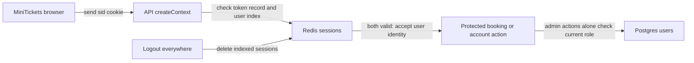

# Sessions vs JWT: the visitor badge register

History: see [CHANGELOG.md](../CHANGELOG.md) or run `pnpm docs:history`

Area: Auth & Security · Status: ✅ built in repository; live AWS acceptance is separate

<!-- interview-card: v2 -->

## 1. What is it?

A session keeps login authority on the server; the browser holds a random reference to it. A JSON Web Token (JWT) carries signed information, such as a user ID, that services can verify without looking up a session.

## 2. Why do we need it?

A MiniTickets user logs out on every device after losing a laptop. The server must cancel those devices’ login authority even though they still hold old cookies.

## 3. How does it work?

1. Login creates a fresh random cookie and a server record.
2. Every protected request checks that record and its membership in the user’s index.
3. Logout removes authority; an old cookie then cannot authorize another request.

## 4. How do we use it in MiniTickets?

`createContext` verifies `sid` through Redis. Login replaces the incoming session; logout revokes one device or all indexed devices. Admin actions read the current role from Postgres. A UI presence cookie only helps navigation and never authorizes work.

## 5. Interview-ready answer

“MiniTickets uses random session cookies with authority stored in Redis. Every read checks the token record and user index, allowing one-device or all-device revocation. Admin actions check the current database role. JWTs could avoid that lookup, but prompt revocation and role changes would need expiry or another authoritative check. Our choice trades an authentication-store dependency for centralized control.”

## 6. Important follow-up questions

- **What if session state is evicted?** Authentication fails closed; the user must log in again.
- **Can logout stop an authorized request already running?** No. It blocks later authorization checks.
- **Can JavaScript read the session cookie?** No. `HttpOnly` prevents that access; other protections still matter.
- **Are role change and revocation atomic?** No. They span Postgres and Redis, so races remain.

## 7. Advanced details

Technical reference

### Session lifecycle and authorization

The [session](../glossary.md#session) uses **32 random bytes** in cookie `sid`. `apps/api/src/queries/sessions.ts` → `create`, `get`, `revokeAll` stores user ID and creation time under a hashed-token key for **7 days**. An index tracks at most **20 devices**, bounding revocation work. Every read requires token record and index membership; missing/evicted state fails closed.

`apps/api/src/services/auth.ts` → `login`, `logoutEverywhere` verifies the password, creates a fresh session and deletes the token record named by the incoming `sid`. Logout deletes one; atomic `REVOKE` deletes all indexed records and the index. Cookies use HttpOnly, SameSite=Lax and Secure in production. The presence cookie only avoids a predictable redirect flash; the API verifies the real session.

`apps/api/src/trpc/context.ts` → `createContext` supplies identity to `protectedProcedure`. `adminProcedure` uses `isAdmin` to read the current Postgres role. `services/users.ts` revokes sessions before and after `makeAdmin`. A role embedded indefinitely in a session or JWT becomes stale. Already authorized work cannot be recalled, and Postgres role update plus Redis revocation is not one global transaction. Session-versioning/transactional role coordination are possible improvements, not current guarantees.

### Reach and troubleshooting

Browser → HTTPS `/trpc` passes ALB to `minitickets-dev-api-sg` TCP 4000. API → [Valkey](elasticache-valkey.md) uses TCP 6379, with `minitickets-dev-redis-sg` admitting `minitickets-dev-api-sg`; `REDIS_URL` uses TLS. API → [RDS](rds-postgres.md) uses TCP 5432 through its DB group for password/current role. The login password begins authority; `sid` then acts as a bearer credential. [Rate limiting](rate-limiting.md) uses the verified session user for booking quotas.

Console: ElastiCache → Valkey caches → `minitickets-dev-valkey` for health, not raw login tokens. CloudWatch → Logs → `/minitickets/dev/api` for failures. No AWS screen lists sessions. Sudden logouts suggest eviction/index loss; restore headroom and log in again. An old badge accepted later suggests inspecting revoke/index membership, allowing for an already authorized request finishing.

### Alternatives, evidence and growth

JWTs support offline verification across independent services; comparable revocation/role freshness needs expiry or authoritative versions. A managed identity provider can outsource federation and account recovery. `pnpm demo:security` checks old-cookie, all-device and role revocation locally; no new execution or live AWS/CI acceptance is claimed here.

At 10x, monitor auth-store failures and session churn; at 100x, consider coordinated auth versions, device management and key/credential rotation. Read the [current system](../00-big-picture.md), [sessions/roles scenario](../guides/interview-scenarios.md#sessions-roles) and [security tour](../guides/infra-explorer.html?tour=security-layers).

### Code anchors

- Anchor: `apps/api/src/queries/sessions.ts` — `StoredSession`; follow the numbered comments at this boundary.
- Anchor: `apps/api/src/services/auth.ts` — `logout`; follow the numbered comments at this boundary.

[Open this piece in the city explorer](../guides/infra-explorer.html?concept=sessions-vs-jwt#chapter=24&piece=valkey).

## Where it appears in the story

- [app-story: 5b. Session identity, roles and revocation](../app-story.md#5b-session-identity-roles-and-revocation)

