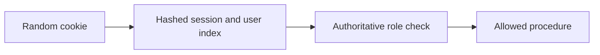

# Server-side sessions in Redis vs JWT (and logout)

History: see [CHANGELOG.md](../CHANGELOG.md) or run `pnpm docs:history`

Area: Auth & Security · Status: ✅ built in repository; live AWS acceptance is separate

## 1. In one line

Opaque Redis sessions trade an auth-store lookup for immediate indexed revocation. Current roles come from Postgres only where needed; JWT claims would need expiry/version checks for equivalent role revocation.

## 2. Real-life comparison

A visitor badge can be cancelled in the central register, even if someone still holds the paper copy.

## 3. Picture it

## 4. Where in our code

- Anchor: `apps/api/src/queries/sessions.ts` — `StoredSession`; follow the numbered comments at this boundary.
- Anchor: `apps/api/src/services/auth.ts` — `logout`; follow the numbered comments at this boundary.

`apps/api/src/queries/sessions.ts` implements indexed creation/read/revokeAll; `services/users.ts` revokes around makeAdmin. `pnpm demo:security` checks old-cookie, all-device and role revocation. Cookies are HttpOnly/SameSite with Secure in production. An in-flight authorized request cannot be recalled; two-store role/revocation is not a global transaction.

## 5. See it yourself

Run `pnpm demo:security` and inspect the asserted outcome described above.

Failure thought experiment: Is the presence cookie authorization? No; it only avoids a predictable redirect flash; API verifies the real session. Do not change a live stack to demonstrate it.

## 6. How it connects

Uses the [current system](../00-big-picture.md); gives a concrete decision to the [scenario](../guides/interview-scenarios.md#sessions-roles) and [explorer tour](../guides/infra-explorer.html?tour=security-layers).

## 7. Our settings and WHY

Opaque Redis sessions trade an auth-store lookup for immediate indexed revocation. Current roles come from Postgres only where needed; JWT claims would need expiry/version checks for equivalent role revocation. A role embedded forever in a session becomes stale after a privilege change.

## 8. Trade-offs

Redis/index eviction fails closed and forces login. The 20-device bound makes revoke work bounded. Session-versioning/transactional role changes are proposed improvements for larger deployments.

## 9. Alternatives and when to choose them

10x: monitor auth-store failures and session churn. 100x: coordinated auth versioning, device management and key/credential rotation.

## 10. What breaks and how we notice

Is the presence cookie authorization? No; it only avoids a predictable redirect flash; API verifies the real session.

## 13. Interview answers at 3 levels

- **Simple:** Opaque Redis sessions trade an auth-store lookup for immediate indexed revocation.
- **Senior:** Opaque session cookies keep revocation server-side; JWTs reduce lookup dependence but revocation/role changes need expiry or another authoritative version. MiniTickets hashes random tokens in Redis, rotates login sessions, indexes at most 20 devices and checks membership on every read. Admin authorization reads Postgres; role changes revoke sessions before and after the update.
- **Lead:** 10x: monitor auth-store failures and session churn. 100x: coordinated auth versioning, device management and key/credential rotation.

## 14. Follow-up questions with answers

Is the presence cookie authorization? No; it only avoids a predictable redirect flash; API verifies the real session.

What happens if session membership is missing? **Authentication fails closed.**

## 15. Say it in 30 seconds

Opaque session cookies keep revocation server-side; JWTs reduce lookup dependence but revocation/role changes need expiry or another authoritative version. MiniTickets hashes random tokens in Redis, rotates login sessions, indexes at most 20 devices and checks membership on every read. Admin authorization reads Postgres; role changes revoke sessions before and after the update.

## 16. Status and production work

Repository implementation and local evidence are described above. Live AWS/CI execution remains owner acceptance. 10x: monitor auth-store failures and session churn. 100x: coordinated auth versioning, device management and key/credential rotation.

## Where it appears in the story

- [app-story: 5b. Session identity, roles and revocation](../app-story.md#5b-session-identity-roles-and-revocation)
