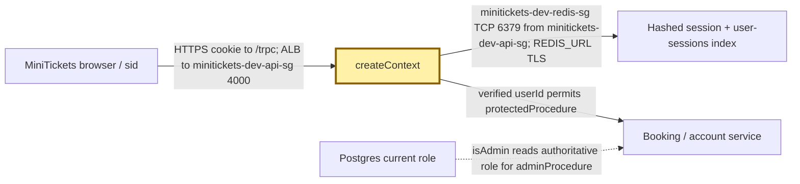
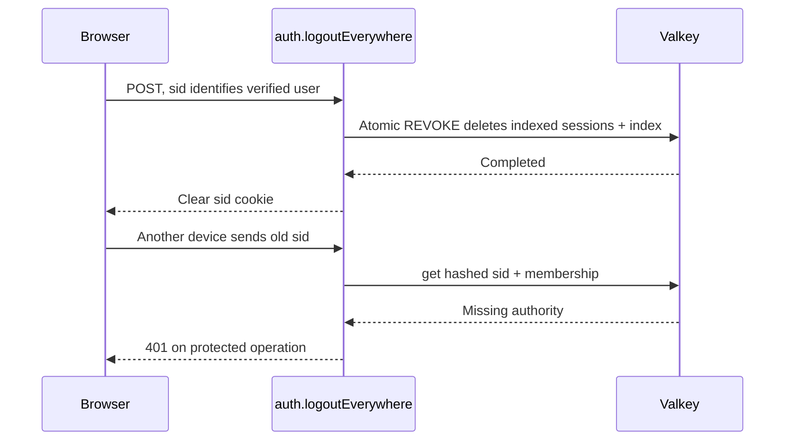

# Sessions vs JWT: the visitor badge register

History: see [CHANGELOG.md](../CHANGELOG.md) or run `pnpm docs:history`

Area: Auth & Security · Status: ✅ built in repository; live AWS acceptance is separate

<!-- interview-card: v1 -->

## 1. In one line

MiniTickets checks a [session](../glossary.md#session)—a server-held login record—each time; it does not use self-contained JWT login tokens.

## 2. Where it sits

[Open this piece in the city explorer](../guides/infra-explorer.html?concept=sessions-vs-jwt#chapter=24&piece=valkey).

## 3. How it works

## 4. What happens in MiniTickets

1. Login verifies the password and makes 32 random bytes for cookie `sid`.
2. Redis stores user ID and creation time under a hashed-token key for **7 days**. A user index tracks at most **20 devices**.
3. `createContext` checks the token record and index membership before accepting the user. Missing membership denies login authority.
4. A new login deletes the token record named by its incoming `sid` cookie. Logout deletes one record; logout-everywhere removes all indexed records.
5. Admin actions read the current role from Postgres when needed.

## 5. Reach / Allowed / Password

**Reach:** API → Valkey :6379; minitickets-dev-redis-sg admits minitickets-dev-api-sg.

**Allowed:** session identity opens protected procedures; current Postgres role opens admin ones.

**Password:** login password starts the session; `sid` then acts as the visitor badge.

## 6. In our code

`apps/api/src/queries/sessions.ts` → `create`, `get`, `revokeAll`

`apps/api/src/trpc/context.ts` → `createContext`

`apps/api/src/services/auth.ts` → `login`, `logoutEverywhere`

## 7. In the AWS console

ElastiCache → Valkey caches → `minitickets-dev-valkey`: inspect health, not raw login tokens. CloudWatch → Logs → `/minitickets/dev/api`: failures. Individual sessions have no AWS console screen.

## 8. Good / Bad

**Good:** one place cancels a badge; browser receives no role claim to grow stale.

**Bad:** every authenticated request needs Redis; eviction can force a fresh login.

## 9. Other choices

- Pick a JWT (a signed token carrying claims) when independent services need offline verification; plan expiry and revocation.
- Pick a managed identity provider when account recovery and federation should be outsourced.

## 10. Connected to

| Neighbor | Direction | What allows it | Console check |
| --- | --- | --- | --- |
| [Valkey](elasticache-valkey.md) | → login register | minitickets-dev-redis-sg :6379 from minitickets-dev-api-sg | ElastiCache → cache |
| [RDS](rds-postgres.md) | → password/current role | minitickets-dev-db-sg :5432 from minitickets-dev-api-sg | RDS → database |
| [Rate limiting](rate-limiting.md) | → booking identity | verified session user ID | CloudWatch → API logs |

## 11. When it breaks

- Sudden logouts → Redis eviction/index loss → restore memory headroom, then log in again.
- Old badge still works → revoke path/index → verify token deletion; a request already authorized can finish.

## 12. Say it in 30 seconds

“MiniTickets sends a random session cookie and keeps authority in Redis. Every read checks the record and its user index. Login rotates the token, sessions last seven days and the index caps twenty devices. Logout can revoke one device or all of them. JWTs could remove that lookup, but prompt revocation would need another design.”

## 13. Likely follow-ups

- **Can JavaScript read `sid`?** No; it is HttpOnly, with SameSite=Lax and Secure in production.
- **Is the UI presence cookie authority?** No. Only the API’s verified session authorizes work.

## 14. Remember it

A badge works only while its number remains in the city register.

## 15. More detail

Source notes, earlier detail and code anchors

Opaque Redis sessions trade an auth-store lookup for immediate indexed revocation. Current roles come from Postgres only where needed; JWT claims would need expiry/version checks for equivalent role revocation.

### Earlier card: 2. Real-life comparison

A visitor badge can be cancelled in the central register, even if someone still holds the paper copy.

### Earlier card: 3. Picture it

### Earlier card: 4. Where in our code

- Anchor: `apps/api/src/queries/sessions.ts` — `StoredSession`; follow the numbered comments at this boundary.
- Anchor: `apps/api/src/services/auth.ts` — `logout`; follow the numbered comments at this boundary.

`apps/api/src/queries/sessions.ts` implements indexed creation/read/revokeAll; `services/users.ts` revokes around makeAdmin. `pnpm demo:security` checks old-cookie, all-device and role revocation. Cookies are HttpOnly/SameSite with Secure in production. An in-flight authorized request cannot be recalled; two-store role/revocation is not a global transaction.

### Earlier card: 5. See it yourself

Run `pnpm demo:security` and inspect the asserted outcome described above.

Failure thought experiment: Is the presence cookie authorization? No; it only avoids a predictable redirect flash; API verifies the real session. Do not change a live stack to demonstrate it.

### Earlier card: 6. How it connects

Uses the [current system](../00-big-picture.md); gives a concrete decision to the [scenario](../guides/interview-scenarios.md#sessions-roles) and [explorer tour](../guides/infra-explorer.html?tour=security-layers).

### Earlier card: 7. Our settings and WHY

Opaque Redis sessions trade an auth-store lookup for immediate indexed revocation. Current roles come from Postgres only where needed; JWT claims would need expiry/version checks for equivalent role revocation. A role embedded forever in a session becomes stale after a privilege change.

### Earlier card: 8. Trade-offs

Redis/index eviction fails closed and forces login. The 20-device bound makes revoke work bounded. Session-versioning/transactional role changes are proposed improvements for larger deployments.

### Earlier card: 9. Alternatives and when to choose them

10x: monitor auth-store failures and session churn. 100x: coordinated auth versioning, device management and key/credential rotation.

### Earlier card: 10. What breaks and how we notice

Is the presence cookie authorization? No; it only avoids a predictable redirect flash; API verifies the real session.

### Earlier card: 13. Interview answers at 3 levels

- **Simple:** Opaque Redis sessions trade an auth-store lookup for immediate indexed revocation.
- **Senior:** Opaque session cookies keep revocation server-side; JWTs reduce lookup dependence but revocation/role changes need expiry or another authoritative version. MiniTickets hashes random tokens in Redis, rotates login sessions, indexes at most 20 devices and checks membership on every read. Admin authorization reads Postgres; role changes revoke sessions before and after the update.
- **Lead:** 10x: monitor auth-store failures and session churn. 100x: coordinated auth versioning, device management and key/credential rotation.

### Earlier card: 14. Follow-up questions with answers

Is the presence cookie authorization? No; it only avoids a predictable redirect flash; API verifies the real session.

What happens if session membership is missing? **Authentication fails closed.**

### Earlier card: 15. Say it in 30 seconds

Opaque session cookies keep revocation server-side; JWTs reduce lookup dependence but revocation/role changes need expiry or another authoritative version. MiniTickets hashes random tokens in Redis, rotates login sessions, indexes at most 20 devices and checks membership on every read. Admin authorization reads Postgres; role changes revoke sessions before and after the update.

### Earlier card: 16. Status and production work

Repository implementation and local evidence are described above. Live AWS/CI execution remains owner acceptance. 10x: monitor auth-store failures and session churn. 100x: coordinated auth versioning, device management and key/credential rotation.

## Where it appears in the story

- [app-story: 5b. Session identity, roles and revocation](../app-story.md#5b-session-identity-roles-and-revocation)
