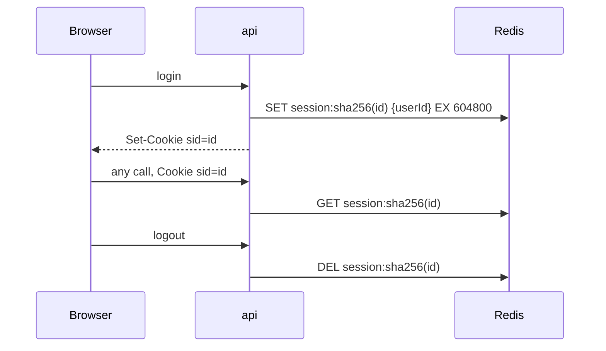

# Server-side sessions in Redis vs JWT (and logout)

History: see [CHANGELOG.md](../CHANGELOG.md) or run `pnpm docs:history`

Area: Auth & Security · Status: ✅ built · Step doc: [07 login](../../07-login-session.md), [08 logout](../../08-logout.md)

## 1. In one line

After login the browser gets a random **session id** in a cookie, and the server keeps the session
in Redis (stored under the id's **hash**); logout deletes it, so the cookie stops working at once.
A **JWT** would instead carry signed user data in the token itself, with no server lookup.

## 2. Real-life comparison

A cloakroom ticket (session): the number means nothing by itself; the cloakroom keeps the coat, and
can cancel the ticket. A signed permission letter (JWT): it proves itself, but once handed out it
works until it expires, even if you change your mind.

## 3. Picture it



## 4. Where in our code

- Anchor: `apps/api/src/queries/sessions.ts` · `keyFor`, `create`, `get`, `remove`.
- Anchor: `apps/api/src/services/auth.ts` · `logout`: server-side revocation.

Step by step:

1. `create(userId)`: `randomBytes(32)` (256 bits from the OS's secure generator) →
   `base64url` → the cookie value.
2. Redis key: `session:` + SHA-256 hex of that id. Value: `{ userId, createdAt }`. `EX 604800`
   (7 days) ([ttl](ttl.md)).
3. WHY hash the id: someone who reads Redis (a leak, a backup) sees only hashes and can't build a
   working cookie. SHA-256 is enough because the id is random, not a password.
4. Every request: `createContext` → `get(id)` → `{ userId }` or `null` ([trpc-context](trpc-context.md)).
5. Logout: `remove(id)` (`DEL`), then clear the cookie. Idempotent ([idempotency](idempotency.md)).

## 5. See it yourself

Recorded against a local api: after logout, the old cookie gets `{"result":{"data":null}}` from
`auth.me`. In Redis:

```bash
docker exec minitickets-redis-1 redis-cli --scan --pattern 'session:*' | head -2
# session:7554d7539f...   (64 hex characters: a SHA-256, never the cookie value)
```

Compare the `sid` cookie in DevTools with the key: they don't match, by design.

**Break it on purpose:** store the raw id as the key. Anyone who can read Redis can copy a key into
a cookie and become that user.

## 6. How it connects

- **Uses ←** [sql-vs-nosql](sql-vs-nosql.md) (Redis), [elasticache-valkey](elasticache-valkey.md).
- **Gives →** [session-cookie](session-cookie.md), [trpc-context](trpc-context.md),
  [protected-procedure](protected-procedure.md), [stateless-servers](stateless-servers.md).

## 7. Our settings and WHY

| Choice | Why |
| ------ | --- |
| Opaque random id, server-side state | Instant revocation on logout; nothing to decode in the cookie. |
| Store `sha256(id)` | A Redis leak doesn't give working sessions. |
| 7-day TTL, same as cookie `maxAge` | Cookie and session expire together. |

## 8. Trade-offs

- **Pros:** real logout; easy to revoke all sessions of a user later; small cookie; no signing keys.
- **Cons:** a Redis lookup per request; Redis is critical; no sliding expiry (a session ends 7 days
  after login, even if active).

## 9. Alternatives and when to choose them

- **JWT (stateless):** many services verify tokens without a shared store; revocation needs short
  lifetimes + refresh tokens or a deny-list (which is a store again).
- **Signed cookies with data** (iron-session): no store, same revocation problem.
- **Managed auth** (Cognito, Auth0): offload login, MFA and resets.

## 10. What breaks, and how we'd notice

- Redis flushed or replaced: everyone is logged out (no data loss).
- Redis down: logins and protected calls fail with 500; `/ready` 503.

## 13. Interview answers at 3 levels

- **Simple:** The browser gets a random ticket; the server remembers who it belongs to, and forgets
  it on logout.
- **Senior:** Login creates 32 random bytes, stores `session:<sha256>` → `{ userId }` in Redis with a
  7-day TTL and sends the raw id as an HttpOnly cookie. Each request hashes the cookie and looks it
  up once in the context. Logout deletes the key, so the old cookie is useless immediately, which a
  JWT can't do without extra state.
- **Lead:** Sessions vs JWT is revocation and coupling vs lookup cost. For one api with a fast
  store, sessions are simpler and safer. JWTs pay off with many independent services, and then you
  still need short lifetimes and refresh rotation.

## 14. Follow-up questions interviewers ask

- *How do you log out everywhere?* Keep a per-user set of session keys and delete them all (not
  built).
- *Why not bcrypt the session id?* It's random, so a fast hash is enough; slow hashing would cost
  every request.

## 15. Say it in 30 seconds

"Server-side sessions: login makes a 256-bit random id, the cookie holds it, Redis holds its SHA-256
with the user id and a 7-day TTL. Every request looks it up once; logout deletes it, so the cookie
dies immediately. A JWT can't be revoked like that without adding state back."

## 16. Status

✅ built.
