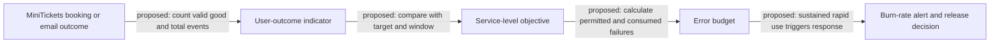

# Slo error budget

History: see [CHANGELOG.md](../CHANGELOG.md) or run `pnpm docs:history`

Area: Observability · Status: 📖 explain-only

<!-- interview-card: v2 -->

## 1. What is it?

A service-level objective (SLO) would set a reliability target over a time window. Its error budget would be the amount of failure allowed within that target.

## 2. Why do we need it?

MiniTickets can show a low server-error count while confirmations arrive too late. A useful objective would measure the buyer’s outcome and tell the team when reliability needs priority over more releases.

## 3. How does it work?

1. Define a measurable user outcome and which events count.
2. Choose a target and time window with the business.
3. Track budget use and respond to sustained rapid consumption.

## 4. How do we use it in MiniTickets?

SLOs and automated budget-based release policy are explain-only. MiniTickets has correlated logs and managed symptom alarms today. A future booking-success, booking-latency or email-delay objective would need explicit denominators and evidence from representative traffic.

## 5. Interview-ready answer

“MiniTickets does not claim a production SLO. A useful design would measure valid user outcomes, set a target over a window and treat permitted failures as an error budget. Sustained fast consumption would trigger investigation or release restraint. I would define exclusions and test the alert behavior first; raw server errors or a fast development demo do not establish business reliability.”

## 6. Important follow-up questions

- **What is an SLI?** A service-level indicator: the measured outcome used to judge the target.
- **Does 99.5 percent mean no failures?** No. As an example, it permits 0.5 percent of valid events to miss the objective.
- **Why measure budget burn?** It shows how quickly current failures are consuming the allowance.
- **Can ALB errors define booking success alone?** No. Business rejection, delayed work and missing outcomes need explicit treatment.

## 7. Advanced details

Technical reference

### Proposed metrics and current boundaries

Existing integration point: `apps/api/src/http/correlation-id.ts`, current logs and managed symptom alarms. A proposed CloudWatch user-outcome SLI would cover booking success/latency or email delay. No production SLO resource, multi-window burn alert, release-budget policy or runnable feature demo is built. The **99.5% / 0.5%** example is arithmetic, not an adopted MiniTickets target.

Define eligible events, exclusions, denominator, target/window and how late asynchronous outcomes are counted. Alert on sustained rapid budget burn across appropriate windows rather than harmless short noise. A dev app without representative traffic cannot establish a meaningful production objective.

### Related tracing proposal and trade-offs

The old card also described proposed timed tracing: a new `apps/api/src/tracing.ts` before server modules, ADOT sidecar, Lambda tracing, narrowly scoped X-Ray writes and W3C `traceparent` in messages. None is built. Spans would add causal timing; sampling loses individual traces, consumes resources and needs privacy/cost limits. It does not replace complete business-outcome measurement.

Future work may test alert calculations, correlate field evidence, sample tracing deliberately and tie release policy to agreed budgets. ALB counts and averages alone may hide a failing journey. No live objective, deployment or budget-policy execution is claimed.

### Related reading

[current system](../00-big-picture.md) · [scenario](../guides/interview-scenarios.md#tracing-slos) · [explorer tour](../guides/infra-explorer.html?tour=failing-email)

[Open this concept in the city explorer](../guides/infra-explorer.html?concept=slo-error-budget#chapter=19&piece=dashboard).

## Where it appears in the story

- [infra-story: 9b. Follow a booking through symptoms](../infra-story.md#9b-follow-a-booking-through-symptoms)

