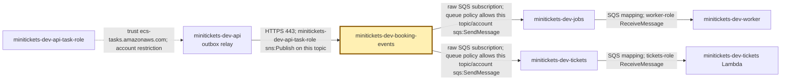
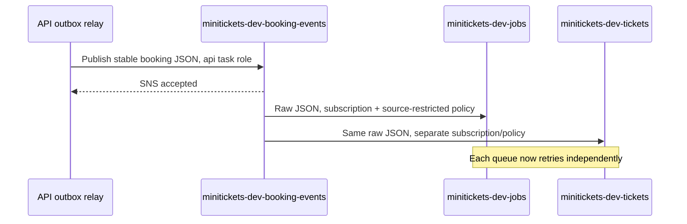

# SNS: the city notice copier

History: see [CHANGELOG.md](../CHANGELOG.md) or run `pnpm docs:history`

Area: AWS Events · Status: ✅ built in repository; live AWS acceptance is separate
<!-- interview-card: v1 -->

## 1. In one line

MiniTickets publishes one booking notice to [SNS](../glossary.md#sns); SNS copies it into separate email and ticket work trays.

## 2. Where it sits

[Open this piece in the city explorer](../guides/infra-explorer.html?concept=sns#chapter=24&piece=sns-bookings).

## 3. How it works

## 4. What happens in MiniTickets

1. The outbox relay reads a committed booking notice.
2. `publishBookingConfirmed` calls SNS once with its stored JSON.
3. Two subscriptions copy the same body to `minitickets-dev-jobs` and `minitickets-dev-tickets`.
4. Each queue holds its own backlog. Email failure does not stop ticket creation.
5. SNS acceptance lets the relay mark its row sent; it does not prove either worker finished.

## 5. Reach / Allowed / Password

**Reach:** API task uses HTTPS 443 to SNS's public API.

**Allowed:** API task role grants `sns:Publish` on one topic; queue policies allow SNS from that topic/account.

**Password:** temporary ECS task credentials; no SNS password.

## 6. In our code

`apps/api/src/queues/jobs.ts` → `publishBookingConfirmed`.

`infra/src/jobs/booking-events.ts` → `createBookingEvents`; `infra/src/compute/iam.ts` → `createIamRoles`.

## 7. In the AWS console

`us-east-1` → **Amazon SNS → Topics → minitickets-dev-booking-events → Subscriptions**. Expect two `sqs` subscriptions with raw delivery enabled. **SQS → Queues → each queue → Access policy** shows the topic ARN and source account restrictions.

## 8. Good / Bad

**Good:** publish once; consumers recover independently.

**Bad:** messages can repeat or arrive out of order; accepting a publish is separate from queue delivery.

## 9. Other choices

- Pick one SQS queue when workers share one job rather than each needing a copy.
- Pick EventBridge when many event patterns need richer routing.
- Pick Kafka when retained, ordered partitions and replay justify its extra work.

## 10. Connected to

| Neighbor | Direction | What allows it | Console check |
| --- | --- | --- | --- |
| [Outbox](outbox.md) | in | Task role `sns:Publish` | IAM → minitickets-dev-api-task-role → Permissions |
| [SQS](sqs.md) | out | Subscription + queue policy | SNS → topic → Subscriptions |
| [IAM roles](execution-vs-task-role.md) | guard | Task trust + topic grant | IAM → Roles → minitickets-dev-api-task-role |

## 11. When it breaks

- SNS accepts but one tray stays empty → subscriptions and queue policy → repair missing route or wrong source ARN.
- Both copies reach one worker → queue layout → give each kind of work its own subscription and queue.

## 12. Say it in 30 seconds

“SNS is our notice copier; SQS is our waiting tray. MiniTickets publishes one booking event to SNS. Email and ticket queues each receive a copy, then retry at their own pace. Two workers on one queue would divide the work. Standard fan-out can duplicate or reorder events, so consumers use stable booking identities.”

## 13. Likely follow-ups

**Why raw delivery?** The queue body stays our versioned JSON, without an SNS wrapper.

**Does SNS hold our consumer backlog?** SQS does.

## 14. Remember it

A copier gives each team a copy; a shared tray lets teams take turns.

## 15. More detail

Provisioning order, local evidence and growth

- Anchor: `apps/api/src/queues/jobs.ts` — `jobsEnabled`; follow the numbered comments at this boundary.
- Anchor: `infra/src/jobs/booking-events.ts` — `createBookingEvents`; follow the numbered comments at this boundary.

`createBookingEvents` waits for queue policies before subscriptions, then returns the topic ARN only after both subscriptions exist. This keeps a newly started API from publishing into a topic with no routes and marking the outbox row sent. Policies name `sns.amazonaws.com`, `sqs:SendMessage`, the exact queue, `aws:SourceArn` and `aws:SourceAccount`. IAM permission belongs to the API task role, not its execution role or worker roles.

The shared message schema carries a version and stable message/booking/correlation identities. SNS/SQS are standard delivery: duplicates and reordering remain possible. A topic supplies routing, not each consumer's backpressure. `pnpm demo:tickets` and `pnpm demo:outbox` exercise local emulator SDK boundaries separately; they do not prove managed AWS delivery. At greater load, measure each queue's age and provider capacity. If ordering or replay becomes a requirement, define its business scope before choosing FIFO or a retained log. SNS/SQS charge by use; historical cost figures are not current quotes. [Fan-out scenario](../guides/interview-scenarios.md#fanout). Live AWS fan-out remains owner acceptance.

## Where it appears in the story

- [app-story: 9c. Side path: outbox, fan-out and recoverable work](../app-story.md#9c-side-path-outbox-fan-out-and-recoverable-work)
