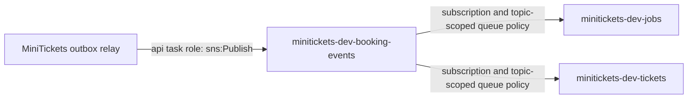

# SNS: the city notice copier

History: see [CHANGELOG.md](../CHANGELOG.md) or run `pnpm docs:history`

Area: AWS Events · Status: ✅ built in repository; live AWS acceptance is separate
<!-- interview-card: v2 -->

## 1. What is it?

[SNS](../glossary.md#sns) distributes one published message to several destinations. MiniTickets uses it to give email and ticket workers their own copy of a booking notice.

## 2. Why do we need it?

Every booking needs both an email and tickets. Two workers reading one queue would split the jobs between them. SNS copies each notice into two queues so both jobs can happen.

## 3. How does it work?

1. The relay publishes a notice saved with the booking.
2. SNS sends its body to both subscribed queues.
3. Each queue keeps work until its own consumer finishes.

## 4. How do we use it in MiniTickets?

`publishBookingConfirmed` publishes the stored booking JSON. SNS acceptance lets the relay mark its outbox row sent; it does not mean either worker finished. Separate queues let email fail and recover without blocking ticket creation.

## 5. Interview-ready answer

“SNS provides MiniTickets' fan-out: one booking event becomes a copy for email and another for tickets. SQS then holds each consumer's backlog independently. This differs from competing workers on one queue, which divide work. Publish acceptance is only one boundary; consumers still need retries, monitoring and duplicate-safe behavior.”

## 6. Important follow-up questions

- **Where does backpressure live?** Each SQS queue holds its consumer's backlog.
- **Can messages repeat or change order?** Yes. Our standard SNS/SQS path needs stable identities and cannot assume ordering.
- **What if one queue stays empty?** Inspect that subscription and its queue policy; publish acceptance does not prove delivery.
- **Why raw delivery?** Workers receive our versioned JSON directly, without an extra SNS message wrapper.

## 7. Advanced details

Technical reference

### Configuration and security

The API task role `minitickets-dev-api-task-role` trusts `ecs-tasks.amazonaws.com` with an account restriction. It grants `sns:Publish` on the booking-events topic. Each SQS mapping invokes only its own worker: `minitickets-dev-worker` for jobs and `minitickets-dev-tickets` for tickets.

The two raw subscriptions target `minitickets-dev-jobs` and `minitickets-dev-tickets`; both get the stored booking JSON. The relay marks sent after publish acceptance, not consumer completion. API reaches SNS over HTTPS 443 with temporary task-role credentials; there is no SNS password.

### Implementation and operational limits

- Anchor: `apps/api/src/queues/jobs.ts` — `jobsEnabled`; follow the numbered comments at this boundary.
- Anchor: `infra/src/jobs/booking-events.ts` — `createBookingEvents`; follow the numbered comments at this boundary.

`createBookingEvents` waits for queue policies before subscriptions, then returns the topic ARN only after both subscriptions exist. This keeps a newly started API from publishing into a topic with no routes and marking the outbox row sent. Policies name `sns.amazonaws.com`, `sqs:SendMessage`, the exact queue, `aws:SourceArn` and `aws:SourceAccount`. IAM permission belongs to the API task role, not its execution role or worker roles.

The shared message schema carries a version and stable message/booking/correlation identities. SNS/SQS are standard delivery: duplicates and reordering remain possible. A topic supplies routing, not each consumer's backpressure. `pnpm demo:tickets` and `pnpm demo:outbox` exercise local emulator SDK boundaries separately; they do not prove managed AWS delivery. At greater load, measure each queue's age and provider capacity. If ordering or replay becomes a requirement, define its business scope before choosing FIFO or a retained log. SNS/SQS charge by use; historical cost figures are not current quotes. [Fan-out scenario](../guides/interview-scenarios.md#fanout). Live AWS fan-out remains owner acceptance.

### Source references

`apps/api/src/queues/jobs.ts` → `publishBookingConfirmed`.

`infra/src/jobs/booking-events.ts` → `createBookingEvents`; `infra/src/compute/iam.ts` → `createIamRoles`.

### Console and troubleshooting

`us-east-1` → **Amazon SNS → Topics → minitickets-dev-booking-events → Subscriptions**. Expect two `sqs` subscriptions with raw delivery enabled. **SQS → Queues → each queue → Access policy** shows the topic ARN and source account restrictions.

- SNS accepts but one tray stays empty → subscriptions and queue policy → repair missing route or wrong source ARN.
- Both copies reach one worker → queue layout → give each kind of work its own subscription and queue.

### Trade-offs and related concepts

- Pick one SQS queue when workers share one job rather than each needing a copy.
- Pick EventBridge when many event patterns need richer routing.
- Pick Kafka when retained, ordered partitions and replay justify its extra work.

| Neighbor | Direction | What allows it | Console check |
| --- | --- | --- | --- |
| [Outbox](outbox.md) | in | Task role `sns:Publish` | IAM → minitickets-dev-api-task-role → Permissions |
| [SQS](sqs.md) | out | Subscription + queue policy | SNS → topic → Subscriptions |
| [IAM roles](execution-vs-task-role.md) | guard | Task trust + topic grant | IAM → Roles → minitickets-dev-api-task-role |

[Open this piece in the city explorer](../guides/infra-explorer.html?concept=sns#chapter=24&piece=sns-bookings).

## Where it appears in the story

- [app-story: 9c. Side path: outbox, fan-out and recoverable work](../app-story.md#9c-side-path-outbox-fan-out-and-recoverable-work)

