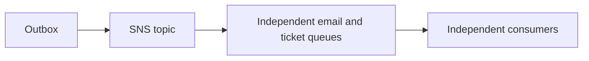

# Sns

History: see [CHANGELOG.md](../CHANGELOG.md) or run `pnpm docs:history`

Area: AWS Events · Status: ✅ built in repository; live AWS acceptance is separate

## 1. In one line

SNS fans a booking event into independent email and ticket queues. Raw delivery keeps one versioned payload, and queue policies constrain the topic and account; duplicates and reordering remain possible.

## 2. Real-life comparison

A durable work tray keeps the task after the customer leaves; a completed stamp identifies a repeat.

## 3. Picture it

## 4. Where in our code

- Anchor: `apps/api/src/queues/jobs.ts` — `jobsEnabled`; follow the numbered comments at this boundary.
- Anchor: `infra/src/jobs/booking-events.ts` — `createBookingEvents`; follow the numbered comments at this boundary.

`infra/src/jobs/booking-events.ts` configures raw SNS deliveries and queue source restrictions. `apps/api/src/queues/jobs.ts` publishes one stable message. Run `pnpm demo:tickets` and `pnpm demo:outbox` separately; P4 local emulators exercise the same SDK boundaries. AWS fan-out acceptance is still manual.

## 5. See it yourself

Run `pnpm demo:tickets` and inspect the asserted outcome described above.

Failure thought experiment: Why not two Lambdas on one SQS queue? They compete; each message is not promised to both. Do not change a live stack to demonstrate it.

## 6. How it connects

Uses the [current system](../00-big-picture.md); gives a concrete decision to the [scenario](../guides/interview-scenarios.md#fanout) and [explorer tour](../guides/infra-explorer.html?tour=booking).

## 7. Our settings and WHY

SNS fans a booking event into independent email and ticket queues. Raw delivery keeps one versioned payload, and queue policies constrain the topic and account; duplicates and reordering remain possible. Two consumers must each receive the event; competing on one queue would divide work.

## 8. Trade-offs

SNS/SQS are operationally small but standard delivery is unordered/duplicated. A bus is routing, not a replacement for all consumer backpressure.

## 9. Alternatives and when to choose them

10x: per-consumer backlog/concurrency. 100x: partition ordering domains and retention/replay requirements.

## 10. What breaks and how we notice

Why not two Lambdas on one SQS queue? They compete; each message is not promised to both.

## 11. Reach / Allowed / Password

Prove the network path separately from the scoped IAM action and the runtime credential. [Every IAM badge](../guides/infra-build-along.md#every-iam-badge-who--what--attached) shows trust, permissions and attachment. No AWS endpoint needs an inbound SG simply because a non-VPC Lambda calls it.

## 12. Cost

Existing resource/usage costs are detailed in the corresponding infra guide chapter. No new resources were deployed by this documentation change. Historical phase costs are illustrative snapshots, not a current quote; inspect billing and current regional pricing before a capacity decision.

## 13. Interview answers at 3 levels

- **Simple:** SNS fans a booking event into independent email and ticket queues.
- **Senior:** A topic fans one event out to multiple subscriptions. A queue buffers work for competing consumers. MiniTickets publishes to SNS, then separate email/ticket SQS queues; each can retry independently. EventBridge adds richer routing/integrations; Kafka adds retained partitioned replay. Choose those only when the product needs those semantics.
- **Lead:** 10x: per-consumer backlog/concurrency. 100x: partition ordering domains and retention/replay requirements.

## 14. Follow-up questions with answers

Why not two Lambdas on one SQS queue? They compete; each message is not promised to both.

What does a topic add? **Fan-out to separate consumers.**

## 15. Say it in 30 seconds

A topic fans one event out to multiple subscriptions. A queue buffers work for competing consumers. MiniTickets publishes to SNS, then separate email/ticket SQS queues; each can retry independently. EventBridge adds richer routing/integrations; Kafka adds retained partitioned replay. Choose those only when the product needs those semantics.

## 16. Status and production work

Repository implementation and local evidence are described above. Live AWS/CI execution remains owner acceptance. 10x: per-consumer backlog/concurrency. 100x: partition ordering domains and retention/replay requirements.

## Where it appears in the story

- [app-story: 9c. Side path: outbox, fan-out and recoverable work](../app-story.md#9c-side-path-outbox-fan-out-and-recoverable-work)
