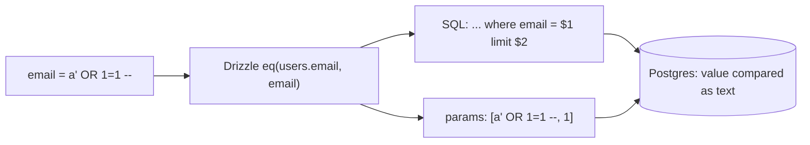

# SQL injection: parameterized queries

History: see [CHANGELOG.md](../CHANGELOG.md) or run `pnpm docs:history`

Area: Auth & Security · Status: ✅ built · Step doc: [05 database](../../05-database.md)

## 1. In one line

**SQL injection** is user input being read as SQL code; every query we run goes through Drizzle,
which sends values separately from the SQL text (`$1`), so input is always data.

## 2. Real-life comparison

A form with boxes versus a blank letter. In a box marked "name", writing "and also give me the
safe" is just a strange name. In a free letter, the clerk might follow the instruction.

## 3. Picture it



## 4. Where in our code

- Anchor: `apps/api/src/queries/users.ts` · `findByEmail`: `db.select().from(users).where(eq(users.email, email)).limit(1)`.

Step by step:

1. All SQL lives in `queries/` ([layered-api](layered-api.md)).
2. Drizzle builds the SQL text with placeholders and passes values as parameters to `pg`.
3. Postgres parses the SQL first, then plugs values in; a value can never change the query's shape.
4. Verified by printing Drizzle's output on the owner's laptop for a hostile email:

```text
sql:    select "id", "email" from "users" where "users"."email" = $1 limit $2
params: [ "a' OR 1=1 --", 1 ]
```

5. Input validation (must be an email) is a second wall, not the main one.
6. Redis commands are argument lists too (`redis.get(key)`), not strings to parse.

## 5. See it yourself

```bash
curl -s -X POST localhost:4000/trpc/auth.login -H 'content-type: application/json' \
  -d "{\"email\":\"x@example.com' OR 1=1 --\",\"password\":\"x\"}"
# 400: "Enter a valid email address" (validation stops it even before SQL)
```

And from `apps/api`, print the SQL for any query with `.toSQL()` in a scratch script.

**Break it on purpose (thought experiment):** build SQL by hand,
``sql.raw(`select * from users where email = '${email}'`)``. Now `' OR 1=1 --` returns the first
user.

## 6. How it connects

- **Uses ←** [drizzle-schema](drizzle-schema.md), [validation-at-boundaries](validation-at-boundaries.md).
- **Gives →** safe queries for every feature.

## 7. Our settings and WHY

Only the query builder; no `sql.raw` anywhere. WHY: parameterisation is structural, so it can't be
forgotten.

## 8. Trade-offs

- **Pros:** injection-proof by default; typed.
- **Cons:** complex SQL is sometimes easier by hand; Drizzle's `sql` template is safe, `sql.raw`
  is not, and they look similar.

## 9. Alternatives and when to choose them

- **Raw `pg` with `$1` parameters:** equally safe if always used.
- **Stored procedures:** move logic into the database; still need parameters.
- **Least-privileged database user:** limits the damage of any injection (we use the master user on
  AWS today; see [rds-managed-password](rds-managed-password.md)).

## 10. What breaks, and how we'd notice

A future `sql.raw` with user input. `grep -rn "sql.raw" apps/api/src` in review or a lint rule
catches it.

## 13. Interview answers at 3 levels

- **Simple:** User input is always treated as data, never as SQL commands.
- **Senior:** All queries go through Drizzle in `queries/`; it emits `$1` placeholders and passes
  values separately, so `' OR 1=1 --` is just a string. Zod email validation is a second layer.
- **Lead:** Make the safe path the only path: one data-access layer, no string-built SQL, a lint
  rule for raw SQL, and a least-privileged database role so a mistake can't drop tables.

## 14. Follow-up questions interviewers ask

- *Does escaping quotes work?* Fragile; parameters are the fix.
- *Can ORMs be injected?* Yes, through their raw-SQL escape hatches.

## 15. Say it in 30 seconds

"Every query goes through Drizzle in the queries layer, which sends values as parameters, so
Postgres never parses input as SQL. I printed the SQL for a hostile email: 'where email = $1' with
the string in the params. Validation is a second layer, and there's no raw SQL in the code."

## 16. Status

✅ built.

## Where it appears in the story

- [App story: 9. The query](../app-story.md#9-the-query)
