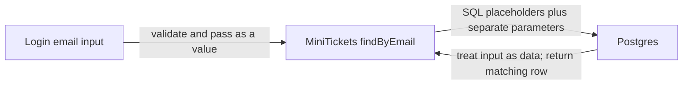

# SQL injection: parameterized queries

History: see [CHANGELOG.md](../CHANGELOG.md) or run `pnpm docs:history`

Area: Auth & Security · Status: ✅ built · Step doc: [05 database](../../05-database.md)
<!-- interview-card: v2 -->

## 1. What is it?

SQL injection happens when untrusted input becomes database instructions. Parameterized queries keep the instruction text separate from the values supplied by users.

## 2. Why do we need it?

An email containing quote marks and SQL-like text must remain an email value. It must not turn MiniTickets login lookup into a query that returns every account.

## 3. How does it work?



1. Define the query structure in trusted code.
2. Send user-controlled values separately as parameters.
3. Let the database execute that fixed structure with those values.

## 4. How do we use it in MiniTickets?

Our query layer uses Drizzle query builders and parameterized SQL templates. Validation adds useful bounds and formats; it does not replace parameterization. The current AWS application database user is still more privileged than necessary.

## 5. Interview-ready answer

“MiniTickets prevents SQL injection by keeping query structure separate from user values. Drizzle supplies placeholders and parameters instead of inserting raw input into SQL text. Validation is another layer, not the main defense. I still review raw-SQL escape hatches and restrict database privileges to limit damage if a future query is unsafe.”

## 6. Important follow-up questions

- **Does escaping quotes solve it?** Parameters are the safer structural approach; hand-written escaping is fragile.
- **Can an ORM still be vulnerable?** Yes. Unsafe raw SQL can bypass its safe value handling.
- **Can parameters choose any table or column?** They represent values; dynamic query structure needs a trusted allow-list.
- **Does encryption at rest help?** No. The database decrypts data for queries it accepts.

## 7. Advanced details

<details>
<summary>Technical reference</summary>

### Source references

- Anchor: `apps/api/src/queries/users.ts` · `findByEmail`: `db.select().from(users).where(eq(users.email, email)).limit(1)`.

Step by step:

1. All SQL lives in `queries/` ([layered-api](layered-api.md)).
2. Drizzle builds the SQL text with placeholders and passes values as parameters to `pg`.
3. Postgres parses the SQL first, then plugs values in; a value can never change the query's shape.
4. Verified by printing Drizzle's output on the owner's laptop for a hostile email:

```text
sql:    select "id", "email" from "users" where "users"."email" = $1 limit $2
params: [ "a' OR 1=1 --", 1 ]
```

5. Input validation (must be an email) is a second wall, not the main one.
6. Redis commands are argument lists too (`redis.get(key)`), not strings to parse.

### Configuration and design

Only the query builder; no `sql.raw` anywhere. WHY: parameterisation is structural, so it can't be
forgotten.

### Checks and troubleshooting

```bash
curl -s -X POST localhost:4000/trpc/auth.login -H 'content-type: application/json' \
  -d "{\"email\":\"x@example.com' OR 1=1 --\",\"password\":\"x\"}"
# 400: "Enter a valid email address" (validation stops it even before SQL)
```

And from `apps/api`, print the SQL for any query with `.toSQL()` in a scratch script.

**Break it on purpose (thought experiment):** build SQL by hand,
``sql.raw(`select * from users where email = '${email}'`)``. Now `' OR 1=1 --` returns the first
user.

A future `sql.raw` with user input. `grep -rn "sql.raw" apps/api/src` in review or a lint rule
catches it.

- *Does escaping quotes work?* Fragile; parameters are the fix.
- *Can ORMs be injected?* Yes, through their raw-SQL escape hatches.

### Trade-offs and alternatives

- **Pros:** injection-proof by default; typed.
- **Cons:** complex SQL is sometimes easier by hand; Drizzle's `sql` template is safe, `sql.raw`
  is not, and they look similar.

- **Raw `pg` with `$1` parameters:** equally safe if always used.
- **Stored procedures:** move logic into the database; still need parameters.
- **Least-privileged database user:** limits the damage of any injection (we use the master user on
  AWS today; see [rds-managed-password](rds-managed-password.md)).

### Further technical context

All queries go through Drizzle in `queries/`; it emits `$1` placeholders and passes
  values separately, so `' OR 1=1 --` is just a string. Zod email validation is a second layer.

### Related reading

- **Uses ←** [drizzle-schema](drizzle-schema.md), [validation-at-boundaries](validation-at-boundaries.md).
- **Gives →** safe queries for every feature.

[Open this piece in the city explorer](../guides/infra-explorer.html?concept=sql-injection#chapter=5&piece=rds).

## Where it appears in the story

- [App story: 9. The query](../app-story.md#9-the-query)

</details>
