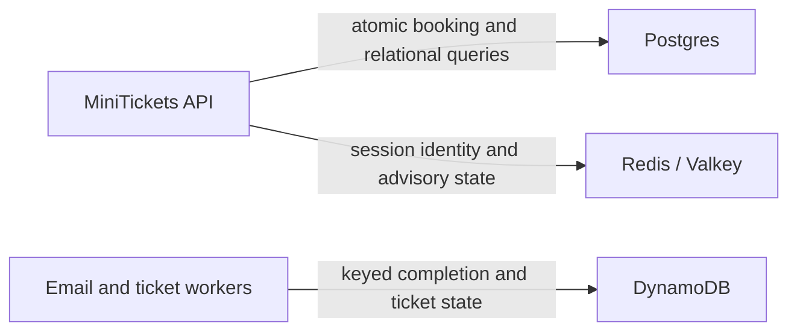

# SQL vs NoSQL

History: see [CHANGELOG.md](../CHANGELOG.md) or run `pnpm docs:history`

Area: Data · Status: ✅ built · Step doc: [05 database](../../05-database.md), [07 login](../../07-login-session.md)
<!-- interview-card: v2 -->

## 1. What is it?

SQL databases organize data into related tables and support queries and constraints over them. NoSQL covers several other data models, including key-value and document stores; it is not one capability set.

## 2. Why do we need it?

MiniTickets needs seats, bookings and outbox changes to commit together, while login checks mostly need a fast key lookup with expiry. Those are different access and correctness needs.

## 3. How does it work?



1. Identify the access pattern, invariants and failure requirements.
2. Choose the store whose guarantees fit them.
3. Keep the authority for each kind of data explicit.

## 4. How do we use it in MiniTickets?

Postgres owns durable users, bookings, seats and outbox. Redis/Valkey owns login sessions and support state. DynamoDB stores email completion and issued ticket state. Ticket issuance does not move the authoritative seat transaction out of Postgres.

## 5. Interview-ready answer

“MiniTickets uses different stores for different jobs: Postgres for relational invariants and atomic booking, Redis for shared expiring sessions, and DynamoDB for keyed asynchronous state. I choose by access patterns, consistency and recovery needs rather than the SQL or NoSQL label. Each additional store adds operational and cross-store failure boundaries.”

## 6. Important follow-up questions

- **Is NoSQL always eventually consistent?** No. It depends on the system and operation; DynamoDB offers strong base-table reads when requested.
- **Could sessions live in Postgres?** Yes. It reduces systems, with different load and expiry-cleanup choices.
- **Is Redis merely a cache here?** Not for sessions: it is the login authority, so unavailable or missing state must fail closed.
- **What if stores disagree about seats?** The Postgres booking transaction decides; Redis availability is advisory.

## 7. Advanced details

<details>
<summary>Technical reference</summary>

### Current reading notes

Current DynamoDB is built for processed jobs and tickets, not explain-only. Session records now have a bounded per-user index and Lua coordination rather than only a bare SET. Redis loss affects authentication and may force login; it is inaccurate to call lost session state “no data loss”, even though durable bookings remain in Postgres.

### Implementation reference

- Anchor: `apps/api/src/db/schema/users.ts` · `users`: relational, typed columns, unique constraint.
- Anchor: `apps/api/src/queries/sessions.ts` · `keyFor`, `create`: `SET session:<sha256> <json> EX 604800`.

Why each store:

| Need | Users | Sessions |
| ---- | ----- | -------- |
| Must survive for years | yes | no (7 days) |
| Uniqueness rule | email | none |
| Access pattern | by email, by id | by key only |
| Expiry built in | no | yes (`EX`) |
| Speed | fast | very fast (memory) |

### Inspection and historical evidence

```bash
docker exec minitickets-redis-1 redis-cli --scan --pattern 'session:*' | head -3
docker exec minitickets-redis-1 redis-cli TTL "<one of those keys>"      # seconds left
docker exec minitickets-postgres-1 psql -U minitickets -d minitickets -c 'select id, email from users limit 3'
```

**Break it on purpose (thought experiment):** store sessions in a Postgres table. It works, but
you need a cleanup job for expired rows and every request adds load to the main database.

### Settings and reasoning

Postgres 17 for durable relational data; Redis 7.4 locally / Valkey 8.2 on AWS for short-lived
keys with TTL. WHY: use each store for what it is good at.

### Trade-offs

- **Pros:** right tool per data; Redis TTL removes cleanup jobs.
- **Cons:** two systems to run, secure and monitor; Redis data is less durable (append-only file
  locally; on AWS a single node with no snapshots, so sessions are lost if it is replaced).

### Alternatives and scaling

- **Only Postgres:** fewer moving parts; fine for small apps (sessions table + cleanup).
- **DynamoDB:** managed key-value with TTL, serverless scaling (built for email completion and ticket records; see `dynamodb`).
- **Document stores (MongoDB):** flexible document shapes; assess their actual transaction and constraint features against the access pattern.

### Failure diagnosis

- Redis session loss: affected users must log in again; session state is lost even though durable Postgres bookings remain. Postgres lost: real data loss
  ([backups-dr](backups-dr.md)).

### Further questions

- *When would you pick NoSQL for primary data?* Huge scale with simple key access, or flexible
  documents, where you accept weaker joins and constraints.
- *Is Redis a database or a cache?* Here it's the primary store for sessions, not a cache.

### Related reading

- [rds-postgres](rds-postgres.md)
- [elasticache-valkey](elasticache-valkey.md)
- [sessions-vs-jwt](sessions-vs-jwt.md)
- [ttl](ttl.md)
- [unique-constraint-race](unique-constraint-race.md)

[Open this piece in the city explorer](../guides/infra-explorer.html?concept=sql-vs-nosql#chapter=0&piece=laptop-postgres).

## Where it appears in the story

- [App story: 9. The query](../app-story.md#9-the-query)

</details>
