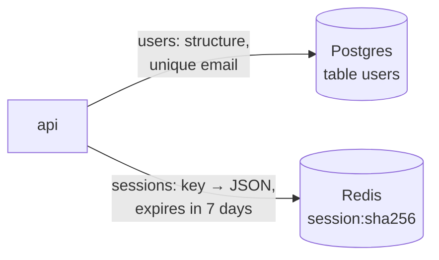

# SQL vs NoSQL

History: see [CHANGELOG.md](../CHANGELOG.md) or run `pnpm docs:history`

Area: Data · Status: ✅ built · Step doc: [05 database](../../05-database.md), [07 login](../../07-login-session.md)

## 1. In one line

We use both: **Postgres** (SQL: tables, constraints, transactions) for users, and **Redis** (a
key-value NoSQL store in memory, with expiry) for sessions; each fits its data.

## 2. Real-life comparison

A filing cabinet with strict forms and a locked index (Postgres) for records that must stay correct
for years, and a cloakroom with numbered tickets that are thrown away at closing (Redis) for things
you only need briefly and quickly.

## 3. Picture it



## 4. Where in our code

- Anchor: `apps/api/src/db/schema/users.ts` · `users`: relational, typed columns, unique constraint.
- Anchor: `apps/api/src/queries/sessions.ts` · `keyFor`, `create`: `SET session:<sha256> <json> EX 604800`.

Why each store:

| Need | Users | Sessions |
| ---- | ----- | -------- |
| Must survive for years | yes | no (7 days) |
| Uniqueness rule | email | none |
| Access pattern | by email, by id | by key only |
| Expiry built in | no | yes (`EX`) |
| Speed | fast | very fast (memory) |

## 5. See it yourself

```bash
docker exec minitickets-redis-1 redis-cli --scan --pattern 'session:*' | head -3
docker exec minitickets-redis-1 redis-cli TTL "<one of those keys>"      # seconds left
docker exec minitickets-postgres-1 psql -U minitickets -d minitickets -c 'select id, email from users limit 3'
```

**Break it on purpose (thought experiment):** store sessions in a Postgres table. It works, but
you need a cleanup job for expired rows and every request adds load to the main database.

## 6. How it connects

- **Uses ←** [rds-postgres](rds-postgres.md), [elasticache-valkey](elasticache-valkey.md).
- **Gives →** [sessions-vs-jwt](sessions-vs-jwt.md), [ttl](ttl.md),
  [unique-constraint-race](unique-constraint-race.md).

## 7. Our settings and WHY

Postgres 17 for durable relational data; Redis 7.4 locally / Valkey 8.2 on AWS for short-lived
keys with TTL. WHY: use each store for what it is good at.

## 8. Trade-offs

- **Pros:** right tool per data; Redis TTL removes cleanup jobs.
- **Cons:** two systems to run, secure and monitor; Redis data is less durable (append-only file
  locally; on AWS a single node with no snapshots, so sessions are lost if it is replaced).

## 9. Alternatives and when to choose them

- **Only Postgres:** fewer moving parts; fine for small apps (sessions table + cleanup).
- **DynamoDB:** managed key-value with TTL, serverless scaling (explain-only card `dynamodb`).
- **Document stores (MongoDB):** flexible shapes; weaker relational guarantees.

## 10. What breaks, and how we'd notice

- Redis lost: everyone is logged out (no data loss). Postgres lost: real data loss
  ([backups-dr](backups-dr.md)).

## 13. Interview answers at 3 levels

- **Simple:** Users in a SQL database, logins in a fast temporary store.
- **Senior:** Postgres holds users with a unique email constraint; Redis/Valkey holds sessions as
  `session:<sha256>` → JSON with a 7-day `EX`. Expiry is free in Redis, and session lookups don't
  load the main database.
- **Lead:** Choose stores by consistency, durability and access pattern, not fashion. Two stores
  means two failure modes; losing Redis is a logout event, losing Postgres is an incident, so their
  HA and backup plans differ.

## 14. Follow-up questions interviewers ask

- *When would you pick NoSQL for primary data?* Huge scale with simple key access, or flexible
  documents, where you accept weaker joins and constraints.
- *Is Redis a database or a cache?* Here it's the primary store for sessions, not a cache.

## 15. Say it in 30 seconds

"We use both. Postgres for users, because we need durability and a unique email constraint. Redis
for sessions, because it's a fast key-value store with built-in expiry. Losing Redis logs people
out; losing Postgres loses data, so they get different HA plans."

## 16. Status

✅ built.

## Where it appears in the story

- [App story: 9. The query](../app-story.md#9-the-query)
